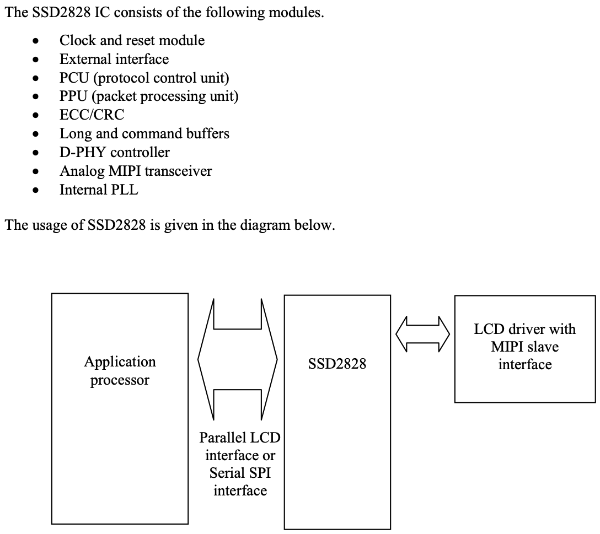
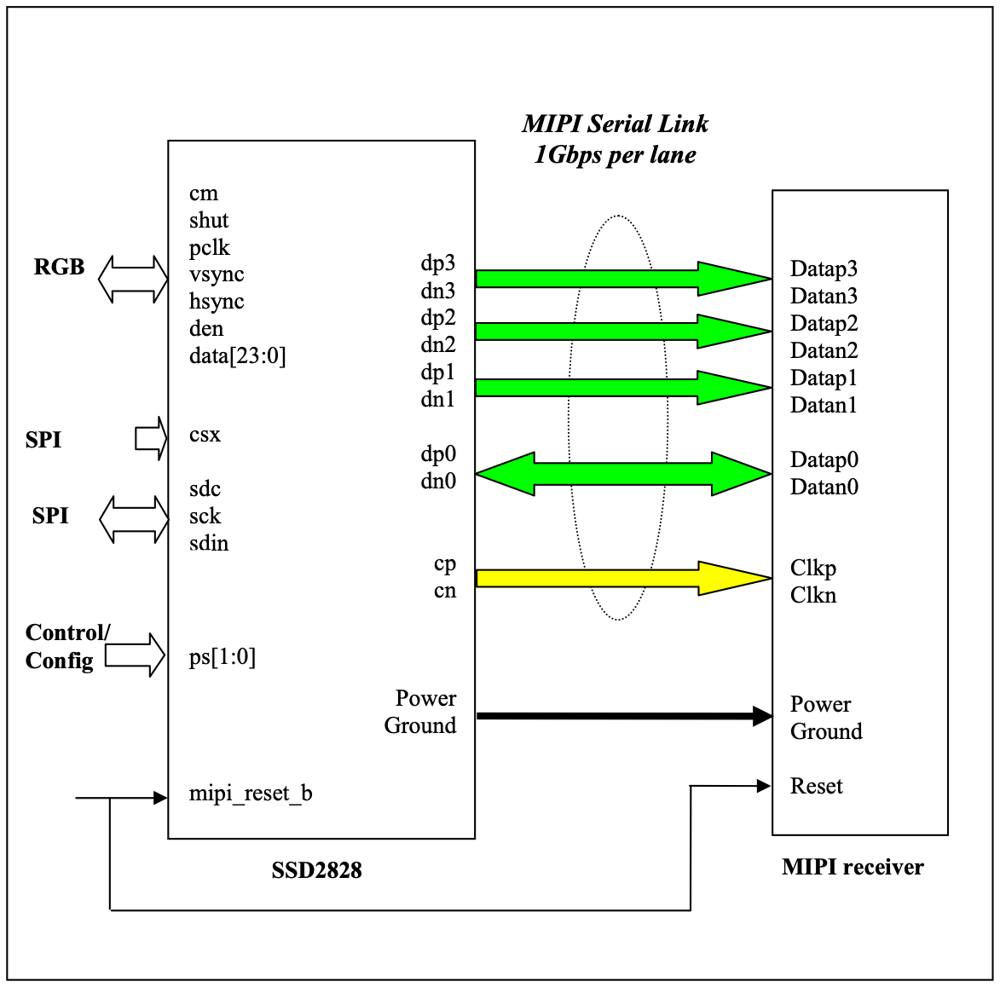
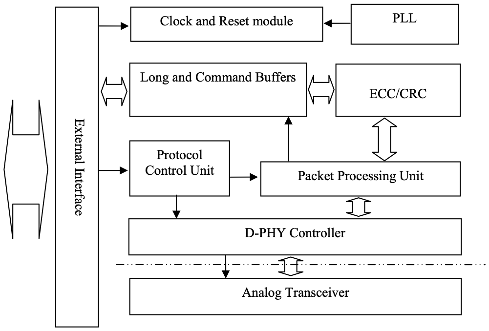

# 4 BLOCK DIAGRAM

<!-- pdf:11 -->

<!-- pdf:12 -->

Below is the interface diagram for the SSD2828 driving MIPI slave panel. Three types of interface are supported which are RGB and SPI interfaces. The interfaces can be selected through ps[1:0] pins.

<!-- pdf:13 -->

