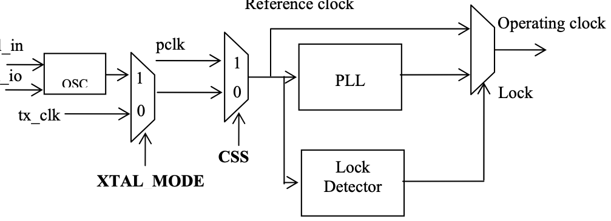

# 5 FUNCTIONAL DESCRIPTION

<!-- pdf:14 -->

### 5.1 Functional Blocks

### 5.2 Clock and Reset Module

The clock and reset module controls the generation of the operation clock for the whole system. There are two reference clock sources for the PLL. One is from the tx_clk and the other is from the pclk. The application processor can choose the reference clock for the PLL by program the CSS. The PLL output clock is used to generate the clock and data on the serial link during HS mode. The PLL frequency is the same as the data rate on 1 data lane. Hence, the PLL needs to be programmed according to the HS speed. Please refer to 9.3.5 for how to program the PLL.

NOTE: The default value of the CSS is 0 which selects the tx_clk. Hence, after power up, tx_clk must be present so that the registers can be programmed. If the application processor wants to switch the clock source, tx_clk must be provided first so that the CSS field can be programmed. After the CSS is programmed, the tx_clk can be turned off.

After powering up, the PLL is in sleep mode. The host needs to program the PLL setting before enable the PLL. If the host needs to switch the clock source of the PLL, it needs to put the PLL into sleep mode first. Afterwards, the host needs to program the PLL with new setting and enable the PLL. In both cases, the PLL needs a certain amount of time to lock the output clock frequency after being enabled. Hence, when the PLL is in sleep mode or when the PLL is enabled but not locked, the whole system is operating using the reference clock. After the PLL gets locked, the system is operating using the PLL output clock. Please see the diagram below for detailed clocking scheme. Since the reference clock is much slower than the PLL output clock, the host needs to operate at low speed too, before the PLL gets locked. Please refer to 14 for the requirement of low speed and normal speed.

An output lock signal is provided for indication. This signal is connected to one of the interrupt source. The host can use the interrupt signal int to decide whether to operate at low speed or normal speed. The host can also poll the status bit PLS for the lock status.

Various clocks are mentioned in this document. Below is the explanation for each of them.

- Bit clock

It is the output clock from PLL. It is the clock source of all the clocks in the SSD2828.

<!-- pdf:15 -->

- Nibble clock

It is a clock whose frequency is 1/4 of the bit clock.

- Byte clock

It is a clock whose frequency is 1/8 of the bit clock.

- Low power clock

It is a clock generated from byte clock. The divider value is given by field LPD. Please refer to 8.1.12. The low power clock period corresponds to 2 x TLPX, as defined in MIPI D-PHY specification.

### 5.3 External Interface

The external interface is in charge of the communication with the application processor. It supports 2 types of interface, which are RGB and SPI.

- Parallel RGB interface for dumb display controller. The data bus width can be 16-bit, 18-bit and 24-bit.

- Serial SPI interface for smart display controller. The SPI interface supports 3 modes, which are 8-Bit 3 wire, 8- Bit 4 wire and 24-bit 3 wire. The 8-Bit 3 wire mode is the type C option 1 interface as specified in MIPI DBI 2.0. The 8-Bit 4 wire mode is the type C option 3 interface as specified in MIPI DBI 2.0.

The SPI interface is a completely separate interface from the other. Please see the pin table description for detailed scheme.

The SSD2828 supports one interface configuration.

- A combination of RGB and SPI interface

This configuration is mainly used to drive a dumb display panel through the MIPI link. The RGB interface inputs the display data to the dumb display. The SPI interface inputs the data which is to configure the dumb display. Alternatively, the SPI interface can also input the data which is to drive a smart display panel, if the MIPI slave can control a dumb display panel and a smart one at the same time.

### 5.4 Protocol Control Unit (PCU)

The PCU is in charge of the handling of outgoing and incoming data stream. It has a state machine to decide what packet to be sent when an event comes in and how to react to the received packet.

### 5.5 Packet Processing Unit (PPU)

The PPU is in charge of packet assembly and disassembly. During transmission, it will form the packet according to the instruction from the PCU. During reception, it will extract necessary information from the packet and pass to the PCU.

<!-- pdf:16 -->

### 5.6 Error Correction Code/ Cyclic Redundancy Check (ECC/CRC)

During transmission, the ECC/CRC module will generate the ECC or CRC for the outgoing bit stream.

During reception, the ECC/CRC module will check the correctness of the ECC and CRC field of the incoming stream.

If there is 1 bit of error in the data and ECC field, this error will be corrected by the ECC module. If there are more than 1 bit of error in the data and ECC field, the ECC module will detect the error and report it. If there is at least 1 bit of error in the data and CRC field, the CRC module will detect the error and report it.

### 5.7 Long and Command Buffers

In the forward direction, the SSD2828 supports DCS short write, DCS long write, Generic short write, Generic long write packets and all video packets. The internal buffers are used as temporary storage for incoming data, so that the application processor does not need to wait for the packet to be transmitted before writing the next one. All the command packets will be stored in the command buffers, except DCS command 2C/3C. All the long packets in video mode and the long packets with DCS command 2C/3C in command mode will be stored in the long buffer. After a complete packet is written into the buffer, the SSD2828 will send out the packet.

The command buffer can contain one or multiple packets, up to the size of 1024 bytes. As long as 1 complete packet is received, the state machine will instructs the D-PHY Controller to send out the packet.

Each long buffer can contain, maximum, 2 packets.

For each buffer, there are 2 status bits associated. One is buffer empty and the other is buffer available. Buffer empty means there is no packet in the buffer. Buffer available means that there is space to hold at least one packet. The buffer status can be reflected to the application processor through interrupt signal.

### 5.8 Interrupt signal

An interrupt signal is provided to trigger the application processor for certain event in the SSD2828. The events include internal long or command buffer empty, internal long or command buffer available, data ready for read back, acknowledgement response from MIPI slave, BTA response from the MIPI slave, time out, and packet operation ready. Please see the interrupt register description and 9.3.1.6 for more details.

### 5.9 D-PHY Controller

The D-PHY controller is in charge of the communication with the analog transceiver. During transmission, it receives data from PPU and informs the analog transmitter how to transmit. During reception, it receives data from analog receiver and passes the data to the PPU for further processing. At the same time, it is also performing the handshaking process, such as, bus turn around and switching between different modes.

### 5.10 Analog Transceiver

It consists of 4 data lane controllers and 1 clock lane controller. 1 of the data lane controllers is capable of providing reverse transmission.

<!-- pdf:17 -->

### 5.11 Internal PLL

The internal PLL will generate the required high speed clock for the whole system operation. The input reference clock can come from either the tx_clk (_XIN, _XIO) or the pclk.
