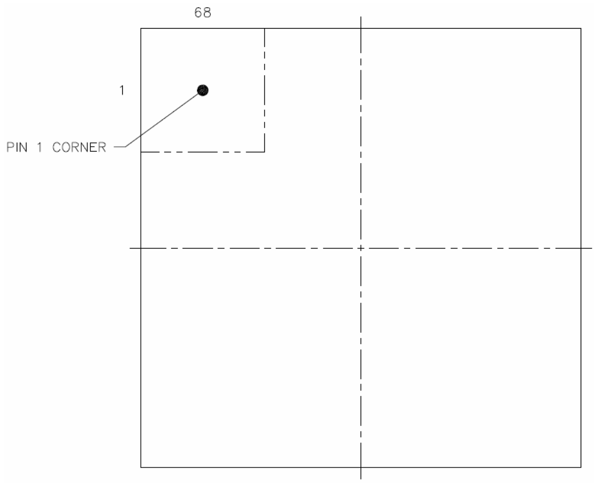

# 6 SSD2828QN4 Pin Assignment

<!-- pdf:18 -->

**Table 6-1: SSD2828QN4 Pinout Diagram – 68 QFN-EP (Top view)**

<!-- pdf:19 -->

**Table 6-2: SSD2828QN4 Pin Assignment – 68 QFN-EP (Top view)**

| QFN pin # | Net name | QFN pin # | Net name |
|---|---|---|---|
| 1 | DATAP0 | 35 | DATA0 |
| 2 | DATAN0 | 36 | DATA1 |
| 3 | GND | 37 | DATA2 |
| 4 | DATAP1 | 38 | DATA3 |
| 5 | DATAN1 | 39 | DATA4 |
| 6 | GND | 40 | DATA5 |
| 7 | CLKP | 41 | DATA6 |
| 8 | CLKN | 42 | DATA7 |
| 9 | GND | 43 | DATA8 |
| 10 | DATAP2 | 44 | DATA9 |
| 11 | DATAN2 | 45 | DATA10 |
| 12 | GND | 46 | DATA11 |
| 13 | DATAP3 | 47 | DATA12 |
| 14 | DATAN3 | 48 | DATA13 |
| 15 | MVDD | 49 | DATA14 |
| 16 | VDDIO | 50 | DATA15 |
| 17 | PS0 | 51 | DATA16 |
| 18 | PS1 | 52 | DATA17 |
| 19 | NC | 53 | DATA18 |
| 20 | NC | 54 | DATA19 |
| 21 | NC | 55 | DATA20 |
| 22 | RESET | 56 | DATA21 |
| 23 | SDO | 57 | DATA22 |
| 24 | SDI | 58 | DATA23 |
| 25 | SCK | 59 | CSX0 |
| 26 | SDC | 60 | MVDD |
| 27 | SHUT | 61 | SYS_CLK_OUT |
| 28 | DEN | 62 | TX_CLK_XIO |
| 29 | HSYNC | 63 | TX_CLK_XIN |
| 30 | PCLK | 64 | VDDIO |
| 31 | MVDD | 65 | GND |
| 32 | GND | 66 | MVDD |
| 33 | VDDIO | 67 | GND |
| 34 | VSYNC | 68 | VDDIO |

**Table 6-3: SSD2828QN4 RGB data arrangement**

|  | D23 | D22 D | 21 | D20 | D19 | D18 | D17 | D16 | D15 | D14 | D13 | D12 | D11 | D10 | D9 | D8 | D7 | D6 | D5 | D4 | D3 | D2 | D1 | D0 |
|---|---|---|---|---|---|---|---|---|---|---|---|---|---|---|---|---|---|---|---|---|---|---|---|---|
| 24bpp | R7 | R6 R | 5 | R4 | R3 | R2 | R1 | R0 | G7 | G6 | G5 | G4 | G3 | G2 | G1 | G0 | B7 | B6 | B5 | B4 | B3 | B2 | B1 | B0 |
| 18bpp | X | X | X | X | X | X | R5 | R4 | R3 | R2 | R1 | R0 | G5 | G4 | G3 | G2 | G1 | G0 | B5 | B4 | B3 | B2 | B1 | B0 |
| 16bpp | X | X | X | X | X | X | X | X | R4 | R3 | R2 | R1 | R0 | G5 | G4 | G3 | G2 | G1 | G0 | B4 | B3 | B2 | B1 | B0 |
