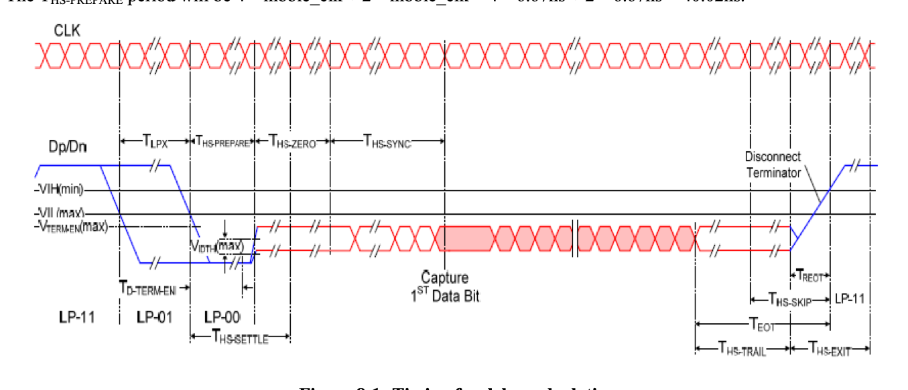
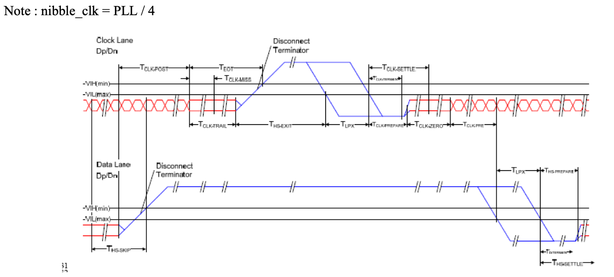
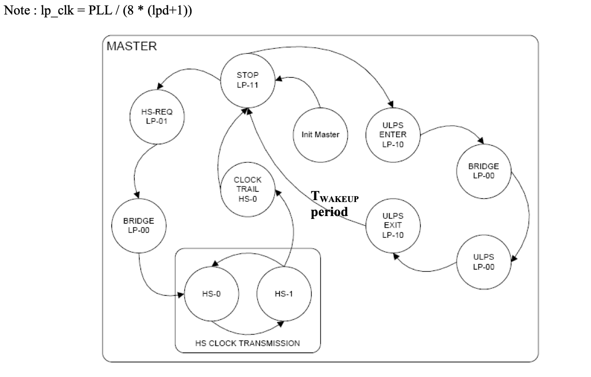
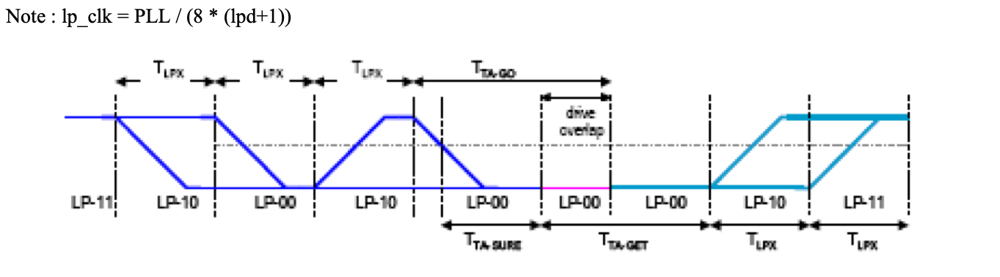
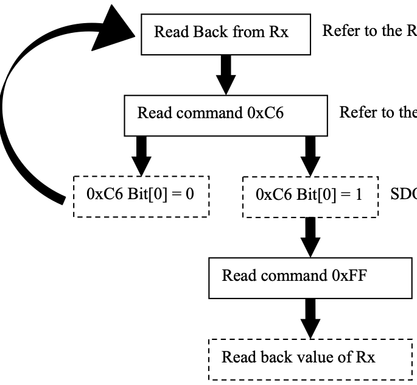

# 8 COMMAND TABLE

<!-- pdf:23 -->

**Table 8-1: SSD2828 Register Summary**

| Offset | Name | Mnemonic | Reset Value |
|---|---|---|---|
| 0xB0 | Device Identification Register | DIR | 0x2828 |
| 0xB1 | RGB Interface Control Register 1 | VICR1 | 0x020A |
| 0xB2 | RGB Interface Control Register 2 | VICR2 | 0x0214 |
| 0xB3 | RGB Interface Control Register 3 | VICR3 | 0x0428 |
| 0xB4 | RGB Interface Control Register 4 | VICR4 | 0x0780 |
| 0xB5 | RGB Interface Control Register 5 | VICR5 | 0x0438 |
| 0xB6 | RGB Interface Control Register 6 | VICR6 | 0x0024 |
| 0xB7 | Configuration Register | CFGR | 0x0301 |
| 0xB8 | VC Control Register | VCR | 0x0045 |
| 0xB9 | PLL Control Register | PCR | 0x0000 |
| 0xBA | PLL Configuration Register | PLCR | 0x8120 |
| 0xBB | Clock Control Register | CCR | 0x0003 |
| 0xBC | Packet Size Control Register 1 | PSCR1 | 0x0000 |
| 0xBD | Packet Size Control Register 2 | PSCR2 | 0x0000 |
| 0xBE | Packet Size Control Register 3 | PSCR3 | 0x0100 |
| 0xBF | Packet Drop Register | PDR | 0x0000 |
| 0xC0 | Operation Control Register | OCR | 0x0000 |
| 0xC1 | Maximum Return Size Register | MRSR | 0x0001 |
| 0xC2 | Return Data Count Register | RDCR | 0x0000 |
| 0xC3 | ACK Response Register | ARSR | 0x0000 |
| 0xC4 | Line Control Register | LCR | 0x0000 |
| 0xC5 | Interrupt Control Register | ICR | 0x0080 |
| 0xC6 | Interrupt Status Register | ISR | 0xCF06 |
| 0xC7 | Error Status Register | ESR | 0x0000 |
| 0xC9 | Delay Adjustment Register 1 | DAR1 | 0x1402 |
| 0xCA | Delay Adjustment Register 2 | DAR2 | 0x2803 |
| 0xCB | Delay Adjustment Register 3 | DAR3 | 0x0416 |
| 0xCC | Delay Adjustment Register 4 | DAR4 | 0x0A0A |
| 0xCD | Delay Adjustment Register 5 | DAR5 | 0x1000 |
| 0xCE | Delay Adjustment Register 6 | DAR6 | 0x0405 |
| 0xCF | HS TX Timer Register 1 | HTTR1 | 0x0000 |
| 0xD0 | HS TX Timer Register 2 | HTTR2 | 0x0010 |
| 0xD1 | LP RX Timer Register 1 | LRTR1 | 0x0000 |
| 0xD2 | LP RX Timer Register 2 | LRTR2 | 0x0010 |
| 0xD3 | TE Status Register | TSR | 0x0000 |
| 0xD4 | SPI Read Register | LRR | 0x00FA |
| 0xD5 | PLL Lock Register | PLLR | 0x1450 |
| 0xD6 | Test Register | TR | 0x0005 |
| 0xD7 | TE Count Register | TECR | 0x0001 |
| 0xD8 | Analog Control Register 1 | ACR1 | 0x2020 |
| 0xD9 | Analog Control Register 2 | ACR2 | 0x64A0 |
| 0xDA | Analog Control Register 3 | ACR3 | 0x99A4 |
| 0xDB | Analog Control Register 4 | ACR4 | 0x8098 |
| 0xDC | Interrupt Output Control Register | IOCR | 0x0000 |
| 0xDD | RGB Interface Control Register 7 | VICR7 | 0x0000 |
| 0xDE | Lane Configuration Register | LCFR | 0x0000 |
| 0xDF | Delay Adjustment Register 7 | DAR7 | 0x0010 |
| 0xE0 | Pull Control Register 1 | PUCR1 | 0x5556 |
| 0xE1 | Pull Control Register 2 | PUCR2 | 0x6656 |
| 0xE2 | Pull Control Register 3 | PUCR3 | 0x0159 |

<!-- pdf:24 -->

| Offset | Name | Mnemonic | Reset Value |
|---|---|---|---|
| 0xE9 | CABC Brightness Control Register 1 | CBCR1 | 0x0000 |
| 0xEA | CABC Brightness Control Register 2 | CBCR2 | 0x6900 |
| 0xEB | CABC Brightness Status Register | CBSR | 0x0000 |
| 0xEC | Encoder Control Register | ECR | 0x7800 |
| 0xED | Video Sync Delay Register | VSDR | 0x0002 |
| 0xEE | Trimming Register | TMR | 0x0000 |
| 0xEF | GPIO Register 1 | GPIO1 | 0x0000 |
| 0xF0 | GPIO Register 2 | GPIO2 | 0x0000 |
| 0xF1 | DLYA01 Register | DLYA01 | 0x2020 |
| 0xF2 | DLYA23 Register | DLYA23 | 0x2020 |
| 0xF3 | DLYB01 Register | DLYB01 | 0x2020 |
| 0xF4 | DLYB23 Register | DLYB23 | 0x2020 |
| 0xF5 | DLYC01 Register | DLYC01 | 0x2020 |
| 0xF6 | DLYC23 Register | DLYC23 | 0x2020 |
| 0xF7 | Analog Control Register 5 | ACR5 | 0x0000 |
| 0xFF | Read Register | RR | 0x0000 |

<!-- pdf:25 -->

### 8.1 Register Description

#### 8.1.1 Device Identification Register

Offset Address

DIR Device Identification Register 0xB0

| Bits | Name | Type | Reset |
|---|---|---|---|
| 15:8 | DIR[15:8] | RO | 0x28 |
| 7:0 | DIR[7:0] | RO | 0x28 |

**Table 8-2: Device Identification Register Description**

| Name | Description | Setting |
|---|---|---|
| DIR Bit 15-0 | Device Identification Number | 0x2828 |

<!-- pdf:26 -->

#### 8.1.2 RGB Interface Control Register 1

Offset Address

VICR1 RGB Interface Control Register 1 0xB1

| Bits | Name | Type | Reset |
|---|---|---|---|
| 15:8 | VSA | RW | 0x02 |
| 7:0 | HSA | RW | 0x0A |

**Table 8-3: RGB Interface Control Register 1 Description**

| Name | Description | Setting |
|---|---|---|
| VSA Bit 15-8 | Vertical Sync Active Period – These bits specify the Vsync active period. The Vsync active period is from the Vsync falling edge to rising edge, in terms of Hsync pulses. It is only used in non-burst mode with Sync pulses. Please refer to 9.3 for more details. | The minimum value is 1. |
| HSA Bit 7-0 | Horizontal Sync Active Period – These bits specify the Hsync active period. The Hsync active period is from the Hsync falling edge to rising edge, in terms of pclk. It is only used in non-burst mode with Sync pulses. Please refer to 9.3 for more details. | The minimum value is 1. |

<!-- pdf:27 -->

#### 8.1.3 RGB Interface Control Register 2

Offset Address

VICR2 RGB Interface Control Register 2 0xB2

| Bits | Name | Type | Reset |
|---|---|---|---|
| 15:8 | VBP | RW | 0x02 |
| 7:0 | HBP | RW | 0x14 |

**Table 8-4: RGB Interface Control Register 2 Description**

| Name | Description | Setting |
|---|---|---|
| VBP Bit 15-8 | Vertical Back Porch Period – These bits specify the vertical back porch period in terms of Hsync pulses. The vertical back porch period depends on the video mode setting. If the mode is non-burst mode with Sync pulses, it is from the Vsync rising edge to the Hsync of the first line of active display. If the mode is non-burst mode with Sync events, it is from the Vsync falling edge to the Hsync of the first line of active display. If the mode is burst mode, it is the same as the non-burst mode with Sync events. Please refer to 9.3 for more details. |  |
| HBP Bit 7-0 | Horizontal Back Porch Period – These bits specify the horizontal back porch period in terms of pclk. The horizontal back porch period depends on the non-burst mode setting. If the mode is non-burst mode with Sync pulses, it is from the Hsync rising edge to the start of the valid display pixel. If the mode is non-burst mode with Sync events, it is from the Hsync falling edge to the start of the valid display pixel. If the mode is burst mode, it is the same as the non-burst mode with Sync events. Please refer to 9.3for more details. |  |

<!-- pdf:28 -->

#### 8.1.4 RGB Interface Control Register 3

Offset Address

VICR3 RGB Interface Control Register3 0xB3

| Bits | Name | Type | Reset |
|---|---|---|---|
| 15:8 | VFP | RW | 0x04 |
| 7:0 | HFP | RW | 0x28 |

**Table 8-5: RGB Interface Control Register 3 Description**

| Name | Description | Setting |
|---|---|---|
| VFP Bit 15-8 | Vertical Front Porch Period – These bits specify the vertical front porch period in terms of Hsync pulses. The vertical front porch period is from the first Hsync after the last line of active display to the next Vsync falling edge. Please refer to 9.3 for more details. |  |
| HFP Bit 7-0 | Horizontal Front Porch Period – These bits specify the horizontal front porch period in terms of pclk. The horizontal front porch period is from the end of the valid display pixel to the next Hsync falling edge. Please refer to 9.3 for more details. |  |

<!-- pdf:29 -->

#### 8.1.5 RGB Interface Control Register 4

Offset Address

VICR4 RGB Interface Control Register 4 0xB4

| Bits | Name | Type | Reset |
|---|---|---|---|
| 15:8 | HACT[15:8] | RW | 0x07 |
| 7:0 | HACT[7:0] | RW | 0x80 |

**Table 8-6: RGB Interface Control Register 4 Description**

| Name | Description | Setting |
|---|---|---|
| HACT Bit 15-0 | Horizontal Active Period – These bits specify the horizontal active period in terms of pclk. During the horizontal active period, the den signal should always be high. Please refer to 9.3 for more details. | The maximum value is 0x0A00. |

<!-- pdf:30 -->

#### 8.1.6 RGB Interface Control Register 5

Offset Address

VICR5 RGB Interface Control Register 5 0xB5

| Bits | Name | Type | Reset |
|---|---|---|---|
| 15:8 | VACT[15:8] | RW | 0x04 |
| 7:0 | VACT[7:0] | RW | 0x38 |

**Table 8-7: RGB Interface Control Register 5 Description**

| Name | Description | Setting |
|---|---|---|
| VACT Bit 15-0 | Vertical Active Period – These bits specify the vertical active period in terms of Hsync pulses. Please refer to 9.3 for more details. | The minimum value is 1. |

<!-- pdf:31 -->

#### 8.1.7 RGB Interface Control Register 6

Offset Address

VICR6 RGB Interface Control Register6 0xB6

| Bits | Name | Type | Reset |
|---|---|---|---|
| 15 | VS_P | RW | 0x0 |
| 14 | HS_P | RW | 0x0 |
| 13 | PCLK_P | RW | 0x0 |
| 12:9 | — | RO | 0x0 |
| 8 | CBM | RW | 0x0 |
| 7 | NVB | RW | 0x0 |
| 6 | NVD | RW | 0x0 |
| 5 | BLLP | RW | 0x1 |
| 4 | VCS | RW | 0x0 |
| 3:2 | VM | RW | 0x1 |
| 1:0 | VPF | RW | 0x0 |

**Table 8-8: RGB Interface Control Register 6 Description**

| Name | Description | Setting |
|---|---|---|
| VS_P Bit 15 | VS_P – This bit control the polarity of the Vsync pulse input. | 0 – Vsync Pulse is active low 1 – Vsync Pulse is active high |
| HS_P Bit 14 | HS_P – This bit control the polarity of the Hsync pulse output. | 0 – Hsync Pulse is active low 1 – Hsync Pulse is active high |
| PCLK_P Bit 13 | PCLK_P – This bit control the polarity of the CM output. | 0 – Data is launch at falling edge, SSD2828 latch data at rising edge 1 – Data is launch at rising edge, SSD2828 latch data at falling edge |
| Reserved Bit 12-9 |  |  |
| CBM Bit 8 | Compress Burst Mode Control – If the mode is burst and this bit is 1, MIPITX will send video packet in compressed burst mode (i.e. no blanking packet after horizontal sync packet) | 0 – Video with blanking packet. 1 - Video with no blanking packet. |
| NVB Bit 7 | Non Video Data Burst Mode Control – This bit specifies how non video data will be interleaved with video data transmission in burst mode. | 0 – Non video data will be transmitted during any BLLP period. 1 - Non video data will only be transmitted during vertical blanking period. |
| NVD Bit 6 | Non Video Data Transmission Control –This bit specifies how non video data will be interleaved with video data transmission. Please refer to 9.2.1 for more details. The SSD2828 will send non video data (written from the SPI interface) during the vertical blanking period (non burst mode) or any BLLP period in burst mode (depends on NVB setting). The data can be sent either in high speed mode or low power mode. This bit selects which mode to use. If LP mode is selected, the data | 0 – Non video data will be transmitted using HS mode. 1 – Non video data will be transmitted using LP mode. |

<!-- pdf:32 -->

| Name | Description | Setting |
|---|---|---|
|  | lane will enter LP mode for BLLP period, even if there is no non-video data to send. Please note that sending data in LP mode is much slower than HS mode. It is the responsibility of the host processor to make sure that the duration is long enough to finish the data transfer and the timing of Hsync and Vsync is not affected. |  |
| BLLP Bit 5 | BLLP Control – This bit specifies the SSD2828 operation during BLLP period. This bit takes effect only for non burst mode and NVD being 0. When the video mode is burst mode, the SSD2828 will not send any blanking packet during BLLP. It will enter LP mode. When NVD is 1 in non burst mode, the SSD2828 will stay in LP mode after sending the non video data (if there is any), until the BLLP period ends. When NVD is 0 in non burst mode, the SSD2828 will use this bit to decide whether to send blanking packet or enter LP mode after sending non video data (if there is any), until the BLLP period ends. Please note that entering and exiting from LP mode needs more time, as the speed of LP mode is slow. It is the responsibility of the host processor to make sure that the period is long enough to finish the data transfer and the timing of Hsync and Vsync is not affected. | 0 – Blanking packet will be sent during BLLP period. 1 – LP mode will be used during BLLP period. |
| VCS Bit 4 | Video Clock Suspend – This bit specifies the clock lane behavior. This bit is only applicable for burst mode. When the video mode is non burst mode, the clock lane will remain in HS mode all the time. | 0 – The clock lane remains in HS mode, when there is no data to transmit. 1 – The clock lane enters LP mode when there is no data to transmit. |
| VM Bit 3-2 | Video Mode – These bits specify the video mode the SSD2828 will use, when RGB interface is selected. Please refer to MIPI DSI for the definition of different modes. | 00 – Non burst mode with sync pulses 01 – Non burst mode with sync events 10 – Burst mode 11 – Reserved |
| VPF Bit 1-0 | Video Pixel Format – These bits specify the pixel format for video mode. | 00 – 16bpp 01 – 18bpp, packed 10 – 18bpp, loosely packed 11 – 24bpp |

| 24bpp | D23 | D22 | D21 | D20 | D19 | D18 | D17 | D16 | D15 | D14 | D13 | D12 | D11 | D10 | D9 | D8 | D7 | D6 | D5 | D4 | D3 | D2 | D1 | D0 |
|---|---|---|---|---|---|---|---|---|---|---|---|---|---|---|---|---|---|---|---|---|---|---|---|---|
| 18bpp | X | X | X | X | X | X | D17 | D16 | D15 | D14 | D13 | D12 | D11 | D10 | D9 | D8 | D7 | D6 | D5 | D4 | D3 | D2 | D1 | D0 |
| 16bpp | X | X | X | X | X | X | X | X | D15 | D14 | D13 | D12 | D11 | D10 | D9 | D8 | D7 | D6 | D5 | D4 | D3 | D2 | D1 | D0 |

<!-- pdf:33 -->

#### 8.1.8 Configuration Register

Offset Address

CFGR Configuration Register 0xB7

| Bits | Name | Type | Reset |
|---|---|---|---|
| 15:12 | — | RO | 0x0 |
| 11 | TXD | RW | 0x0 |
| 10 | LPE | RW | 0x0 |
| 9 | EOT | RW | 0x1 |
| 8 | ECD | RW | 0x1 |
| 7 | REN | RW | 0x0 |
| 6 | DCS | RW | 0x0 |
| 5 | CSS | RW | 0x0 |
| 4 | HCLK | RW | 0x0 |
| 3 | VEN | RW | 0x0 |
| 2 | SLP | RW | 0x0 |
| 1 | CKE | RW | 0x0 |
| 0 | HS | RW | 0x1 |

**Table 8-9: Configuration Register Description**

| Name | Description | Setting |
|---|---|---|
| Reserved Bit 15-12 |  |  |
| TXD Bit 11 | Transmit Disable – This bit specifies whether the SSD2828 will disable the sending of MIPI Packets stored in the buffers. Software can enable TXD, fill out the buffers and then disable it to send all packets out in 1 burst. | 0 – Transmit on 1 – Transmit halt |
| LPE Bit 10 | Long Packet Enable – This bit specifies whether the SSD2828 will send out a Generic Long Write Packet or Generic Short Write Packet when the payload is no more than 2 bytes. It also specifies whether the SSD2828 will send out a DCS Long Write Packet or DCS Short Write Packet when the payload is no more than 1 byte. | 0 – Short Packet 1 – Long Packet |
| EOT Bit 9 | EOT Packet Enable – This bit specifies whether the SSD2828 will send out the EOT packet at the end of HS transmission or not. | 0 – Do not send 1 – Send |
| ECD Bit 8 | ECC CRC Check Disable – This bit specifies whether SSD2828 will perform ECC and CRC checking for the packets received from the MIPI slave. | 0 – Enable 1 – Disable |
| REN Bit 7 | Read Enable –This bit specifies whether the next operation is a write or read operation. | 0 – Write operation 1 – Read operation |
| DCS Bit 6 | DCS Enable – This bit specifies whether the packet to be sent is DCS packet or generic packet. This bit applies for both write and read operation. | 0 – Generic packet (The packet can be any one of Generic Long Write, Generic Short Write, Generic Read packet, depending on the configuration.) 1 – DCS packet (The packet can be any one of DCS Long Write, DCS Short Write, DCS Read packet, depending on the configuration.) |

<!-- pdf:34 -->

| Name | Description | Setting |
|---|---|---|
| CSS Bit 5 | Clock Source Select – This bit selects the clock source for the PLL. Please refer to 5.2 for the system behavior when the clock source is switched. The CSS setting should be programmed only when PEN is 0. It has no effect when PEN is 1. | 0 – The clock source is tx_clk 1 – The clock source is pclk |
| HCLK Bit 4 | HS Clock Disable – This bit controls the clock lane behavior during the reverse direction communication. This bit takes effect only when CKE is 0 and VEN is 0. | 0 – HS clock is enabled 1 – HS clock is disabled |
| VEN Bit 3 | Video Mode Enable – This bit controls the video mode operation. Only after this bit is set to 1, video mode is enabled. This bit takes effect only when the interface setting is RGB + SPI. Please refer to 0 for the video mode operation. | 0 – Video mode is disabled 1 – Video mode is enabled |
| SLP Bit 2 | Sleep Mode Enable – This bit controls the sleep mode operation. Please refer to 9.3.2 for the sleep mode operation. When this bit is set to 1, the HS bit will be cleared to 0 automatically. | 0 – Sleep mode is disabled 1 – Sleep mode is enabled. Only the register interface is active. |
| CKE Bit 1 | Clock Lane Enable – This bit controls the clock lane mode when data lane enters LP mode. | 0 – Clock lane will enter LP mode, if it is not in reverse direction communication. Clock lane will follow the setting of HCLK, if it is in reverse direction communication. 1 – Clock lane will enter HS mode for all the cases. |
| HS Bit 0 | HS Mode – This bit controls whether the SSD2828 is using HS or LP mode to send data. This bit can be affected by the SLP bit value. | 0 – LP mode 1 – HS mode |

<!-- pdf:35 -->

#### 8.1.9 VC Control Register

Offset Address

VCR VC Control Register 0xB8

| Bits | Name | Type | Reset |
|---|---|---|---|
| 15:8 | — | RO | 0x0 |
| 7:6 | VCM | RW | 0x1 |
| 5:4 | VCE | RW | 0x0 |
| 3:2 | VC2 | RW | 0x1 |
| 1:0 | VC1 | RW | 0x1 |

**Table 8-10: VC Control Register Description**

| Name | Description | Setting |
|---|---|---|
| Reserved Bit 15-8 |  |  |
| VCM Bit 7-6 | Virtual Channel ID for Maximum Return Size Packet – These bits specify the VC ID for the Maximum Return Size Packet sent by SSD2828. This register field is included as the VC ID for this packet might be different from the VC ID for the packets carrying the actual data. |  |
| VCE Bit 5-4 | Virtual Channel ID for EOT Packet – These bits specify the VC ID for the EOT Packet sent by SSD2828. This register field is included as the VC ID for this packet might be different from the VC ID for the packets carrying the actual data. |  |
| VC2 Bit 3-2 | Virtual Channel ID for SPI Interface – These bits specify the VC ID for the packets written in through the SPI interface, when the interface setting is RGB + SPI This register field is included as the RGB + SPI interface can address two different LCD panels at the same time. The VC ID for the two panels is different. |  |
| VC1 Bit 1-0 | Virtual Channel ID for RGB Interface – These bits specify the VC ID for the packets written in through the RGB interface, when the interface is RGB + SPI |  |

<!-- pdf:36 -->

#### 8.1.10 PLL Control Register

Offset Address

PCR PLL Control Register 0xB9

| Bits | Name | Type | Reset |
|---|---|---|---|
| 15:14 | SYSD | RW | 0x0 |
| 13 | SYS_DIS | RW | 0x0 |
| 12:1 | — | RO | 0x0 |
| 0 | PEN | RW | 0x0 |

**Table 8-11: PLL Control Register Description**

| Name | Description | Setting |
|---|---|---|
| SYSD Bit 15-14 | SYS_clk Divider – These bits give the divider value for generating the sys_clk output from the tx_clk or crystal input. | 00 – Divide by 1 01 – Divide by 2 10 – Divide by 4 11 – Divide by 8 |
| SYS_DIS Bit 13 | SYS_clk DISable – This bit will shut off the Sys_clk signal output when enabled. | 0 – Enable Sys_clk output 1 – Disable Sys_clk output |
| Reserved Bit 12-1 |  |  |
| PEN Bit 0 | PLL Enable – This bit controls the PLL operation. | 0 – PLL power down 1 – PLL enable |

Remark: Frequency of PLL can only be changed during PEN = 0

<!-- pdf:37 -->

#### 8.1.11 PLL Configuration Register

Offset Address

PLCR PLL Configuration Register 0xBA

| Bits | Name | Type | Reset |
|---|---|---|---|
| 15:14 | FR | RW | 0x2 |
| 13 | — | RO | 0x0 |
| 12:8 | MS | RW | 0x01 |
| 7:0 | NS | RW | 0x20 |

**Table 8-12: PLL Configuration Register Description**

| Name | Description | Setting |
|---|---|---|
| FR Bit 15-14 | Frequency Range – These bits select the range of the output clock. The FR setting should be programmed only when PEN is 0. It has no effect when PEN is 1. | 00 – 62.5 < f OUT < 125 01 – 126 < f OUT < 250 10 – 251 < f OUT < 500 11 – 501 < f OUT < 1000 |
| Reserved Bit 13 |  |  |
| MS Bit 12-8 | PLL Divider – These bits specify the PLL pre- divider value, MS. The frequency of the phase detector, f REF is determined by f PRE = f IN MS The input frequency, f IN and phase detector frequency, f REF should be between 5Mhz to 100Mhz. The MS setting should be programmed only when PEN is 0. It has no effect when PEN is 1. | - 0x00 : MS=1 - 0x01 : MS=1 - 0x02 : MS=2 … - 0x1F : MS=31 |
| NS Bit 7-0 | PLL Multiplier – These bits specify the PLL output frequency multiplier value, NS. The output frequency, f OUT is determined by f OUT = f PRE ∗ NF The NS setting should be programmed only when PEN is 0. It has no effect when PEN is 1. | - 0x00 : NS=1 - 0x01 : NS=1 - 0x02 : NS=2 … - 0xFF : NS=255 |

e.g. TX_CLK = 10MHz, 0xBAh = 0x8028h

PLL = 40 x 10 / 1 = 400Mbps

<!-- pdf:38 -->

#### 8.1.12 Clock Control Register

Offset Address

CCR Clock Control Register 0xBB

| Bits | Name | Type | Reset |
|---|---|---|---|
| 15:6 | — | RO | 0x0 |
| 5:0 | LPD | RW | 0x03 |

**Table 8-13: Clock Control Register Description**

| Name | Description | Setting |
|---|---|---|
| Reserved Bit 15-6 |  |  |
| LPD Bit 5-0 | LP Clock Divider – These bits give the divider value for generating the LP mode clock from the byte clock. | 0x0 – Divide by 1 0x1 – Divide by 2 … 0x3F – Divide by 64 |

Remark: e.g. LPD = 0x4

PLL = 400Mbps

LP clock = 400Mbps / LPD / 8 = 400 / 5 / 8 = 10MHz

<!-- pdf:39 -->

#### 8.1.13 Packet Size Control Register 1

Offset Address

PSCR1 Packet Size Control Register1 0xBC

| Bits | Name | Type | Reset |
|---|---|---|---|
| 15:8 | TDC[15:8] | RW | 0x00 |
| 7:0 | TDC[7:0] | RW | 0x00 |

**Table 8-14: Packet Size Control Register 1 Description**

| Name | Description | Setting |
|---|---|---|
| TDC Bit 15-0 | Transmit Data Count – These bits set the total number of data bytes to be transmitted by the SSD2828 in the next operation. The SSD2828 will use the value in this field to decide what type of packet to send out. The settings of TDC and PST(0xBE) will configure the transfer mode into partition and non-partition mode when the command is 0x2C or 0x3C. Partition mode(TDC > PST) For DCS Long Write packet with DCS command being 0x2C or 0x3C, there is no limit in the maximum number of bytes to be transmitted in 1 write. The PST value can be set to maximum of 4096 bytes. The SSD2828 will auto insert 0x3C command at these boundaries. The maximum MCU speed at the input is 1/12 of the link frequency. Non-Partition mode(TDC <= PST) For DCS Long Write packet with DCS command being 0x2C or 0x3C, the maximum number of bytes to be transmitted in 1 write is 4096 bytes(TDC). In this mode, the PST value is the same or greater than the TDC value. The maximum MCU speed at the input is 1/8 of the link frequency. Please refer to 9.3.1.1 for more details. | Partition mode When TDC > PST. Non-partition mode When TDC <= PST. Maximum TDC = 4096(0x1000) |

<!-- pdf:40 -->

#### 8.1.14 Packet Size Control Register 2

Offset Address

PSCR2 Packet Size Control Register 2 0xBD

| Bits | Name | Type | Reset |
|---|---|---|---|
| 15:8 | TDC[31:24] | RW | 0x0 |
| 7:0 | TDC[23:16] | RW | 0x0 |

**Table 8-15: Packet Size Control Register 2 Description**

| Name | Description | Setting |
|---|---|---|
| TDC[31:16] Bit 31-0 | Transmit Data Count – Please see the description of Packet Size Control Register 1. |  |

<!-- pdf:41 -->

#### 8.1.15 Packet Size Control Register 3

Offset Address

PSCR2 Packet Size Control Register 3 0xBE

| Bits | Name | Type | Reset |
|---|---|---|---|
| 15:13 | — | RO | 0x0 |
| 12:8 | PST[12:8] | RW | 0x1 |
| 7:0 | PST[7:0] | RW | 0x00 |

**Table 8-16: Packet Size Control Register 3 Description**

| Name | Description | Setting |
|---|---|---|
| Reserved Bit 15-13 |  |  |
| PST Bit 12-0 | Packet Size Threshold – These bits give the threshold value for partitioning the incoming long packet data into smaller packets. The partitioning only applies to the DCS Long Write packet with DCS command being 0x2C or 0x3C in Command mode(if_sel=1). The payload will be partitioned into multiple packets. The PST represents the threshold in term of bytes. The maximum MCU speed at the input is 1/10 of the link frequency. Please refer to 9.3.1.1 for more details. | The maximum value allowed is 4096 bytes. Program PST<TDC will allows auto insertion of 0x3C at the PST boundary(Partition mode). If the user tries to program a larger value than the maximum allowed value into this field, SSD2828 will cap the value to the maximum value. When the interface setting is 16- bit, the value in this field must be multiple of 2 bytes, or even number. If an odd number is written in, it will be automatically truncated to an even number. For example, 0x5 will be truncated to 0x4. When the interface setting is 24- bit, the value in this field must be in multiple of 3 bytes |

<!-- pdf:42 -->

#### 8.1.16 Generic Packet Drop Register

Offset Address

GPDR Generic Packet Drop Register 0xBF

| Bits | Name | Type | Reset |
|---|---|---|---|
| 15:8 | GPD[15:8] | WO | 0x0 |
| 7:0 | GPD[7:0] | WO | 0x0 |

**Table 8-17: Generic Packet Drop Register Description**

| Name | Description | Setting |
|---|---|---|
| GPD Bit 15-0 | Generic Packet Drop – This register is not a true register. It is the entry point for the internal buffer. The payload of the generic packets (Generic Short Write, Generic Long Write, and Generic Read) or the command and payload if DCS packet should be written into this register. The SSD2828 will send them out using the corresponding generic or DCS packet. DCS field of CFGR register will be used to determine the data drop into this register is for generic or DCS packet generation. The application processor can treat this register as an FIFO and continuously write data into it. When the interface is 16-bit, the width of this field is 16-bit. When the interface is 8-bit, the width of this field is 8-bit. Since the register is only the entry point of the internal buffer, the application processor is not able to read the data written into the buffer. |  |

<!-- pdf:43 -->

#### 8.1.17 Operation Control Register

Offset Address

OCR Operation Control Register 0xC0

| Bits | Name | Type | Reset |
|---|---|---|---|
| 15:9 | — | RO | 0x0 |
| 8 | RST | RWAC | 0x0 |
| 7:1 | — | RO | 0x0 |
| 0 | COP | RWAC | 0x0 |

**Table 8-18: Operation Control Register Description**

| Name | Description | Setting |
|---|---|---|
| Reserved Bit 15-9 |  |  |
| RST Bit 8 | Software Reset - Writing a ‘1’ to this bit will reset the entire module except SSD2828 local register setting. This bit will be cleared after the reset is completed. Wrting a ‘1’ to this bit will cause the MIPI link enters TX stop state immediately and any outgoing MIPI packet will be terminated immediately. | 0 – NOP 1 – Software Reset |
| Reserved Bit 7-1 |  |  |
| COP Bit 0 | Cancel Operation – This bit is to cancel the current operation. When this bit is set to 1, the SSD2828 will still finish transmitting the current packet. (Otherwise, the serial link operation will lose sync.) Afterwards, the SSD2828 will stop any further transmission. It will clear its internal buffer such that all the data being written in and not sent out yet will be cleared. It will also bring the state machine to its initial state. Once this process is finished, the COP bit will be automatically set to 0. At the same time, the PO bit of the status register will be set to 1 too. At this stage, there is no data in the internal buffer. The application processor can start a new operation. This operation is not valid in video mode(VEN=1). | 0 – NOP 1 – Cancel the current operation |

<!-- pdf:44 -->

#### 8.1.18 Maximum Return Size Register

Offset Address

MRSR Maximum Return Size Register 0xC1

| Bits | Name | Type | Reset |
|---|---|---|---|
| 15:0 | MRS | RW | 0x00 |

**Table 8-19: Maximum Return Size Register Description**

| Name | Description | Setting |
|---|---|---|
| MRS Bit 15-0 | Maximum Return Size – These bits set the maximum return size of the read response packet returned by the MIPI slave. The SSD2828 will automatically send out the Set Maximum Return Size packet using the value in this field, before every read operation. It informs the MIPI slave about the limit of the SSD2828. The application processor does not need to program the register before every read operation, if the maximum return size does not change. However, the Set Maximum Return Size packet will always be sent. |  |

<!-- pdf:45 -->

#### 8.1.19 Return Data Count Register

Offset Address

RDCR Return Data Count Register 0xC2

| Bits | Name | Type | Reset |
|---|---|---|---|
| 15:0 | RDC | RO | 0x00 |

**Table 8-20: Return Data Count Register Description**

| Name | Description | Setting |
|---|---|---|
| RDC Bit 15-0 | Return Data Count – These bits reflect the number of data bytes received from the MIPI slave read response packet. This register can only be updated by the SSD2828 hardware. |  |

<!-- pdf:46 -->

#### 8.1.20 ACK Response Status Register

Offset Address

ARSR ACK Response Status Register 0xC3

| Bits | Name | Type | Reset |
|---|---|---|---|
| 15:0 | AR | RO | 0x00 |

**Table 8-21: ACK Response Status Register Description**

| Name | Description | Setting |
|---|---|---|
| AR Bit 15-0 | ACK Response – These bits contain the ACK response from the MIPI slave. The register will be updated when ACK with Error Report packet is received. Otherwise, the value will be set to 0. The bits in this register follow the definition in MIPI DSI. This register can only be updated by the SSD2828 hardware. |  |

<!-- pdf:47 -->

#### 8.1.21 Line Control Register

Offset Address

LCR Line Control Register 0xC4

| Bits | Name | Type | Reset |
|---|---|---|---|
| 15:6 | — | RO | 0x0 |
| 5 | IBC | RW | 0x0 |
| 4 | RT | RWAC | 0x0 |
| 3 | RTB | RWAC | 0x0 |
| 2 | FBC | RWAC | 0x0 |
| 1 | FBT | RW | 0x0 |
| 0 | FBW | RW | 0x0 |

**Table 8-22: Line Control Register Description**

| Name | Description | Setting |
|---|---|---|
| Reserved Bit 15-6 |  |  |
| IBC Bit 5 | Ignore Bus Contention – This bit is to detect bus contention reported by the Analog Phy. If this bit is disabled, whenever bus contention is detected, the state machine will ignore it and continue sending new packet if available. If this bit is enabled, the state machine will halt further transmission. | 0 – Detect Bus Contention from Analog Phy 1 – Ignore Bus Contention detected by Analog Phy |
| RT Bit 4 | Reset Trigger – This bit is to send a Reset Trigger Message. When this bit is set to 1, the SSD2828 will send a Reset Trigger Message. It is recommended to enter LP mode and send this trigger message. If this bit is programmed during vertical active data is being sent on MIPI link, the reset trigger will be delayed to next vertical blanking period so that the reset trigger message will not disturb the video timing on the MIPI link. Once the Reset Trigger Message is sent out, RT bit will be automatically set to 0. | 0 – NOP 1 – Send a Reset Trigger Message |
| RTB Bit 3 | Register Triggered BTA – This bit automatically perform Bus Turnaround(BTA) when link is not used. When bus is returned back from the slave, the link will remains in Low Power state until a new request come in where HS bit determination the transfer mode. | 0 – NOP 1 – Automatically perform BTA when link is available. In video mode, it will be sent at the next vertical blanking period. |
| FBC Bit 2 | Force Bus Contention – This bit controls whether to force a bus contention on the data lane. This bit will be changed to 0, after the bus contention is not detected. | 0 – NOP 1 – Drive the data lane to LP11 to force a bus contention. |
| FBT | Force BTA TE – This bit controls whether to | 0 – No BTA after previous BTA |

<!-- pdf:48 -->

| Name | Description | Setting |
|---|---|---|
| Bit 1 | perform automatic BTA after previous BTA so as to get the TE response from MIPI slave. | 1 – Perform automatic BTA after previous BTA |
| FBW Bit 0 | Force BTA After Write – This bit controls whether to automatically generate a BTA after a write operation. It is only valid for write operation. After performing BTA, the bus authority has been passed to the MIPI slave. The SSD2828 is not able to send any data to the MIPI slave before the bus authority is passed back. It is the responsibility of the application processor to check the status of the bus before sending any data. | 0 – Not BTA after the next write packet. 1 – Automatically perform BTA after the next write packet. |

<!-- pdf:49 -->

#### 8.1.22 Interrupt Control Register

Offset Address

ICR Interrupt Control Register 0xC5

| Bits | Name | Type | Reset |
|---|---|---|---|
| 15 | CBEE | RW | 0x0 |
| 14 | CBAE | RW | 0x0 |
| 13:10 | — | RO | 0x0 |
| 9 | MLEE | RW | 0x0 |
| 8 | MLAE | RW | 0x0 |
| 7 | PLSE | RW | 0x1 |
| 6 | LPTOE | RW | 0x0 |
| 5 | HSTOE | RW | 0x0 |
| 4 | — | RO | 0x0 |
| 3 | ARRE | RW | 0x0 |
| 2 | BTARE | RW | 0x0 |
| 1 | POE | RW | 0x0 |
| 0 | RDRE | RW | 0x0 |

**Table 8-23: Interrupt Control Register Description**

| Name | Description | Setting |
|---|---|---|
| CBEE Bit 15 | Command Buffer Empty Enable – This bit enables the mapping of CBE interrupt to the int pin. | 0 – Not enabled 1 – Enabled |
| CBAE Bit 14 | Command Buffer Available Enable – This bit enables the mapping of CBA interrupt to the int pin. | 0 – Not enabled 1 – Enabled |
| Reserved Bit 13-10 |  |  |
| MLEE Bit 9 | MCU Long Buffer Empty Enable – This bit enables the mapping of MLE interrupt to the int pin. | 0 – Not enabled 1 – Enabled |
| MLAE Bit 8 | MCU Long Buffer Available Enable – This bit enables the mapping of MLA interrupt to the int pin. | 0 – Not enabled 1 – Enabled |
| PLSE Bit 7 | PLL Lock Status Enable – This bit enables the mapping of the PLS interrupt to the int pin. | 0 – Not enabled 1 – Enabled |
| LPTOE Bit 6 | LP RX Time Out Enable – This bit enables the mapping of the LPTO interrupt to the int pin. | 0 – Not enabled 1 – Enabled |
| HSTOE Bit 5 | HS TX Time Out Enable – This bit enables the mapping of the HSTO interrupt to the int pin. | 0 – Not enabled 1 – Enabled |
| Reserved Bit 4 |  |  |
| ARRE Bit 3 | ACK Response Ready Enable – This bit enables the mapping of ARR interrupt to the int pin. | 0 – Not enabled 1 – Enabled |
| BTARE Bit 2 | BTA Response Enable – This bit enables the mapping of the BTAR interrupt to the int pin. | 0 – Not enabled 1 – Enabled |
| POE Bit 1 | Packet Operation Enable – This bit enables the mapping of the PO interrupt to the int pin. | 0 – Not enabled 1 – Enabled |
| RDRE Bit 0 | Read Data Ready Enable – This bit enables the mapping of the RDR interrupt to the int pin. | 0 – Not enabled 1 – Enabled |

<!-- pdf:50 -->

#### 8.1.23 Interrupt Status Register

Offset Address

ISR Interrupt Status Register 0xC6

| Bits | Name | Type | Reset |
|---|---|---|---|
| 15 | CBE | RO | 0x1 |
| 14 | CBA | RO | 0x1 |
| 13:12 | — | RO | 0x0 |
| 11 | CST | RO | 0x1 |
| 10 | DST | RO | 0x1 |
| 9 | MLE | RO | 0x1 |
| 8 | MLA | RO | 0x1 |
| 7 | PLS | RO | 0x0 |
| 6 | LPTO | RW1C | 0x0 |
| 5 | HSTO | RW1C | 0x0 |
| 4 | ATR | RW1C | 0x0 |
| 3 | ARR | RW1C | 0x0 |
| 2 | BTAR | RW1C | 0x1 |
| 1 | PO | RO | 0x1 |
| 0 | RDR | RO | 0x0 |

**Table 8-24: Interrupt Status Register Description**

| Name | Description | Setting |
|---|---|---|
| CBE Bit 15 | Command Buffer Empty – This bit reflects the status of the internal command buffer of the SPI interface. If the command buffer is empty, this bit will be set to 1. The application processor can write up to the maximum size of the command buffer. | 0 – The command buffer is not empty. 1 – The command buffer is empty. |
| CBA Bit 14 | Command Buffer Available – This bit reflects the status of the internal command buffer of the SPI interface. If the command buffer is not full, this bit will be set to 1. The application processor can write at least 1 packet to the command buffer. | 0 – The command buffer is full. 1 – The command buffer is not full. |
| Reserved Bit 13-12 |  |  |
| CST Bit 11 | Clock Lane Status – This bit reflects the status at the MIPI Clock lane. | 0 – Clock lane is not in LP-11. 1 – Clock lane is in LP-11. |
| DST Bit 10 | Data Lane Status – This bit reflects the status at the MIPI Data lane. | 0 – Data lane is not in LP-11. 1 – Data lane is in LP-11. |
| MLE Bit 9 | Reserved | Reserved |
| MLA Bit 8 | Reserved | Reserved |
| PLS Bit 7 | PLL Lock Status – This bit reflects the status of the PLL. Before the PLL is locked, the whole system is running at the reference clock input of the PLL, as the PLL has no output before getting lock. Hence, the application processor must access the registers using slow speed. | 0 – PLL has not been locked 1 – PLL has been locked |
| LPTO Bit 6 | LP RX Time Out – This bit reflects the status of the LP RX timer. | 0 – The LP RX timer has expired. 1 – The LP RX timer has not expired. |
| HSTO Bit 5 | HS TX Time Out – This bit reflects the status of the HS TX timer. | 0 – The HS TX timer has expired. 1 – The HS TX timer has not expired. |

<!-- pdf:51 -->

| Name | Description | Setting |
|---|---|---|
| ATR Bit 4 | ACK Trigger Response – This bit reflects whether the ACK trigger message has been received or not. | 0 – ACK trigger message has not been received. 1 – ACK trigger message has been received. |
| ARR Bit 3 | ACK Response Ready – This bit reflects whether the ACK response has been received or not. The ACK response can be an ACK trigger message or ACK with Error Report packet. | 0 – Response has not been received. 1 – Response has been received. |
| BTAR Bit 2 | BTA Response – This bit reflects the data lane status after SSD2828 has made a BTA. | 0 – The MIPI slave has not passed the lane authority back. 1 – The MIPI slave has passed the lane authority back. |
| PO Bit 1 | Packet Operation – This bit reflects whether the SSD2828 is ready to take in more data from the application processor. | 0 – Not ready 1 – Ready |
| RDR Bit 0 | Read Data Ready – This bit reflects whether the data from the MIPI slave is ready for read by the application processor. This bit is valid only during the read operation. This bit will be automatically cleared when all the received data are read out. | 0 – Not ready 1 – Ready |

<!-- pdf:52 -->

#### 8.1.24 Error Status Register

Offset Address

ESR Error Status Register 0xC7

| Bits | Name | Type | Reset |
|---|---|---|---|
| 15:11 | — | RO | 0x0 |
| 10 | CRCE | RW1C | 0x0 |
| 9 | ECCE2 | RW1C | 0x0 |
| 8 | ECCE1 | RW1C | 0x0 |
| 7 | SO | RW1C | 0x0 |
| 6:5 | — | RO | 0x0 |
| 4 | MLO | RW1C | 0x0 |
| 3 | — | RO | 0x0 |
| 2 | CONT | RO | 0x0 |
| 1 | — | RO | 0x0 |
| 0 | VMM | RW1C | 0x0 |

**Table 8-25: Error Status Register Description**

| Name | Description | Setting |
|---|---|---|
| Reserved Bit 15-11 |  |  |
| CRCE Bit 10 | CRC Error – This bit reflects the status of CRC checking for the packets received from the MIPI slave. The status is valid only when the ECD bit is set to 0. Once a CRC error occurs, this bit will be set to 1. It will remain as 1 until the application processor writes 1 to clear it. | 0 – No CRC error since this bit is cleared 1 – At least 1 CRC error since this bit is cleared |
| ECCE2 Bit 9 | ECC Multi Bit Error – This bit reflects the status of ECC checking for the packets received from the MIPI slave. The status is valid only when the ECD bit is set to 0. Once an ECC multi-bit error occurs, this bit will be set to 1. It will remain as 1 until the application processor writes 1 to clear it. | 0 – No ECC multi-bit error since this bit is cleared 1 – At least 1 ECC multi-bit error since this bit is cleared |
| ECCE1 Bit 8 | ECC Single Bit Error – This bit reflects the status of ECC checking for the packets received from the MIPI slave. The status is valid only when the ECD bit is set to 0. Once an ECC single-bit error occurs, this bit will be set to 1. It will remain as 1 until the application processor writes 1 to clear it. | 0 – No ECC single-bit error since this bit is cleared 1 – At least 1 ECC single-bit error since this bit is cleared |
| CBO Bit 7 | Command Buffer Overflow – This bit reflects the status of internal command buffer of the SPI interface. If the command buffer has overflowed, this bit will be set to 1. It will remain as 1 until the application processor writes 1 to clear it. | 0 – Overflow has not occurred 1 – Overflow has occurred |
| Reserved Bit 6-5 |  |  |
| MLO Bit 4 | Reserved | Reserved |
| Reserved Bit 3 |  |  |
| CONT | Contention – This bit reflects the status of the | 0 – No contention |

<!-- pdf:53 -->

| Name | Description | Setting |
|---|---|---|
| Bit 2 | data lane contention detector. | 1 – Contention has occurred |
| Reserved Bit 1 |  |  |
| VMM Bit 0 | VC Mis Match – This bit reflects whether there is a mismatch between the VC ID transmitted by the SSD2828 and the VC ID received from the MIPI slave | 0 – No mismatch 1 – Mismatch has occurred |

<!-- pdf:54 -->

#### 8.1.25 Delay Adjustment Register 1

Offset Address

DAR1 Delay Adjustment Register 1 0xC9

| Bits | Name | Type | Reset |
|---|---|---|---|
| 15:8 | HZD | RW | 0x14 |
| 7:0 | HPD | RW | 0x02 |

**Table 8-26: Delay Adjustment Register 1 Description**

| Name | Description | Setting |
|---|---|---|
| HZD Bit 15-8 | HS Zero Delay – These bits specifies the number of nibble clock for HS zero delay period T_HS-ZERO. |  |
| HPD Bit 7-0 | HS Prepare Delay – These bits specifies the number of nibble clock for HS prepare delay period T_HS-PREPARE. |  |

HZD It defined how many nibble clock is the THS-ZERO period (Figure 9-1). For example, if the PLL is running 600Mbps, the nibble clock frequency will be 150Mhz, or 6.67ns. The default of 20 means there are 133ns for THS-ZERO period. The THS-ZERO period will be 20 * nibble_clk = 20 * 6.67ns = 133.4ns.

HPD It defined how many nibble clock is the THS-PREPARE period (Figure 9-1). There is an inherence delay of around 4 nibble_clk from the edge of the LP-00. Hence the actual THS-PREPARE period will be 4 nibble_clk + HPD * nibble_clk periods. For example, if the PLL is running 600bps, the nibble clock frequency will be 150Mhz, or 6.67ns. The THS-PREPARE period will be 4 * nibble_clk + 2 * nibble_clk = 4 * 6.67ns + 2 * 6.67ns = 40.02ns.

<!-- pdf:55 -->

#### 8.1.26 Delay Adjustment Register 2

Offset Address

DAR2 Delay Adjustment Register 2 0xCA

| Bits | Name | Type | Reset |
|---|---|---|---|
| 15:8 | CZD | RW | 0x28 |
| 7:0 | CPD | RW | 0x03 |

**Table 8-27: Delay Adjustment Register 2 Description**

| Name | Description | Setting |
|---|---|---|
| CZD Bit 15-8 | CLK Zero Delay – These bits specifies the number of nibble clock for CLK zero delay period T_CLK-ZERO. |  |
| CPD Bit 7-0 | CLK Prepare Delay – These bits specifies the number of nibble clock for CLK prepare delay period T_CLK-PREPARE. |  |

CZD It defined how many nibble clock is the TCLK-ZERO period (Figure 9-2). For example, if the PLL is running 600bps, the nibble clock frequency will be 150Mhz, or 6.67ns. The TCLK-ZERO period will be 40 * nibble_clk = 40 * 6.67ns ~= 266.8ns.

CPD It defined how many nibble clock is the TCLK-PREPARE period (Figure 9-2). There is an inherence delay of around 3 nibble_clk from the edge of the LP-00. Hence the actual TCLK-PREPARE period will be 3 nibble_clk + CPD * nibble_clk periods. For example, if the PLL is running 600bps, the nibble clock frequency will be 150Mhz, or 6.67ns. The TCLK-PREPARE period will be 3 * nibble_clk + 3 * nibble_clk = 3 * 6.67ns + 3 * 6.67ns ~= 40.02ns.

<!-- pdf:56 -->

#### 8.1.27 Delay Adjustment Register 3

Offset Address

DAR3 Delay Adjustment Register 3 0xCB

| Bits | Name | Type | Reset |
|---|---|---|---|
| 15:8 | CPED | RW | 0x04 |
| 7:0 | CPTD | RW | 0x16 |

**Table 8-28: Delay Adjustment Register 3 Description**

| Name | Description | Setting |
|---|---|---|
| CPED Bit 15-8 | CLK Pre Delay – These bits specifies the number of nibble clock for CLK pre delay period T_CLK-PER. |  |
| CPTD Bit 7-0 | CLK Post Delay – These bits specifies the number of nibble clock for CLK post delay period T_CLK-POST. |  |

CPED It defined how many nibble clock is the TCLK-PRE period (Figure 9-2). There is an inherence delay of 0~1 lp_clk for the TCLK-PRE period. For example, if the PLL is running 600bps, the nibble clock frequency will be 150Mhz, or 6.67ns. If the lpdiv is 7, then lp_clk is 9.375Mhz, or 106.67ns. The TCLK-PRE period (min) will be 4 * nibble_clk + 0 * lp_clk = 4 * 6.67ns ~= 26.68ns The TCLK-PRE period (max) will be 4 * nibble_clk + 1 * lp_clk = 4 * 6.67ns + 1 * 106.67ns ~= 133.35ns

CPTD It defined how many nibble clock is the TCLK-POST period (Figure 9-2). For example, if the PLL is running 600bps, the nibble clock frequency will be 150Mhz, or 6.67ns. The TCLK-POST period will be 22 * nibble_clk = 22 * 6.67ns ~= 146.74ns.

Note : lp_clk = PLL / (8 * (lpd+1))

<!-- pdf:57 -->

#### 8.1.28 Delay Adjustment Register 4

Offset Address

DAR4 Delay Adjustment Register 4 0xCC

| Bits | Name | Type | Reset |
|---|---|---|---|
| 15:8 | CTD | RW | 0x0A |
| 7:0 | HTD | RW | 0x0A |

**Table 8-29: Delay Adjustment Register 4 0/1 Description**

| Name | Description | Setting |
|---|---|---|
| CTD Bit 15-8 | CLK Trail Delay – These bits specifies the number of nibble clock for CLK trail delay period T_CLK-TRAIL. |  |
| HTD Bit 7-0 | HS Trail Delay – These bits specifies the number of nibble clock for HS trail delay period T_HS-TRAIL. Please note that the minimum value for the T_HS- _L is 3. |  |

CTD It defined how many nibble clock is the TCLK-TRAIL period (Figure 9-2). For example, if the PLL is running 600bps, the nibble clock frequency will be 150Mhz, or 6.67ns. The TCLK-TRAIL period will be 10 * nibble_clk = 10 * 6.67ns ~= 66.7ns

HTD It defined how many nibble clock is the THS-TRAIL period (Figure 9-2). For example, if the PLL is running 600bps, the nibble clock frequency will be 150Mhz, or 6.67ns.

The THS-TRAIL period will be 10 * nibble_clk = 10 * 6.67ns ~= 66.7ns.

<!-- pdf:58 -->

#### 8.1.29 Delay Adjustment Register 5

Offset Address

DAR5 Delay Adjustment Register 5 0xCD

| Bits | Name | Type | Reset |
|---|---|---|---|
| 15:8 | WUD[15:8] | RW | 0x10 |
| 7:0 | WUD[7:0] | RW | 0x00 |

**Table 8-30: Delay Adjustment Register 5 Description**

| Name | Description | Setting |
|---|---|---|
| WUD Bit 15-0 | Wake Up Delay – These bits specifies the number of clock cycles for wake up delay period T_WAKEUP. The delay is used to wake up the MIPI slave from ULPS state. The clock is the low power clock. |  |

WUD It defined how many low power clock (lp_clk) is the TWAKEUP period (Figure 9-3), from LP-10 to LP-11. For example, if the PLL is running 600bps, the nibble clock frequency will be 150Mhz, or 6.67ns. If the lpdiv = 7, lp_clk will be 9.375Mhz, or 106.6ns. The TWAKEUP period will be 4096 * lp_clk = 4096 * 106.6ns ~= 436633 ns

<!-- pdf:59 -->

#### 8.1.30 Delay Adjustment Register 6

Offset Address

DAR6 Delay Adjustment Register 6 0xCE

| Bits | Name | Type | Reset |
|---|---|---|---|
| 15:12 | — | RO | 0x0 |
| 11:8 | TGO | RW | 0x4 |
| 7:4 | — | RO | 0x0 |
| 3:0 | TGET | RW | 0x5 |

**Table 8-31: Delay Adjustment Register 6 Description**

| Name | Description | Setting |
|---|---|---|
| Reserved Bit 15-12 |  |  |
| TGO Bit 11-8 | TA Go Delay – These bits specifies the number of T_LPX for TA go delay period T_TA-GO. |  |
| Reserved Bit 7-4 |  |  |
| TGET Bit 3-0 | TA Get Delay – These bits specifies the number of T_LPX for TA get delay period T_TA-GET. |  |

TGO It defined how many TLPX is the TTA-GO period (Figure 9-4). TLPX is half period of lp_clk. For example, if the PLL is running 600bps, the nibble clock frequency will be 150Mhz, or 6.67ns. If the lpdiv = 7, lp_clk will be 9.375Mhz, or 106.6ns. The TTA-GO will be 4 * lp_clk/2 = 4 * 106.6/2 ~= 213.33ns

TGET It defined how many TLPX is the TTA-GET period (Figure 9-4). TLPX is half period of lp_clk. For example, if the PLL is running 600bps, the nibble clock frequency will be 150Mhz, or 6.67ns. If the lpdiv = 7, lp_clk will be 9.375Mhz, or 106.6ns. The TTA-GET will be 5 * lp_clk/2 = 5 * 106.6/2 ~= 266.5ns

<!-- pdf:60 -->

#### 8.1.31 HS TX Timer Register 1

Offset Address

HTTR1 HS TX Timer Register 1 0xCF

| Bits | Name | Type | Reset |
|---|---|---|---|
| 15:8 | HTT[15:8] | RW | 0x00 |
| 7:0 | HTT[7:0] | RW | 0x00 |

**Table 8-32: HS TX Timer Register 1 Description**

| Name | Description | Setting |
|---|---|---|
| HTT Bit 31-0 | HS TX Timer – These bits specify the HS TX timer timeout value. PLL reference clock is used to increment an internal timer. The timer starts when the SSD2828 enters HS transmit mode. When the SSD2828 exits from HS transmit mode, the timer will be reset. If the timer expires before the end of HS transmission, the SSD2828 will signal an error and switch to LP mode to continue the transmission. At the same time, the HS bit will be cleared to 0. Software intervention is required so that the SSD2828 can go back to proper HS transmission mode. |  |

<!-- pdf:61 -->

#### 8.1.32 HS TX Timer Register 2

Offset Address

HTTR2 HS TX Timer Register 2 0xD0

| Bits | Name | Type | Reset |
|---|---|---|---|
| 15:8 | HTT[31:24] | RW | 0x00 |
| 7:0 | HTT [23:16] | RW | 0x10 |

**Table 8-33: HS RX Timer Register 2 Description**

| Name | Description | Setting |
|---|---|---|
| HTT Bit 31-0 | Please see the description of HS TX Timer Register 1 |  |

<!-- pdf:62 -->

#### 8.1.33 LP RX Timer Register 1

Offset Address

LRTR1 LP RX Timer Register 1 0xD1

| Bits | Name | Type | Reset |
|---|---|---|---|
| 15:8 | LRT[15:8] | RW | 0x00 |
| 7:0 | LRT[7:0] | RW | 0x00 |

**Table 8-34: LP TX Timer Register 1 Description**

| Name | Description | Setting |
|---|---|---|
| LRT Bit 31-0 | LP RX Timer – These bits specify the LP RX timer timeout value. PLL reference clock is used to increment an internal timer. The timer starts when the SSD2828 enters LP receive mode. When the SSD2828 exits from LP receive mode, the timer will be reset. If the timer expires before exiting from LP receive mode, the SSD2828 will signal an error and switch to LP transmit mode. The DPHY will drive the data lane to LP11 state. Software intervention is required so that any possible error could be cleared. |  |

<!-- pdf:63 -->

#### 8.1.34 LP RX Timer Register 2

Offset Address

LRTR2 LP RX Timer Register 2 0xD2

| Bits | Name | Type | Reset |
|---|---|---|---|
| 15:8 | LRT[31:24] | RW | 0x00 |
| 7:0 | LRT[23:16] | RW | 0x10 |

**Table 8-35: LP TX Timer Register 2 Description**

| Name | Description | Setting |
|---|---|---|
| LRT Bit 31-0 | Please see the description of LP RX Timer Register 1 |  |

<!-- pdf:64 -->

#### 8.1.35 TE Status Register

Offset Address

TSR TE Status Register 0xD3

| Bits | Name | Type | Reset |
|---|---|---|---|
| 15:1 | — | RO | 0x0 |
| 0 | TER | RW1C | 0x0 |

**Table 8-36: TE Status Register Description**

| Name | Description | Setting |
|---|---|---|
| Reserved Bit 15-1 |  |  |
| TER Bit 0 | TE Response – This bit reflects whether a TE response has been received or not. Once a TE response is received, this bit will be set to 1. At the same time, the output te signal will go high. The host processor can write 1 to clear this bit. Once the bit is cleared, the te signal will go low. | 0 –TE response has not been received. 1 – TE response has been received. |

<!-- pdf:65 -->

#### 8.1.36 SPI Read Register

Offset Address

LRR SPI Read Register 0xD4

| Bits | Name | Type | Reset |
|---|---|---|---|
| 15:8 | — | RO | 0x0 |
| 7:0 | RRA | RW | 0xFA |

**Table 8-37: SPI Read Register Description**

| Name | Description | Setting |
|---|---|---|
| Reserved Bit 15-8 |  |  |
| RRA Bit 7-0 | Register Read Address – These bits specify the address of the register to be read through the SPI interface, when the interface is SPI 8-bit (either 3 wire or 4 wire). |  |

<!-- pdf:66 -->

#### 8.1.37 PLL Lock Register

Offset Address

PLLR PLL Lock Register 0xD5

| Bits | Name | Type | Reset |
|---|---|---|---|
| 15:0 | LOCK | RW | 0x14 |

**Table 8-38: PLL Lock Register Description**

| Name | Description | Setting |
|---|---|---|
| LOCK Bit 15-0 | LOCK – These bits specify the PLL lock range in term of PLL reference frequency, f FIN . The maximum PLL lock period is 500us and the default setting assumed the reference clock, f FIN is 10Mhz from tx_clk. The LOCK setting should be programmed only when PEN is 0. It has no effect when PEN is 1. | 0x1450 * f FIN = 520us |

<!-- pdf:67 -->

#### 8.1.38 Test Register

Offset Address

TR Test Register 0xD6

| Bits | Name | Type | Reset |
|---|---|---|---|
| 15:14 | TM/FL0 | RW | 0x0 |
| 13:9 | EIC | RW | 0x00 |
| 8 | FLM | RW | 0x0 |
| 7:2 | PNB | RW | 0x01 |
| 1 | END | RW | 0x0 |
| 0 | CO | RW | 0x1 |

**Table 8-39: Test Register Description**

| Name | Description | Setting |
|---|---|---|
| TM/FL0 Bit 15-14 | Test Mode – These bits selects whether to inject CRC/ECC error for the outgoing streams. They are used for debugging purpose only. They should be set to 00 in normal mode! Force Lane 0 – These bits are valid when FLM is 1. During this mode, user can write Low Power value to the MIPI lane 0 data using these bits. SSD2828 will not respond to the normal request through RGB or SPI interface. FL0[1] controls MIPI_DP0 and FL0[0] controls MIPI_DN0. | 00 – Normal mode 01 – Inject CRC error 10 – Inject 1 bit ECC error 11 – Inject 2 bit ECC error |
| EIC Bit 13-9 | Error Injection Control – These bits controls the position of the error being injected for testing. It is only applicable when TM is 01. |  |
| FLM Bit 8 | Force Lane Mode – This bit enable user to write to FL0 bits to directly control the analog lane DP0 and DP1. The lane should be in Low Power mode(HS=0) when write using FL0. | 0 – Normal Mode 1 – Force Lane Mode |
| PNB Bit 7-2 | Packet Number in Blanking Period – These bits controls the number of packet to send during video mode blanking period. |  |
| END Bit 1 | Endianess – Internal test only. Default as 0 |  |
| CO Bit 0 | Color Order – This bit specifies the order of the color component in the pixel. During command mode transmission, this bit takes effect only when the IFS bit is 1 and the transmitted packet is DCS write memory packet, 0x2C or 0x3C. During video mode transmission, this bit must be set to 1 so as to follow the MIPI DSI specification. | 1 – RGB. R is in the higher portion of the pixel. 0 – BGR. B is in the higher portion of the pixel. |

<!-- pdf:68 -->

Remark: 24 bits color format

| CO | D23 | D22 | D21 | D20 | D19 | D18 | D17 | D16 | D15 | D14 | D13 | D12 | D11 | D10 | D9 | D8 | D7 | D6 | D5 | D4 | D3 | D2 | D1 | D0 |
|---|---|---|---|---|---|---|---|---|---|---|---|---|---|---|---|---|---|---|---|---|---|---|---|---|
| 1 | R7 | R6 | R5 | R4 | R3 | R2 | R1 | R0 | G7 | G6 | G5 | G4 | G3 | G2 | G1 | G0 | B7 | B6 | B5 | B4 | B3 | B2 | B1 | B0 |
| 0 | B7 | B6 | B5 | B4 | B3 | B2 | B1 | B0 | G7 | G6 | G5 | G4 | G3 | G2 | G1 | G0 | R7 | R6 | R5 | R4 | R3 | R2 | R1 | R0 |

<!-- pdf:69 -->

#### 8.1.39 TE Count Register

Offset Address

TECR TE Count Register 0xD7

| Bits | Name | Type | Reset |
|---|---|---|---|
| 15:8 | TEC[15:8] | RW | 0x00 |
| 7:0 | TEC[7:0] | RW | 0x01 |

**Table 8-40: TE Count Register Description**

| Name | Description | Setting |
|---|---|---|
| TEC Bit 15-0 | TE Count – These bits determines the pulse width of the output te signal. A counter will be started after the TE signal goes to 1. When the counter reaches the value in TEC field, the te signal will be set to 0. The counter uses the PLL reference clock to do counting. | The minimum value is 1. |

<!-- pdf:70 -->

#### 8.1.40 Analog Control Register

Offset Address

ACR1 Analog Control 1 Register 0xD8

| Bits | Name | Type | Reset |
|---|---|---|---|
| 15:14 | D3_DELAY_SEL[3:2] | RW | 0x0 |
| 13:8 | D1_DELAY_SEL | RW | 0x20 |
| 7:6 | D3_DELAY_SEL[1:0] | RW | 0x0 |
| 5:0 | D0_DELAY_SEL | RW | 0x20 |

**Table 8-41: Analog Control 1 Register Description**

| Name | Description | Setting |
|---|---|---|
| D3_DELAY_ SEL[3:2] Bit 15-14 | Data lane 3 DELAY SELect[3:2] – These bits control the delay for serializer output to the HS transmitter. |  |
| D1_DELAY_ SEL Bit 13-8 | Data lane 1 DELAY SELect – These bits control the delay for serializer output to the HS transmitter. |  |
| D3_DELAY_ SEL[1:0] Bit 7-6 | Data lane 3 DELAY SELect[1:0] – These bits control the delay for serializer output to the HS transmitter. |  |
| D0_DELAY_ SEL Bit 5-0 | Data lane 0 DELAY SELect – These bits control the delay for serializer output to the HS transmitter. |  |

<!-- pdf:71 -->

#### 8.1.41 Analog Control Register 2

Offset Address

ACR2 Analog Control Register 2 0xD9

| Bits | Name | Type | Reset |
|---|---|---|---|
| 15:14 | HSTX_Z | RW | 0x1 |
| 13:11 | LPTXDS | RW | 0x4 |
| 10:8 | HSTX_DS | RW | 0x4 |
| 7:6 | D3_DELAY_SEL[5:4] | RW | 0x2 |
| 5:0 | D2_DELAY_SEL | RW | 0x20 |

**Table 8-42: Analog Control Register 2 Description**

| Name | Description | Setting |
|---|---|---|
| HSTX_Z Bit 15-14 | High Speed Transmit Trimming control – These bits control the trimming for output impedance control. |  |
| LPTXDS Bit 13-11 | Low Power TX Drive strength Selection – These bits control the drive strength for the TX in low power mode. |  |
| HSTX_DS Bit 10-8 | High Speed TX current Driver Selection – These bits control the driving current for the TX in high speed mode. |  |
| D3_DELAY_ SEL[5:4] Bit 7-6 | Data lane 3 DELAY SELect[5:4] –These bits control the delay for serializer output to the HS transmitter. |  |
| D2_DELAY_ SEL Bit 5-0 | Data lane 2 DELAY SELect – These bits control the delay for serializer output to the HS transmitter. |  |

<!-- pdf:72 -->

#### 8.1.42 Analog Control Register 3

Offset Address

ACR3 Analog Control Register 3 0xDA

| Bits | Name | Type | Reset |
|---|---|---|---|
| 15 | TLFT1 | RW | 0x1 |
| 14 | TLFT0 | RW | 0x0 |
| 13:11 | PREEM_SEL | RW | 0x3 |
| 10:9 | PREEM_MOD | RW | 0x0 |
| 8 | PREEM_ E | RW | 0x1 |
| 7 | THFT1 | RW | 0x1 |
| 6 | THFT0 | RW | 0x0 |
| 5:3 | TC | RW | 0x04 |
| 2:0 | ISEL | RW | 0x04 |

**Table 8-43: Analog Control Register 3 Description**

| Name | Description | Setting |
|---|---|---|
| TLFT1 Bit 15 |  |  |
| TLFT0 Bit 14 |  |  |
| PREEM_SE L Bit 13-11 | PREEM_SEL – Used for tap selection for preemphasis. |  |
| PREEM_M OD Bit 10-9 | PREEM_MOD – Preemphasis mode selection. |  |
| PREEM_E Bit 8 | PRE-EMphasis Enable – Used for HSTX. |  |
| THFT1 Bit 7 | ThresHold 1 – This bit controls the low power receiver schmitt trigger high to low threshold selection1. |  |
| THFT0 Bit 6 | ThresHold 0 – This bit controls the low power receiver schmitt trigger high to low threshold selection 0. |  |
| TC Bit 5-3 | Temperature Coefficient Select – These bits control the temperature coefficient of the bandbap regulator. |  |
| ISEL Bit 2-0 | Current Output Trim – These bits control current output trim of the bandgap regulator. |  |

<!-- pdf:73 -->

#### 8.1.43 Analog Control Register 4

Offset Address

ACR4 Analog Control Register 4 0xDB

| Bits | Name | Type | Reset |
|---|---|---|---|
| 15:10 | CLK_DELAY_SEL | RW | 0x20 |
| 9 | CKF | RW | 0x0 |
| 8 | — | RO | 0x0 |
| 7:5 | TCI | RW | 0x4 |
| 4 | ENLV | RW | 0x1 |
| 3 | CD_EN | RW | 0x1 |
| 2 | GFFT1 | RW | 0x0 |
| 1 | GFFT0 | RW | 0x0 |
| 0 | GF_E | RW | 0x0 |

**Table 8-44: Analog Control Register 4 Description**

| Name | Description | Setting |
|---|---|---|
| CLK_DELA Y_SEL Bit 15-10 | CLocK lane DELAY SELect – These bits control the delay for serializer output to the HS transmitter. |  |
| CKF Bit 9 | ClocK Flip – This bit controls whether to flip the TX_LP_CP and TX_LP_CN to the analog block. It should be set to 0 for normal operation. |  |
| Reserved Bit 8 |  |  |
| TCI Bit 7-5 | Current Temperature Coefficient Select |  |
| ENLV Bit 4 | BandGap Reference Enable |  |
| CD_EN Bit 3 | Contention Detection Enable |  |
| GFFT1 Bit 2 | Glitch Filter Selection 1 |  |
| GFFT0 Bit 1 | Glitch Filter Selection 0 |  |
| GF_E Bit 0 | Glitch filter Enable |  |

<!-- pdf:74 -->

#### 8.1.44 Interrupt Output Control Register

Offset Address

IOCR Interrupt Output Control Register 0xDC

| Bits | Name | Type | Reset |
|---|---|---|---|
| 15:3 | — | RO | 0x0 |
| 2:1 | IOT | RW | 0x0 |
| 0 | IAS | RW | 0x0 |

**Table 8-45: Interrupt Output Control Register Description**

| Name | Description | Setting |
|---|---|---|
| Reserved Bit 15-3 |  |  |
| IOT Bit 2-1 | Interrupt Output Type – These bits specify the type of output for the int. Write to this bit is only valid when all the enable bits in the Interrupt Control Registers(0xC5) are 0. | 00 – CMOS output 01 – Open Drain active low output(Wired-AND). The IAS should be 0 when selected. 1x – Open Drain active high output(Wired-OR). The IAS should be 1 when selected. 11 – NA |
| IAS Bit 0 | Interrupt Active State – This bit selects the polarity of the int pin at the chip IO. Write to this bit is only valid when all the enable bits in the Interrupt Control Registers(0xC5) are 0. | 0 – int pin is active low, when there is no interrupt events, it is normally high. 1 – int pin is active high, when there is no interrupt events, it is normally low. |

<!-- pdf:75 -->

#### 8.1.45 RGB Interface Control Register 7

Offset Address

VICR7 RGB Interface Control Register7 0xDD

| Bits | Name | Type | Reset |
|---|---|---|---|
| 15:8 | — | RO | 0x0 |
| 7:4 | VBN | RW | 0x00 |
| 3:0 | VFN | RW | 0x00 |

**Table 8-46: RGB Interface Control Register 7 Description**

| Name | Description | Setting |
|---|---|---|
| Reserved Bit 15-8 |  |  |
| VBN Bit 7-4 | Vertical Front Porch Non Video Data Window These fields specify the number of vertical back porch counting backward from the first vertical active line in which non-video data is not allowed to be sent via MIPI link. This field is only valid when VEN is 1 and the interface setting is RGB + SPI. This field should not larger than VBP. If it is larger, the internal logic will cap this field to VBP. |  |
| VFN Bit 3-0 | Vertical Back Porch Non Video Data Window These fields specify the number of vertical front porch from the last vertical active line in which non-video data is not allowed to be sent via MIPI link. This field is only valid when VEN is 1 and the interface setting is RGB + SPI. This field should not larger than VFP. If it is larger, the internal logic will cap this field to VFP. |  |

Note: Setting VBN ≥ VBP and VFN ≥ VFP at the same time will cause non-video data not being sent out through MIPI link when the video mode is non-burst mode or burst mode with NVB = 1.

<!-- pdf:76 -->

#### 8.1.46 Lane Configuration Register

Offset Address

LCFR Lane Configuration Register 0xDE

| Bits | Name | Type | Reset |
|---|---|---|---|
| 15:2 | — | RO | 0x0 |
| 1:0 | LS | RW | 0x00 |

**Table 8-47: Lane Configuration Register Description**

| Name | Description | Setting |
|---|---|---|
| Reserved Bit 15-2 |  |  |
| LS0 Bit 1-0 | Lane Select – These bits define the number of lane to be used for SSD2828. | 00 – 1 lane mode 01 – 2 lane mode 10 – 3 lane mode 11 – 4 lane mode |

<!-- pdf:77 -->

#### 8.1.47 Delay Adjustment Register 7

Offset Address

DAR7 Delay Adjustment Register 7 0xDF

| Bits | Name | Type | Reset |
|---|---|---|---|
| 15:6 | — | RO | 0x0 |
| 5:0 | HED | RW | 0x10 |

**Table 8-48: Delay Adjustment Register 7 Description**

| Name | Description | Setting |
|---|---|---|
| Reserved Bit 15-6 |  |  |
| HED Bit 5-0 | HS Exit Delay – These bits specifies the number of nibble clock for HS exit delay period for data and clock lane. |  |

<!-- pdf:78 -->

#### 8.1.48 Pull Control Register 1

Offset Address

PUCR1 Pull Control Register 1 0xE0

| Bits | Name | Type | Reset |
|---|---|---|---|
| 15:14 | XTAL_PULL | RW | 0x1 |
| 13:12 | PS4_PULL | RW | 0x1 |
| 11:10 | PS3_PULL | RW | 0x1 |
| 9:8 | PS2_PULL | RW | 0x1 |
| 7:6 | PS1_PULL | RW | 0x1 |
| 5:4 | PS0_PULL | RW | 0x1 |
| 3:2 | IS_PULL | RW | 0x1 |
| 1:0 | MR_PULL | RW | 0x2 |

**Table 8-49: Pull Control Register 1 Description**

| Name | Description | Setting |
|---|---|---|
| CSX_PULL Bit 15-14 | Chip Select Pull – These bits select the pull state of the pin csx. | 00 – No pull 10 – 75k pull-up 01 – 75k pull-down 11 – 75k Keeper |
| XTAL_PUL L Bit 15-14 | Xtal Mode Pull – These bits select the pull state of the pin xtal_mode. | 00 – No pull 10 – 75k pull-up 01 – 75k pull-down 11 – 75k Keeper |
| PS4_PULL Bit 13-12 | Pin Select 3 Pull – These bits select the pull state of the pin ps[4]. | 00 – No pull 10 – 75k pull-up 01 – 75k pull-down 11 – 75k Keeper |
| PS3_PULL Bit 11-10 | Pin Select 3 Pull – These bits select the pull state of the pin ps[3]. | 00 – No pull 10 – 75k pull-up 01 – 75k pull-down 11 – 75k Keeper |
| PS2_PULL Bit 9-8 | Pin Select 2 Pull – These bits select the pull state of the pin ps[2]. | 00 – No pull 10 – 75k pull-up 01 – 75k pull-down 11 – 75k Keeper |
| PS1_PULL Bit 7-6 | Pin Select 1 Pull – These bits select the pull state of the pin ps[1]. | 00 – No pull 10 – 75k pull-up 01 – 75k pull-down 11 – 75k Keeper |
| PS0_PULL Bit 5-4 | Pin Select 0 Pull – These bits select the pull state of the pin ps[0]. | 00 – No pull 10 – 75k pull-up 01 – 75k pull-down 11 – 75k Keeper |
| IS_PULL Bit 3-2 | If_Sel Pull – These bits select the pull state of the pin if_sel. | 00 – No pull 10 – 75k pull-up 01 – 75k pull-down 11 – 75k Keeper |
| MR_PULL Bit 1-0 | MIPI Reset Pull – These bits select the pull state of the pin mipi_reset_b. | 00 – No pull 10 – 75k pull-up 01 – 75k pull-down |

<!-- pdf:79 -->

| Name | Description | Setting |
|---|---|---|
|  |  | 11 – 75k Keeper |

<!-- pdf:80 -->

#### 8.1.49 Pull Control Register 2

Offset Address

PUCR2 Pull Control Register 2 0xE1

| Bits | Name | Type | Reset |
|---|---|---|---|
| 15:14 | DEN_PULL | RW | 0x1 |
| 13:12 | HS_PULL | RW | 0x2 |
| 11:10 | PC_PULL | RW | 0x1 |
| 9:8 | VS_PULL | RW | 0x2 |
| 7:6 | DH_PULL | RW | 0x1 |
| 5:4 | DM_PULL | RW | 0x1 |
| 3:2 | DL_PULL | RW | 0x1 |
| 1:0 | CSX_PULL | RW | 0x2 |

**Table 8-50: Pull Control Register 2 Description**

| Name | Description | Setting |
|---|---|---|
| DEN_PULL Bit 15-14 | Den Pull – These bits select the pull state of the pin den. | 00 – No pull 10 – 75k pull-up 01 – 75k pull-down 11 – 75k Keeper |
| HS_PULL Bit 13-12 | Hsync Pull – These bits select the pull state of the pin hsync. | 00 – No pull 10 – 75k pull-up 01 – 75k pull-down 11 – 75k Keeper |
| PC_PULL Bit 11-10 | Pixel_clk Pull – These bits select the pull state of the pin pclk. | 00 – No pull 10 – 75k pull-up 01 – 75k pull-down 11 – 75k Keeper |
| VS_PULL Bit 9-8 | Vsync Pull – These bits select the pull state of the pin vsync. | 00 – No pull 10 – 75k pull-up 01 – 75k pull-down 11 – 75k Keeper |
| DH_PULL Bit 7-6 | Data high byte Pull – These bits select the pull state of the pins data[23:16]. | 00 – No pull 10 – 75k pull-up 01 – 75k pull-down 11 – 75k Keeper |
| DM_PULL Bit 5-4 | Data medium byte Pull – These bits select the pull state of the pins data[15:8]. | 00 – No pull 10 – 75k pull-up 01 – 75k pull-down 11 – 75k Keeper |
| DL_PULL Bit 3-2 | Data low byte Pull – These bits select the pull state of the pins data[7:0]. | 00 – No pull 10 – 75k pull-up 01 – 75k pull-down 11 – 75k Keeper |
| CSX_PULL Bit 1-0 | Chip Select Pull – These bits select the pull state of the pin csx. | 00 – No pull 10 – 75k pull-up 01 – 75k pull-down 11 – 75k Keeper |

<!-- pdf:81 -->

#### 8.1.50 Pull Control Register 3

Offset Address

PUCR3 Pull Control Register 3 0xE2

| Bits | Name | Type | Reset |
|---|---|---|---|
| 15:10 | — | RO | 0x0 |
| 9:8 | SDI_PULL | RW | 0x1 |
| 7:6 | SCK_PULL | RW | 0x1 |
| 5:4 | SDC_PULL | RW | 0x1 |
| 3:2 | SHUT_PULL | RW | 0x2 |
| 1:0 | CM_PULL | RW | 0x1 |

**Table 8-51: Pull Control Register 3 Description**

| Name | Description | Setting |
|---|---|---|
| Reserved Bit 15-10 |  |  |
| SDI_PULL Bit 9-8 | SDI Pull – These bits select the pull state of the pin sdi. | 00 – No pull 10 – 75k pull-up 01 – 75k pull-down 11 – 75k Keeper |
| SCK_PULL Bit 7-6 | SCK Pull – These bits select the pull state of the pin sck. | 00 – No pull 10 – 75k pull-up 01 – 75k pull-down 11 – 75k Keeper |
| SDC_PULL Bit 5-4 | SDC Pull – These bits select the pull state of the pin sdc. | 00 – No pull 10 – 75k pull-up 01 – 75k pull-down 11 – 75k Keeper |
| SHUT_PUL L Bit 3-2 | Shut Pull – These bits select the pull state of the pin shut. | 00 – No pull 10 – 75k pull-up 01 – 75k pull-down 11 – 75k Keeper |
| CM_PULL Bit 1-0 | CM Pull – These bits select the pull state of the pin cm. | 00 – No pull 10 – 75k pull-up 01 – 75k pull-down 11 – 75k Keeper |

<!-- pdf:82 -->

#### 8.1.51 CABC Brightness Control Register 1

Offset Address

CBCR1 CABC Brightness Control Register 1 0xE9

| Bits | Name | Type | Reset |
|---|---|---|---|
| 15:8 | WDBV | RW | 0x00 |
| 7 | — | RO | 0x0 |
| 6 | GAM18 | RW | 0x0 |
| 5 | BL | RW | 0x0 |
| 4 | DD | RW | 0x0 |
| 3 | BCTR | RW | 0x0 |
| 2:1 | BP_MODE | RW | 0x0 |
| 0 | CABC_ EN | RW | 0x0 |

**Table 8-52: CABC Brightness Control Register 1 Description**

| Name | Description | Setting |
|---|---|---|
| WDBV Bit 15-8 | Write Display Brightness Value – These bits control the brightness setting. |  |
| Reserved Bit 7 |  |  |
| GAM18 Bit 6 | Gamma 18 – This bit controls gamma 18 select. |  |
| BL Bit 5 | BackLight Control – This bit controls the backlight on/off at BC line. | 0 – Off (Completely turn off backlight circuit) 1 – On |
| DD Bit 4 | Display Dimming – This bit controls the display dimming feature. | 0 – Display Dimming Off 1 – Display Dimming On |
| BCTR Bit 3 | Brightness Control – This bit controls the On/Off state of the Brightness Control block. | 0 – Off 1 – On |
| BP_MODE Bit 2-1 | BP MODE – These bits control the Brightness Preservation of the CABC. | 00 – Disable DABC 01 – Conservation Mode (Or User Interface Mode) 10 – Normal Mode (Or Still Picture Mode) 11 – Aggressive Mode (Or Moving Image Mode) |
| CABC_EN Bit 0 | CABC ENable – This bit enable the CABC feature. This bit is valid only when if_sel is 0. | 0 – CABC is disable 1 – CABC is enable |

<!-- pdf:83 -->

#### 8.1.52 CABC Brightness Control Register 2

Offset Address

CBCR2 CABC Brightbess Control Register 2 0xEA

| Bits | Name | Type | Reset |
|---|---|---|---|
| 15:12 | PWM_PS | RW | — |
| 11:8 | BCB_PS | RW | — |
| 7:0 | CABC_MB | RW | — |

**Table 8-53: CABC Brightness Control Register 2 Description**

| Name | Description | Setting |
|---|---|---|
| PWM_PS Bit 15-12 | PWM PreScale – These bits control the PWM signal frequency. | This will depend on pixel clock speed (pclk). For example, 10MHz = “0111” or “1000” 20MHz = “0110” or “0101” |
| BCD_PS Bit 11-8 | BCB PreScale – These bits control the number of iternation per second carried out by the BCB unit. | This will depend on pixel clock speed (pclk). For example, 5MHz = “0101” 10MHz = “0110” 25MHz = “1001” 50MHz = “1011” 75MHz = “1100” |
| CABC_MB Bit 7-0 | CABC Minimum Brightness – These bits control the CABC Minimum Brightness level. |  |

<!-- pdf:84 -->

#### 8.1.53 CABC Brightness Status Register

Offset Address

CBSR CABC Brightness Status Register 0xEB

| Bits | Name | Type | Reset |
|---|---|---|---|
| 15:12 | VGA_SEL | RW | — |
| 11:9 | — | RO | — |
| 8 | BCL | RO | — |
| 7:0 | RDBV | RO | — |

**Table 8-54: CABC Brightness Status Register Description**

| Name | Description | Setting |
|---|---|---|
| VGA_SEL Bit 15-12 | VGA SELect – These bits select the type of resolution of the RGB frame. Panel resolutions need not be matched exactly. For example, "0111" will work for any panel with 384000 pixels (+/- 15%). In other words, the range is 326400 to 441600 pixels. Hence, 800x480, 480x800, 512x750 and 750x512 will be supported by VGA_SEL= "0111". | 0001 - 400x240 (WQVGA) 0010 - 400x300 (SQVGA) 0011 - 480x320 (FVGA) 0100 - 540x360 (FVGA+) 0101 - 600x400 (FVGA++) 0110 - 640x480 (VGA) 0111 - 800x480 (WVGA) 1000 - 800x600 (SVGA) 1001 - 1024x600 (WSVGA) 1010 - 1024x768 (XGA) 1011 - 1280x768 (WXGA) 1100 - 1280x960 (SXGA) 1101 - Reserved 1110 - Reserved 1111 - Reserved |
| Reserved Bit 11-9 |  |  |
| BCL Bit 8 | Brightness Control Line – This bit is the pulse width modulation signal output to control external backlight power source. This output is used for Architecture I. |  |
| RDBV Bit 7-0 | Read Display Brightness Value – These bits show the brightness value of the CABC. This output is used for Architecture II. |  |

<!-- pdf:85 -->

#### 8.1.54 Encoder Control Register

Offset Address

ECR Encoder Control Register 0xEC

| Bits | Name | Type | Reset |
|---|---|---|---|
| 15:4 | ENC_LW | RW | — |
| 3:2 | — | RO | — |
| 1 | ENC_MO DE | RW | — |
| 0 | ENC_EN | RW | — |

**Table 8-55: Encoder Control Register Description**

| Name | Description | Setting |
|---|---|---|
| ENC_LW Bit 15-4 | ENCoder LineWidth – These bits define the input line width of the Encoder input. |  |
| Reserved Bit 3-2 |  |  |
| ENC_MODE Bit 1 | ENCoder Mode – This bit select the Smartlink Encoder mode. This bit is valid only when if_sel is 0. | 0 – Type 1 1 – Type 2 |
| ENC_EN Bit 0 | ENCoder ENable – This bit enable the Smartlink Encoder feature. This bit is valid only when if_sel is 0. | 0 – Encoder is disable 1 – Encoder is enable |

<!-- pdf:86 -->

#### 8.1.55 Video Sync Delay Register

Offset Address

VSDR Video Sync Delay Register 0xED

| Bits | Name | Type | Reset |
|---|---|---|---|
| 15:8 | VSD | RW | — |
| 7:0 | HSD | RW | — |

**Table 8-56: Video Sync Delay Register Description**

| Name | Description | Setting |
|---|---|---|
| VSD Bit 15:8 | VSync Delay – These bits control the internal pipeline delay of the Vsync input. |  |
| HSD Bit 7:0 | HSync Delay – These bits control the internal pipeline delay of the Hsync input. |  |

<!-- pdf:87 -->

#### 8.1.56 Trimming Register

Offset Address

TMR Trimming Register 0xEE

| Bits | Name | Type | Reset |
|---|---|---|---|
| 15 | TRIM_ DONE | RO | — |
| 14 | TRIM_ PASS | RO | — |
| 13 | XORC_ DONE | RO | — |
| 12 | XORC_ SEL | RW | — |
| 11 | XORC_ EN | RWAC | — |
| 10 | VBIST_ SRT | RW | — |
| 9 | VBIST_ EN | RW | — |
| 8 | TRIM_EN | RWAC | — |
| 7:4 | TRIM_CMD[7:4] | RW | — |
| 3:0 | TRIM_CMD[3:0]/XORC_FILTER[3:0] | RW | — |

**Table 8-57: Trimming Register Description**

| Name | Description | Setting |
|---|---|---|
| TRIM_DON E Bit 15 | TRIMming DONE – This bit indicates if the trimming process is done. |  |
| TRIM_PASS Bit 14 | TRIMming PASS – This bit indicates if the trimming process is successful. It is valid when bit 15 is set to 1. |  |
| XORC_DON E Bit 13 | XOR Calibration DONE – This bit indicates if the trimming process is done. This bit will be cleared when read. |  |
| XORC_SEL Bit 12 | XOR Calibration SELect – This bit select the internal byte data for calibration to be 8’hAA or 8’h55. | 0 = 8’h55 1 = 8’hAA |
| XORC_EN Bit 11 | XOR Calibration ENable – This bit starts the internal XOR calibration process and when the calibration is done, this bit will be auto clear and the status bits at bit 13 indicates that the calibration process is done. |  |
| VBIST_SRT Bit 10 | Video BIST StaRT – This bit starts the video bist process. Once clear, the video bist engine will stop at the frame boundary. The software should wait for at least 1 frame time before disabling the VBIST_EN bit. |  |
| VBIST_EN Bit 9 | Video BIST ENable – This bit enables the video bist function. The SSD2828 will automatically send the color, red, green, blue, black and white repeatedly base on current setting. This bit should be 0 in normal mode. |  |
| TRIM_EN Bit 8 | TRIMming ENable – This bit enables the auto trimming process and when the trimming is done, this bit will be auto clear and the status bits at bit 14 and bit 15 indicates if the trimming process is successful. |  |

<!-- pdf:88 -->

| Name | Description | Setting |
|---|---|---|
|  | This bit should be 0 in normal mode. |  |
| TRIM_CMD Bit 7:4 | TRIMming CoMmanD – These bits define the upper 4 bits of the command header byte to be used in auto-trimming mode, when TRIM_EN=1, where SSD2828 send out a read request to the MIPI receiver. |  |
| TRIM_CMD /XORC_FIL TER Bit 3:0 | TRIMming CoMmanD – These bits define the lower 4 bits of the command header byte to be used in auto-trimming mode, when TRIM_EN=1, where SSD2828 send out a read request to the MIPI receiver. When XORC_EN=1, these bits define the filter to qualify the XOR calibration pulse width. |  |

<!-- pdf:89 -->

#### 8.1.57 GPIO1 Register

Offset Address

GPIO1 GPIO1 Register 0xEF

| Bits | Name | Type | Reset |
|---|---|---|---|
| 15 | GPIO1_ STAT | RO | — |
| 14:8 | GPIO1_CTR | RW | — |
| 7 | GPIO0_ STAT | RO | — |
| 6:0 | GPIO0_CTR | RW | — |

**Table 8-58: GPIO1 Register Description**

| Name | Description | Setting |
|---|---|---|
| GPIO1_CTR Bit 15 | GPIO 1 Status – This bit provide the status of the te pin when it is configured as input. |  |
| GPIO1_CTR Bit 14:8 | GPIO 1 Control – These bits control the output behavior of the te pin. | Please see the description at bit 6-0. |
| GPIO0_CTR Bit 7 | GPIO 0 Status – This bit provide the status of the dbcl pin when it is configured as input. |  |
| GPIO0_CTR Bit 6:0 | GPIO 0 Control – These bits control the output behavior of the dbcl pin. | Bit 0 – Module or Register This bit controls the pin to be module controlled or register controlled. 0 – Module controlled 1 – Register controlled Bit 1 – Direction This bit controls the direction of the pin when bit 0 is 1. When bit 0 is 0, it has no effect. 0 – Pin is input 1 – Pin is output Bit 2 : Output State This bit controls the output state of the pin when bit 0 is 1. When bit 0 is 0, it has no effect. 0 – Output state is 0 1 – Output state is 1 Bit 4-3 : Pull State These bits control the pull state of the pin when it is in input state. 00 – No pull 10 – 75k pull-up 01 – 75k pull-down 11 – 75k Keeper |

<!-- pdf:90 -->

| Name | Description | Setting |
|---|---|---|
|  |  | Bit 5 : Interrupt Enable This bit enables the GPIO0 input(bit 1 = 0) interrupt to the int pin. When bit 0 is 0, it has no effect. Bit 6 : Interrupt Polarity This bit selects the polarity of the GPIO0 input(bit 1 = 0) when bit 5 is enabled. When bit 0 is 0, it has no effect. 0 – Active low 1 – Active high |

<!-- pdf:91 -->

#### 8.1.58 GPIO2 Register

Offset Address

GPIO2 GPIO2 Register 0xF0

| Bits | Name | Type | Reset |
|---|---|---|---|
| 15:8 | — | RO | — |
| 7 | GPIO2_ STAT | RO | — |
| 6:0 | GPIO2_CTR | RW | — |

**Table 8-59: GPIO1 Register Description**

| Name | Description | Setting |
|---|---|---|
| Reserved Bit 15-8 |  |  |
| GPIO2_CTR Bit 7 | GPIO 2 Status – This bit provide the status of the sys_clk_out pin when it is configured as input. |  |
| GPIO2_CTR Bit 6:0 | GPIO 2 Control – These bits control the output behavior of the sys_clk_out pin. | Bit 0 – Module or Register This bit controls the pin to be module controlled or register controlled. 0 – Module controlled 1 – Register controlled Bit 1 – Direction This bit controls the direction of the pin when bit 0 is 1. When bit 0 is 0, it has no effect. 0 – Pin is input 1 – Pin is output Bit 2 : Output State This bit controls the output state of the pin when bit 0 is 1. When bit 0 is 0, it has no effect. 0 – Output state is 0 1 – Output state is 1 Bit 4-3 : Pull State These bits control the pull state of the pin when it is in input state. 00 – No pull 10 – 75k pull-up 01 – 75k pull-down 11 – 75k Keeper Bit 5 : Interrupt Enable |

<!-- pdf:92 -->

| Name | Description | Setting |
|---|---|---|
|  |  | This bit enables the GPIO0 input(bit 1 = 0) interrupt to the int pin. When bit 0 is 0, it has no effect. Bit 6 : Interrupt Polarity This bit selects the polarity of the GPIO0 input(bit 1 = 0) when bit 5 is enabled. When bit 0 is 0, it has no effect. 0 – Active low 1 – Active high |

<!-- pdf:93 -->

#### 8.1.59 DLYA01 Register

Offset Address

DLYA01 DLYA01 Register 0xF1

| Bits | Name | Type | Reset |
|---|---|---|---|
| 15:14 | — | RO | — |
| 13:8 | DELAY_A_1 | RO | — |
| 7:6 | — | RO | — |
| 5:0 | DELAY_A_0 | RO | — |

**Table 8-60: DLYA01 Register Description**

| Name | Description | Setting |
|---|---|---|
| Reserved Bit 15-14 |  |  |
| DELAY_A_1 Bit 13-8 | DELAY A for lane 1 – These bits provide the status of the XOR calibration results when XORC_SEL is set to 0. |  |
| Reserved Bit 7-6 |  |  |
| DELAY_A_0 Bit 5-0 | DELAY A for lane 0 – These bits provide the status of the XOR calibration results when XORC_SEL is set to 0. |  |

<!-- pdf:94 -->

#### 8.1.60 DLYA23 Register

Offset Address

DLYA23 DLYA23 Register 0xF2

| Bits | Name | Type | Reset |
|---|---|---|---|
| 15:14 | — | RO | — |
| 13:8 | DELAY_A_3 | RO | — |
| 7:6 | — | RO | — |
| 5:0 | DELAY_A_2 | RO | — |

**Table 8-61: DLYA23 Register Description**

| Name | Description | Setting |
|---|---|---|
| Reserved Bit 15-14 |  |  |
| DELAY_A_3 Bit 13-8 | DELAY A for lane 3 – These bits provide the status of the XOR calibration results when XORC_SEL is set to 0. |  |
| Reserved Bit 7-6 |  |  |
| DELAY_A_2 Bit 5-0 | DELAY A for lane 2 – These bits provide the status of the XOR calibration results when XORC_SEL is set to 0. |  |

<!-- pdf:95 -->

#### 8.1.61 DLYB01 Register

Offset Address

DLYB01 DLYB01 Register 0xF3

| Bits | Name | Type | Reset |
|---|---|---|---|
| 15:14 | — | RO | — |
| 13:8 | DELAY_B_1 | RO | — |
| 7:6 | — | RO | — |
| 5:0 | DELAY_B_0 | RO | — |

**Table 8-62: DLYB01 Register Description**

| Name | Description | Setting |
|---|---|---|
| Reserved Bit 15-14 |  |  |
| DELAY_B_1 Bit 13-8 | DELAY B for lane 1 – These bits provide the status of the XOR calibration results when XORC_SEL is set to 1. |  |
| Reserved Bit 7-6 |  |  |
| DELAY_B_0 Bit 5-0 | DELAY B for lane 0 – These bits provide the status of the XOR calibration results when XORC_SEL is set to 1. |  |

<!-- pdf:96 -->

#### 8.1.62 DLYB23 Register

Offset Address

DLYB23 DLYB23 Register 0xF4

| Bits | Name | Type | Reset |
|---|---|---|---|
| 15:14 | — | RO | — |
| 13:8 | DELAY_B_3 | RO | — |
| 7:6 | — | RO | — |
| 5:0 | DELAY_B_2 | RO | — |

**Table 8-63: DLYB23 Register Description**

| Name | Description | Setting |
|---|---|---|
| Reserved Bit 15-14 |  |  |
| DELAY_B_3 Bit 13-8 | DELAY B for lane 3 – These bits provide the status of the XOR calibration results when XORC_SEL is set to 1. |  |
| Reserved Bit 7-6 |  |  |
| DELAY_B_2 Bit 5-0 | DELAY B for lane 2 – These bits provide the status of the XOR calibration results when XORC_SEL is set to 1. |  |

<!-- pdf:97 -->

#### 8.1.63 DLYC01 Register

Offset Address

DLYC01 DLYC01 Register 0xF5

| Bits | Name | Type | Reset |
|---|---|---|---|
| 15:14 | — | RO | — |
| 13:8 | DELAY_C_1 | RO | — |
| 7:6 | — | RO | — |
| 5:0 | DELAY_C_0 | RO | — |

**Table 8-64: DLYC01 Register Description**

| Name | Description | Setting |
|---|---|---|
| Reserved Bit 15-14 |  |  |
| DELAY_C_1 Bit 13-8 | DELAY C for lane 1 – These bits provide the status of the average XOR calibration results from DELAY_A_1 and DELAY_B_1. |  |
| Reserved Bit 7-6 |  |  |
| DELAY_C_0 Bit 5-0 | DELAY C for lane 0 – These bits provide the status of the average XOR calibration results from DELAY_A_0 and DELAY_B_0. |  |

<!-- pdf:98 -->

#### 8.1.64 DLYC23 Register

Offset Address

DLYC23 DLYC23 Register 0xF6

| Bits | Name | Type | Reset |
|---|---|---|---|
| 15:14 | — | RO | — |
| 13:8 | DELAY_C_3 | RO | — |
| 7:6 | — | RO | — |
| 5:0 | DELAY_C_2 | RO | — |

**Table 8-65: DLYC23 Register Description**

| Name | Description | Setting |
|---|---|---|
| Reserved Bit 15-14 |  |  |
| DELAY_C_3 Bit 13-8 | DELAY C for lane 3 – These bits provide the status of the average XOR calibration results from DELAY_A_3 and DELAY_B_3. |  |
| Reserved Bit 7-6 |  |  |
| DELAY_C_2 Bit 5-0 | DELAY C for lane 2 – These bits provide the status of the average XOR calibration results from DELAY_A_2 and DELAY_B_2. |  |

<!-- pdf:99 -->

#### 8.1.65 Analog Control Register 5

Offset Address

ACR5 ACR5 Register 0xF7

| Bits | Name | Type | Reset |
|---|---|---|---|
| 15:8 | — | RO | — |
| 7 | DEC_XO R_E | RW | — |
| 6 | DEC_FB_ E | RW | — |
| 5 | D3_FB_E | RW | — |
| 4 | D2_FB_E | RW | — |
| 3 | D1_FB_E | RW | — |
| 2 | D0_FB_E | RW | — |
| 1 | XOR_TU NE_EN | RW | — |
| 0 | REG_ CTR | RW | — |

**Table 8-66: ACR5 Register Description**

| Name | Description | Setting |
|---|---|---|
| Reserved Bit 15-8 |  |  |
| DEC_XOR_ E Bit 7 | DECoder XOR Enable – This bit enables the XOR function in the analog when Bit[0] is set. This bit is used for internal testing and should be programmed to 0 for normal use. |  |
| DEC_FB_E Bit 6 | DECoder FeedBack Enable – This bit enables the Decoder function in the analog when Bit[0] is set. This bit is used for internal testing and should be programmed to 0 for normal use. |  |
| D3_FB_E Bit 5 | D3 FeedBack Enable – This bit enables the XOR Feedback Tuning for lane 3 when Bit[0] is set. This bit is used for internal testing and should be programmed to 0 for normal use. |  |
| D2_FB_E Bit 4 | D2 FeedBack Enable – This bit enables the XOR Feedback Tuning for lane 2 when Bit[0] is set. This bit is used for internal testing and should be programmed to 0 for normal use. |  |
| D1_FB_E Bit 3 | D1 FeedBack Enable – This bit enables the XOR Feedback Tuning for lane 1 when Bit[0] is set. This bit is used for internal testing and should be programmed to 0 for normal use. |  |
| D0_FB_E Bit 2 | D0 FeedBack Enable – This bit enables the XOR Feedback Tuning for lane 0 when Bit[0] is set. |  |

<!-- pdf:100 -->

| Name | Description | Setting |
|---|---|---|
|  | This bit is used for internal testing and should be programmed to 0 for normal use. |  |
| XOR_TUNE _EN Bit 1 | XOR TUNE ENable – This bit enables the XOR Feedback Tuning when Bit[0] is set. This bit is used for internal testing and should be programmed to 0 for normal use. |  |
| REG_CTR Bit 0 | Analog REGister ConTRol – This bit enable the control of the XOR feedback tuning through register Bit[7:1] or through Analog Test mode 4. This bit is used for internal testing and should be programmed to 0 for normal use. | 0 – Controlled by Analog Test mode 4. 1 – Controlled from Bit[7:1]. |

<!-- pdf:101 -->

#### 8.1.66 Read Register

Offset Address

RR Read Register 0xFF

| Bits | Name | Type | Reset |
|---|---|---|---|
| 15:8 | RD[15:8] | RO | 0x00 |
| 7:0 | RD[7:0] | RO | 0x00 |

**Table 8-67: Read Register Description**

| Name | Description | Setting |
|---|---|---|
| RD Bit 15-0 | Read Data – This register is not a true register. It is the entry point for the internal buffer. It is used to read the data returned by the MIPI slave. The application processor can treat this register as an FIFO and continuously read data from it. When the interface is 16-bit, the width of this field is 16-bit. When the interface is 8-bit, the width of this field is 8-bit. The read of this register is only valid when the RDY bit is 1. In other words, only when the data returned by the MIPI slave is received, the application processor can read this register to get return data. |  |

