# 9 Configuration

<!-- pdf:102 -->

The SSD2828 can be configured to support various operations. The signals involved are ps[1:0] pins, LS register bits. These signals define the interface type supported at the front-end as well as lane distribution at the MIPI link. The features that define the operation of SSD2828 are as below.

- Number of lane for each MIPI link

- RGB and SPI interfaces select at the front-end

- Dump and smart configurations

### 9.1 Lane Management

The number of lanes used in SSD2828 is determined by the LS(0xDE[1:0]) bits. The SSD2828 DPHY lanes consist of 1 clock lane(CL) and 4 data lanes(DL0, DL1, DL2, DL3).

The table below list down all the combination of lane usage and the active state of each of the DPHY lanes.

| LS | SSD2828 | CL | DL0 | DL1 | DL2 | DL3 | Max. Speed |
|---|---|---|---|---|---|---|---|
| 00 | 1 lane | ON | ON | OFF | OFF | OFF | Up to 1.0Gbps |
| 01 | 2 lanes | ON | ON | ON | OFF | OFF | Up to 2.0Gbps |
| 10 | 3 lanes | ON | ON | ON | ON | OFF | Up to 3.0Gbps |
| 11 | 4 lanes | ON | ON | ON | ON | ON | Up to 4.0Gbps |

**Table 9-1: SSD2828 Lane Management**

<!-- pdf:103 -->

### 9.2 Use cases

The SSD2828 can support one interface configuration. Combination of RGB and SPI interfaces. The details of supported configuration are listed below.

#### 9.2.1 RGB + SPI Interface

The application processor can use this configuration to drive a dumb display panel or a smart display panel or both panels. The user needs to set ps[1:0] to select the desired SPI interface. When the SPI interface is not used, the csx pin needs to be kept high.

Since the RGB and SPI interface are completely separated, the two interfaces can operate independently. The RGB interface is used to provide display data for the video mode. The SPI interface is used to program the local registers of SSD2828. If a dumb display panel is driven and the registers of the display need to be programmed, the SPI interface can also be used for register programming. If a smart display panel is driven, the SPI interface can also be used to configure the smart display and send display data, in command mode. Below are some illustrations for the use case.

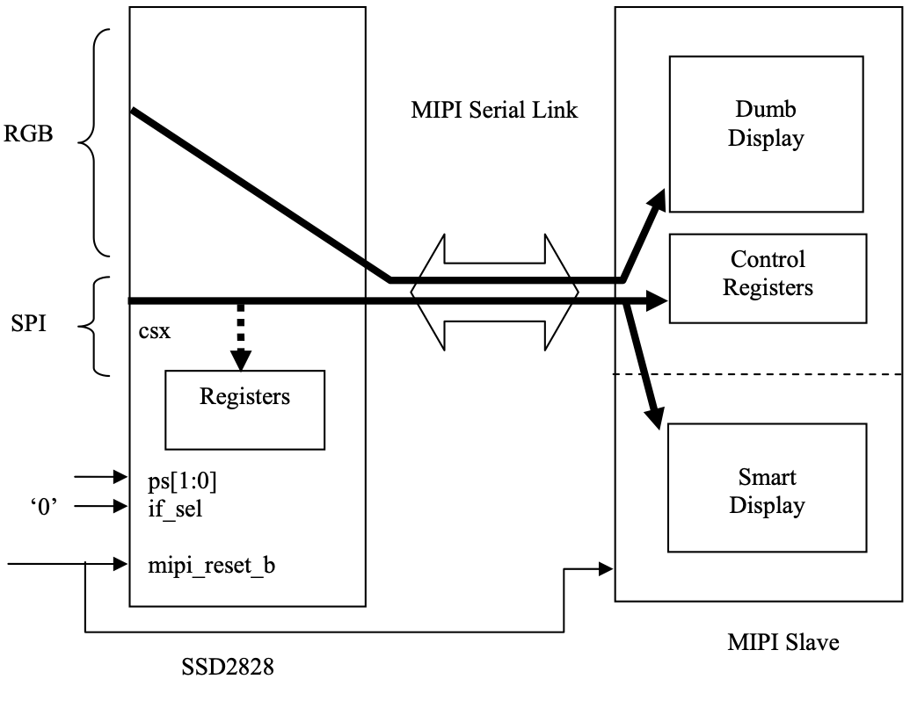

The data for different destinations are separated by the VC field of the packets. The user can program the register VCR to set the VC field. When this configuration is used, the primary usage of the serial link is for sending display video data to the dumb panel. If there is a need to send non-video data through SPI interface concurrently, the SSD2828 can put them into generic write or DCS write packet and interleave them with the video packets.

<!-- pdf:104 -->

If the non-burst video mode is selected, the non-video data packet will only be sent during vertical blanking period. If burst video mode is selected, the non-video data packet can be sent during both horizontal and vertical blanking period (e.g. BLLP period).

During both horizontal and vertical blanking period, the serial link can either remain in HS mode (sending blanking packet) or enter LP mode. The non-video data can also be sent in HS or LP mode. Options have been provided for whether to use HS or LP mode for the blanking period and whether to send the non-video data in HS or LP mode. The NVD and BLLP bits in register VICR6 are provided for this purpose. Please refer to the table below for details.

**Table 9-2: Operation during Video Mode BLLP Period**

| NVD | BLLP | Non-burst mode | Burst mode |
|---|---|---|---|
| 0 | 0 | If there is no non-video data to send, the serial link will send blanking packet in HS mode during BLLP period. If there is non-video data to send, the non-video data will be sent in HS mode. Afterwards, the serial link will send blanking packet in HS mode for the remaining period of BLLP period. | If there is no non-video data to send, the serial link will enter LP mode during BLLP period. If there is non-video data to send, non-video data will be sent in HS mode. Afterwards, the serial link will enter LP mode for the remaining period of BLLP period. |
| 0 | 1 | If there is no non-video data to send, the serial link will enter LP mode during BLLP period. If there is non-video data to send, non-video data will be sent in HS mode. Afterwards, the serial link will enter LP mode for the remaining period of BLLP period. | Same as non-burst mode. |
| 1 | x | The serial link will enter LP mode for BLLP mode. If there is non-video data to send, the data will be sent in LP mode at the beginning of BLLP period. | Same as non-burst mode. |

<!-- pdf:105 -->

#### 9.2.2 MIPI DC Characteristics

Different State Code of the DSI represents different DC voltage levels in the Data and Clock Lanes as stated in below table.

**Table 9-3: DSI State Code and DC Characteristics**

| Code Line Voltage Levels Dp-Line Dn-Line |
|---|
| -0 HS Low |
| -1 HS High |
| 00 LP Low |
| 01 LP Low |
| 10 LP High |
| 11 LP High |

As shown in Figure 9-2, the logic level is different in different state.

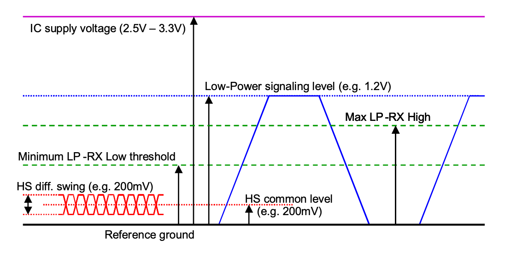

<!-- pdf:106 -->

#### 9.2.3 High Speed Clock Transmission

In High-Speed mode the Clock Lane provides a low-swing, differential DDR (half-rate) clock signal from Master to Slave for High-Speed Data Transmission. The Clock Start and Stop procedures are shown in the following figure.

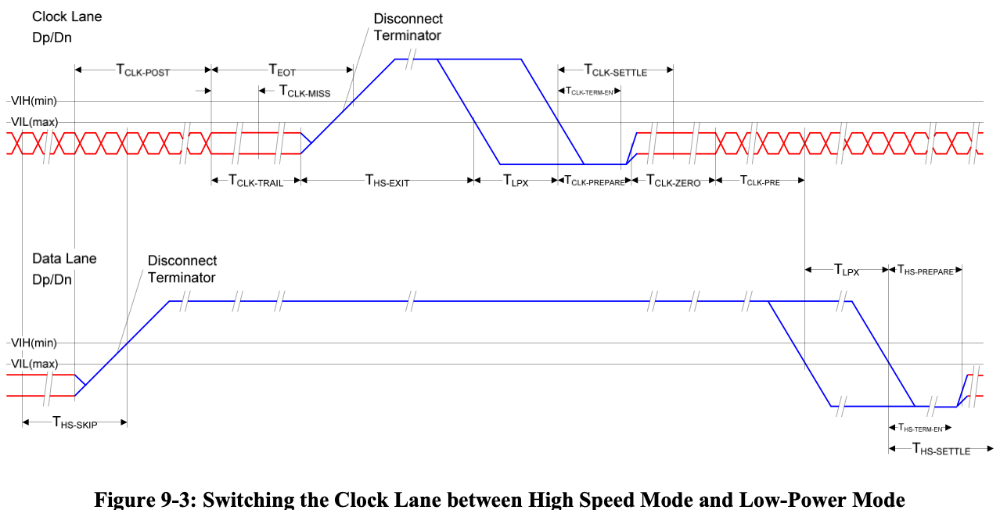

#### 9.2.4 Data Lane State Flow

There are three modes that the Data Lane can be driven into:

1. High Speed Data Transmission

2. Bi-Directional Data Lane Turnaround

3. Escape Mode

**Table 9-4: Data Lane Mode Entering/Exiting Sequences**

| Mode | Entering Mode Sequences | Exiting Mode Sequences |
|---|---|---|
| High Speed Data Transmission | LP-11 =>LP-10 =>LP-00 =>LP-01 =>LP- 00 | LP-00 =>LP-10 =>LP- 11 |
| Bi-Directional Data Lane Turnaround | LP-11 =>LP-01 =>LP-00 =>HS-0 | (HS-0 or HS-1) =>LP-11 |
| Escape | LP-11 =>LP-10 =>LP-00 =>LP-10 =>LP- 00 | High-Z |

<!-- pdf:107 -->

#### 9.2.5 High Speed Data Transmission

High-Speed Data Transmission occurs in bursts. Transmission starts from, and ends with, a Stop state. During

the intermediate time between bursts a Data Lane shall remain in the Stop state, unless a Turnaround or

Escape request is presented on the Lane. During a HS Data Burst the Clock Lane shall be in High-Speed

mode, providing a DDR Clock to the Slave side.

After a Transmit request, a Data Lane leaves the Stop state and prepares for High-Speed mode by means of a Start-of-Transmission (SoT) procedure. Table 9-5 describes the sequence of events on TX and RX side.

**Table 9-5: Start-of-Transmission Sequence**

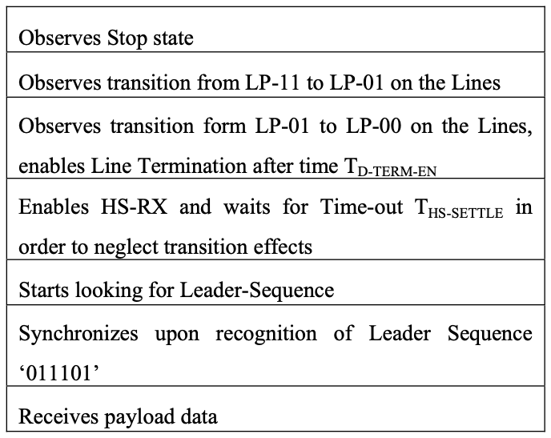

At the end of a Data Burst, a Data Lane leaves High-Speed Transmission mode and enters the Stop state by

means of an End-of-Transmission (EoT) procedure. Table 9-6 shows a possible sequence of events during the

EoT procedure. Note, EoT processing may be handled by the protocol or by the D-PHY.

**Table 9-6: End-of-Transmission Sequence**

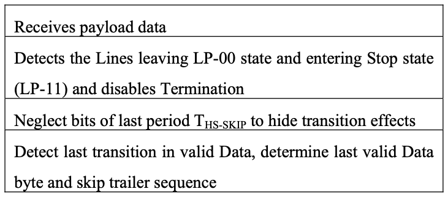

<!-- pdf:108 -->

The following shows the sequence of the high speed data transmission including SoT data.

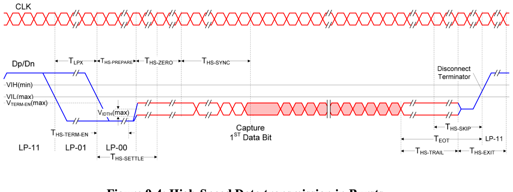

<!-- pdf:109 -->

#### 9.2.6 Bi-Directional Data Lane Turnaround

The transmission direction of a bi-directional Data Lane can be swapped by means of a Link Turnaround procedure. This procedure enables information transfer in the opposite direction of the current direction. The procedure is the same for either a change from Forward-to-Reverse direction or Reverse-to-Forward direction.

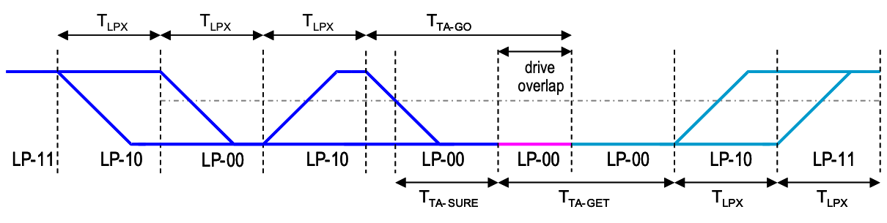

#### 9.2.7 Escape Mode

Escape mode is a special mode of operation for Data Lanes using Low-Power states. With this mode some

additional functionality becomes available. Escape mode operation shall be supported in the Forward

direction and is optional in the Reverse direction. If supported, Escape mode does not have to include all

available features.

A Data Lane enters Escape mode via an Escape mode Entry procedure (LP-11, LP-10, LP-00, LP-01, LP-00).

As soon as the final Bridge state (LP-00) is observed on the Lines the Lane shall enter Escape mode in Space

state (LP-00). If an LP-11 is detected at any time before the final Bridge state (LP-00), the Escape mode Entry

procedure shall be aborted and the receive side shall wait for, or return to, the Stop state.

For Data Lanes, once Escape mode is entered, the transmitter shall send an 8-bit entry command to indicate

the requested action. Table 9-7 lists all currently available Escape mode commands and actions. All

unassigned commands are reserved for future expansion.

<!-- pdf:110 -->

The Stop state is be used to exit Escape mode and cannot occur during Escape mode operation because of the

Spaced-One-Hot encoding. Stop state immediately returns the Lane to Control mode. If the entry command

doesn’t match a supported command, that particular Escape mode action shall be ignored and the receive side

waits until the transmit side returns to the Stop state.

**Table 9-7: MIPI Escape Mode Entry Code**

| Escape Mode Action | Command Type | Entry Command Pattern (first bit transmitted to last bit transmitted) |
|---|---|---|
| Low-Power Data Transmission | mode | 11100001 |
| Ultra-Low Power State | mode | 00011110 |
| Undefined-1 | mode | 10011111 |
| Undefined-2 | mode | 11011110 |
| Reset-Trigger [Remote Application] | Trigger | 01100010 |
| Tearing Effect | Trigger | 01011101 |
| Acknowledge | Trigger | 00100001 |
| Unknown-5 | Trigger | 10100000 |

<!-- pdf:111 -->

#### 9.2.8 Low Power Data Transmission

The Low Power Data Transmission can be started as the following sequences:
- Start: LP-11
- Escape Mode Entry: LP-11, LP-10, LP-00, LP-01,LP-00
- Low Power Data Transmission command: 11100001
  - One or more bytes (8 bit)
  - Pause mode when data lane are stopped
- Exit Escape Mode: LP-00, LP-10, LP-11
- Stop State : LP-11

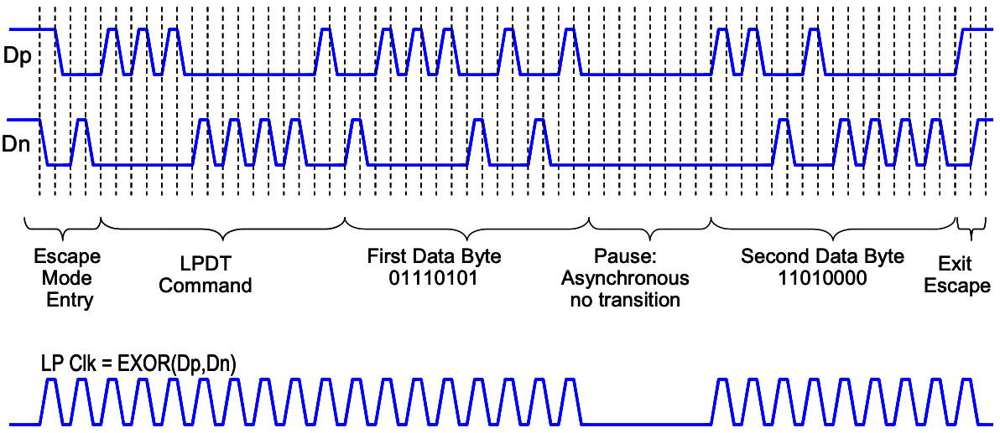

<!-- pdf:112 -->

#### 9.2.9 Reset Trigger

The AP can inform to the display module that it should be reseted in Reset trigger when data lanes are entering in Escape Mode. The Remote Application Reset (RAR) is using a following sequence:
- Start: LP-11
- Escape Mode Entry: LP-11, LP-10, LP-00, LP-01, LP-00
- Remote Application Reset (RAR) command in Escape Mode: 0110 0010 (First to Last bit)
- Mark-1: LP-00, LP-10, LP-11
- Stop State: LP-11

LP-11>10>00>01>00>01>00>10>00>...

|  |  | 0 |  |
|---|---|---|---|
|  |  | 0 | 1 |
|  |  | 0 |  |
| e Mode | Entry | 0 |  |
|  |  | 0 |  |

| 0 | 0 |
|---|---|
| 0 | 0 |
| ntry Co | mmand |

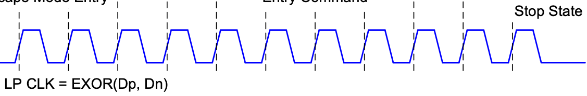

<!-- pdf:113 -->

#### 9.2.10 Tearing Effect

The display module can inform to the AP when a tearing effect event (New V-synch) has been happen on the display module by Tearing Effect (TEE).

The Tearing Effect (TEE) is using a following sequence:
- Start: LP-11
- Escape Mode Entry (EME): LP-11, LP-10, LP-00, LP-01, LP-00
- Tearing Effect: 0101 1101 (First to Last bit)
- Mark-1: LP-00, LP-10, LP-11
- Stop State: LP-11

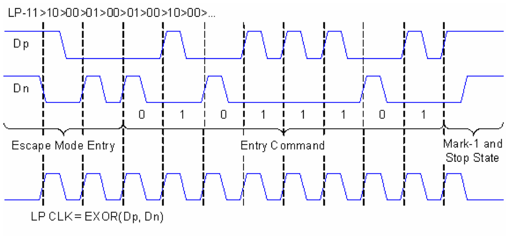

<!-- pdf:114 -->

#### 9.2.11 Acknowledge

The display module can inform to the AP when an error has not recognized on it by Acknowledge (ACK). The Acknowledge (ACK) is using a following sequence:
- Start: LP-11
- Escape Mode Entry: LP-11, LP-10, LP-00, LP-01, LP-00
- Acknowledge (ACK) command: 0010 0001 (First to Last bit)
- Mark-1: LP-00 =>LP-10 =>LP-11
- Stop State: LP-11

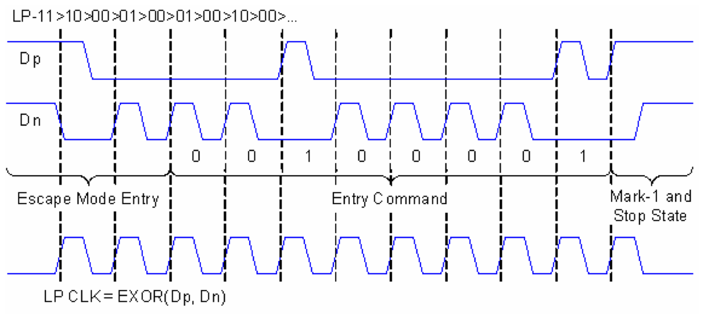

<!-- pdf:115 -->

#### 9.2.12 Packet Transmission

SSL MIPI CORE supports two data transmission defined in MIPI DSI specification.

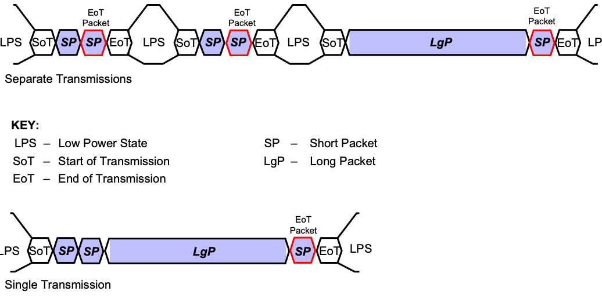

#### 9.2.13 HS Transmission Example

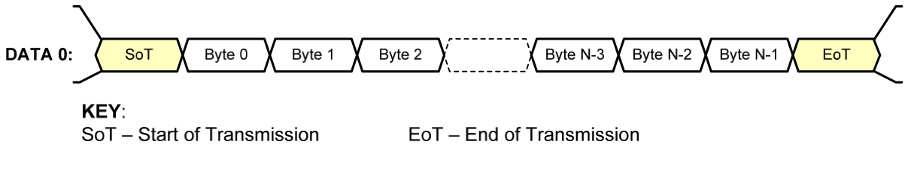

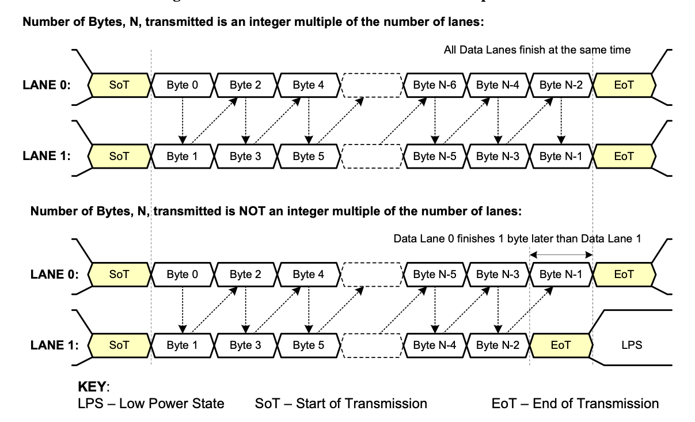

<!-- pdf:116 -->

#### 9.2.14 General Packet Structure

Two packet structures are defined for low-level protocol communication: Long packets and Short packets. For both packet structures, the Data Identifier is always the first byte of the packet. All packet data traverses the interface as bytes. Sequentially, a transmitter shall send data LSB first, MSB last. For packets with multi-byte fields, the least significant byte shall be transmitted first unless otherwise specified.

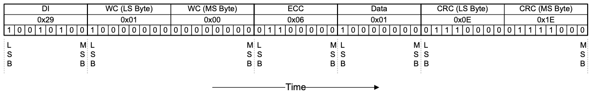

#### 9.2.15 Long Packet Format

Figure 9-14 shows the structure of the Long packet. A Long packet shall consist of three elements: a 32-bit Packet Header (PH), an application-specific Data Payload with a variable number of bytes, and a 16-bit Packet Footer (PF). The Packet Header is further composed of three elements: an 8-bit Data Identifier, a 16- bit Word Count, and 8-bit ECC. The Packet Footer has one element, a 16-bit checksum. Long packets can be from 6 to 65,541 bytes in length.

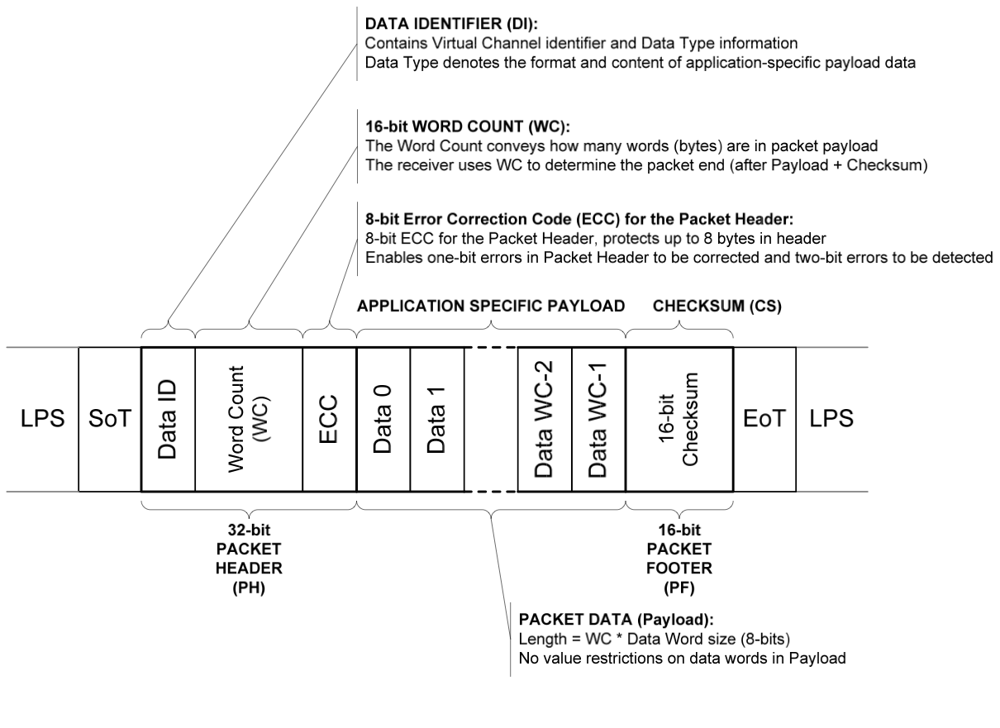

<!-- pdf:117 -->

#### 9.2.16 Short Packet Structure

Figure 9-15 shows the structure of the Short packet. A Short packet shall contain an 8-bit Data ID followed by two command or data bytes and an 8-bit ECC; a Packet Footer shall not be present. Short packets shall be four bytes in length. The Error Correction Code (ECC) byte allows single-bit errors to be corrected and 2-bit errors to be detected in the Short packet.

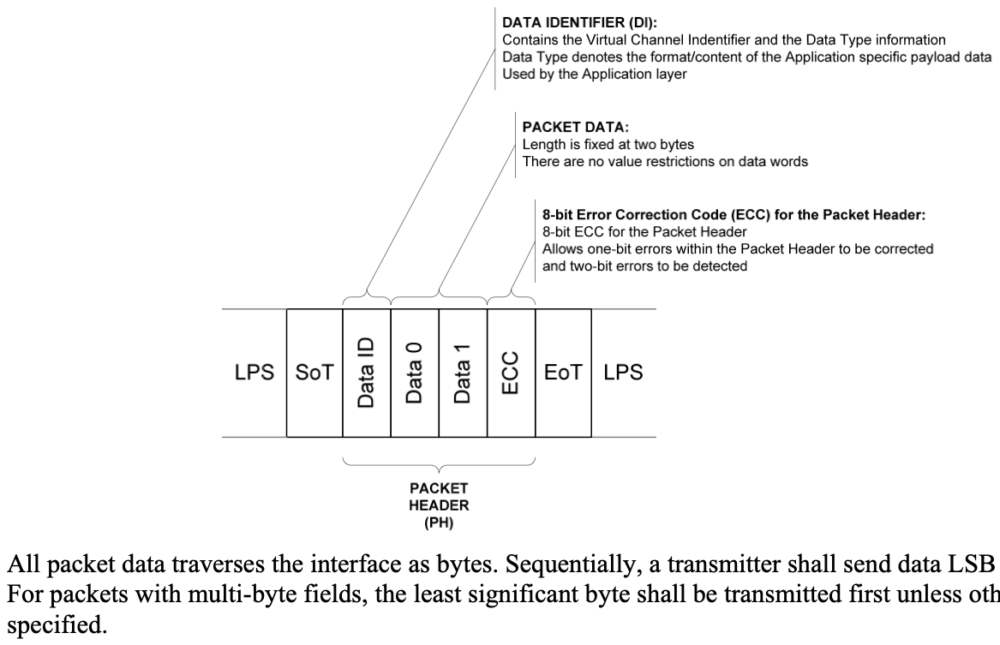

Figure 9-13 shows a complete Long packet data transmission. Note, the figure shows the byte values in standard positional notation, i.e. MSB on the left and LSB on the right, while the bits are shown in chronological order with the LSB on the left, the MSB on the right and time increasing left to right.

#### 9.2.17 Data Identifier (DI)

The Data Identifier defines the Virtual Channel for the data and the Data Type for the application specific payload data.

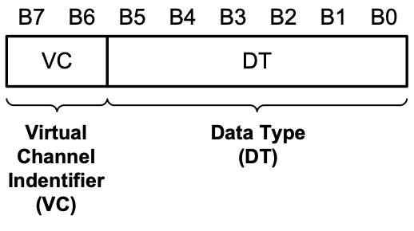

<!-- pdf:118 -->

#### 9.2.18 Victual Channel Identifier (VC)

The VC is the address of the channel between the AP and the display modules. During the data transactions, both AP and display module will use the same VC for communication. In SSD2085, the VC for the command mode is 0x02H and the VC for the video mode is 0x01H.

#### 9.2.19 Data Type (DT)

There are two groups of Data Type:
- Processor to Display Module,
- Display Module to Processor

**Table 9-8: Data Types for Processor-sourced Packets**

| Data Type, hex | Data Type, binary | Description | Packet Size |
|---|---|---|---|
| 01h | 00 0001 | Sync Event, V Sync Start | Short |
| 11h | 01 0001 | Sync Event, V Sync End | Short |
| 21h | 10 0001 | Sync Event, H Sync Start | Short |
| 31h | 11 0001 | Sync Event, H Sync End | Short |
| 08h | 00 1000 | End of Transmission (EoT) packet | Short |
| 02h | 00 0010 | Color Mode (CM) Off Command | Short |
| 12h | 01 0010 | Color Mode (CM) On Command | Short |
| 22h | 10 0010 | Shut Down Peripheral Command | Short |
| 32h | 11 0010 | Turn On Peripheral Command | Short |
| 03h | 00 0011 | Generic Short WRITE, no parameters | Short |
| 13h | 01 0011 | Generic Short WRITE, 1 parameter | Short |
| 23h | 10 0011 | Generic Short WRITE, 2 parameters | Short |
| 04h | 00 0100 | Generic READ, no parameters | Short |
| 14h | 01 0100 | Generic READ, 1 parameter | Short |
| 24h | 10 0100 | Generic READ, 2 parameters | Short |
| 05h | 00 0101 | DCS WRITE, no parameters | Short |
| 15h | 01 0101 | DCS WRITE, 1 parameter | Short |
| 06h | 00 0110 | DCS READ, no parameters | Short |
| 37h | 11 0111 | Set Maximum Return Packet Size | Short |
| 09h | 00 1001 | Null Packet, no data | Long |

<!-- pdf:119 -->

| Data Type, hex | Data Type, binary | Description | Packet Size |
|---|---|---|---|
| 19h | 01 1001 | Blanking Packet, no data | Long |
| 29h | 10 1001 | Generic Long Write | Long |
| 39h | 11 1001 | DCS Long Write/write_LUT Command Packet | Long |
| 0Eh | 00 1110 | Packed Pixel Stream, 16-bit RGB, 5-6-5 Format | Long |
| 1Eh | 01 1110 | Packed Pixel Stream, 18-bit RGB, 6-6-6 Format | Long |
| 2Eh | 10 1110 | Loosely Packed Pixel Stream, 18-bit RGB, 6-6-6 Format | Long |
| 3Eh | 11 1110 | Packed Pixel Stream, 24-bit RGB, 8-8-8 Format | Long |
| x0h and xFh, unspecified | xx 0000 xx 1111 | DO NOT USE All unspecified codes are reserved |  |

**Table 9-9: Data Types for Peripheral-sourced Packets**

| Data Type, hex | Data Type, binary | Description | Packet Size |
|---|---|---|---|
| 00h – 01h | 00 000x | Reserved | Short |
| 02h | 00 0010 | Acknowledge and Error Report | Short |
| 03h – 07h | 00 0011 – 00 0111 | Reserved |  |
| 08h | 00 1000 | End of Transmission (EoT) packet | Short |
| 09h – 10h | 00 1001 – 01 0000 | Reserved |  |
| 11h | 01 0001 | Generic Short READ Response, 1 byte returned | Short |
| 12h | 01 0010 | Generic Short READ Response, 2 bytes returned | Short |
| 13h – 19h | 01 0011 – 01 1001 | Reserved |  |
| 1Ah | 01 1010 | Generic Long READ Response | Long |
| 1Bh | 01 1011 | Reserved |  |
| 1Ch | 01 1100 | DCS Long READ Response | Long |
| 1Dh – 20h | 01 1101 – 10 0000 | Reserved |  |
| 21h | 10 0001 | DCS Short READ Response, 1 byte returned | Short |
| 22h | 10 0010 | DCS Short READ Response, 2 bytes returned | Short |
| 23h – 3Fh | 10 0011 – 11 1111 | Reserved |  |

<!-- pdf:120 -->

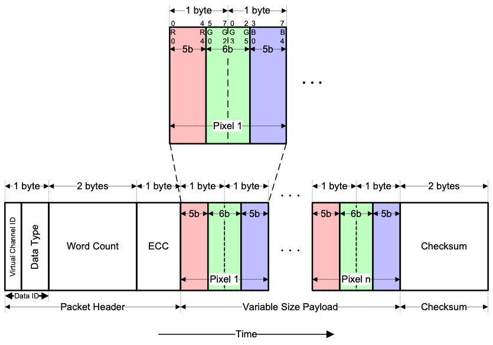

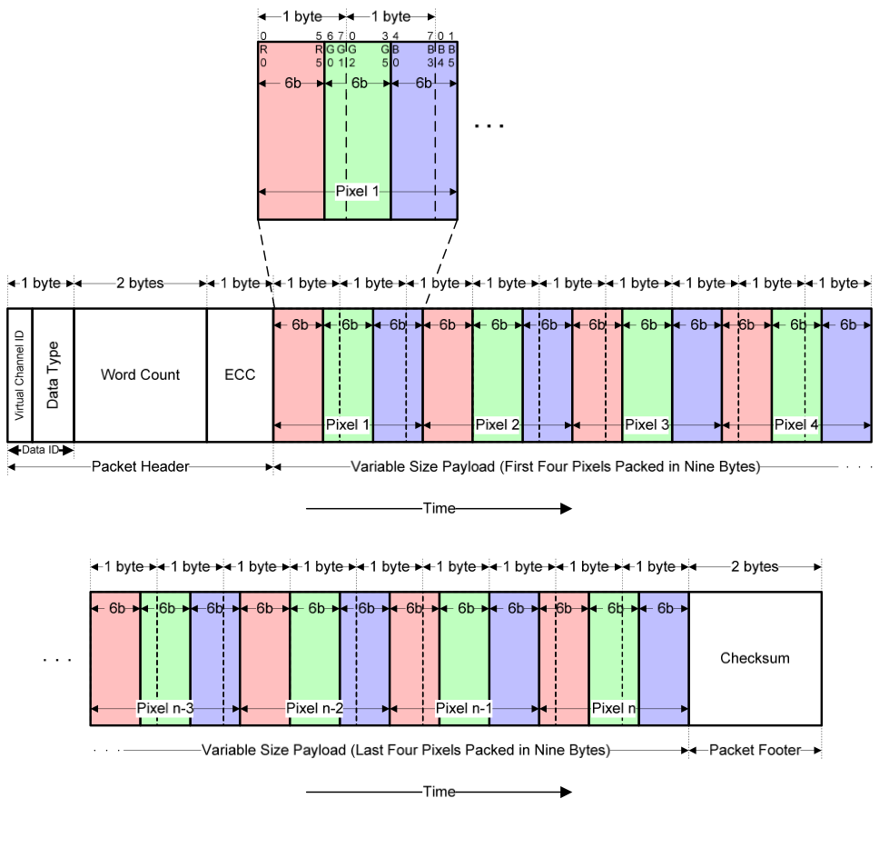

<!-- pdf:121 -->

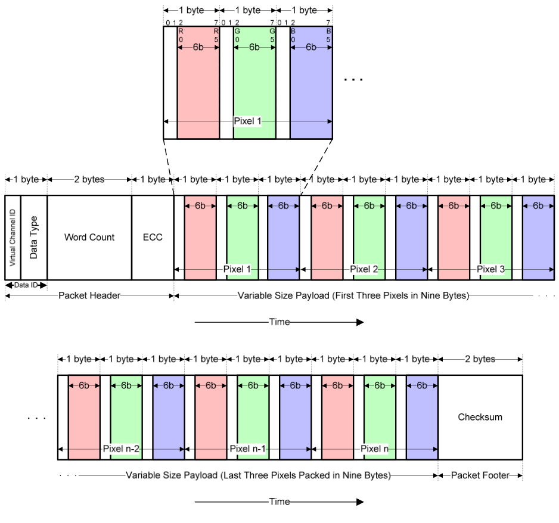

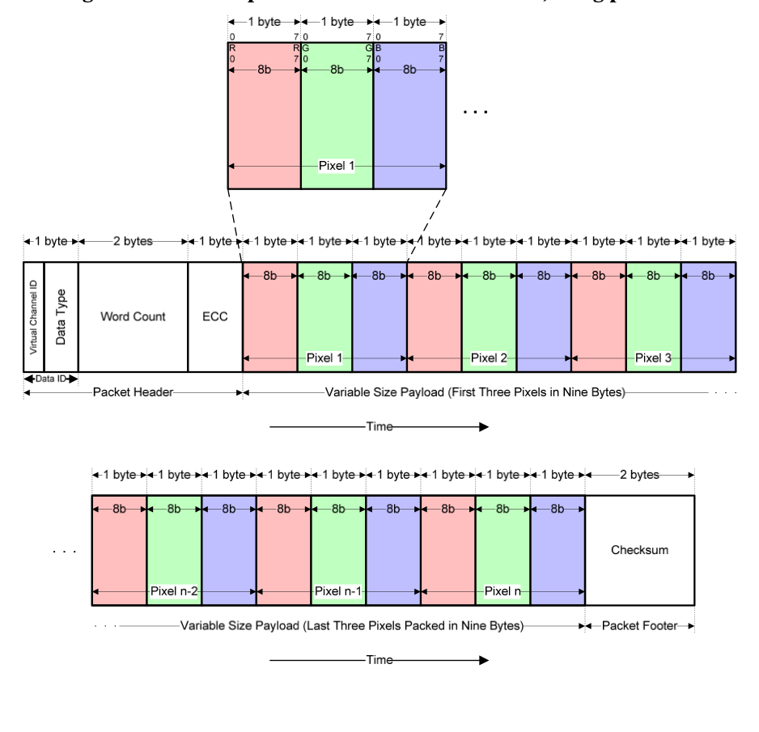

<!-- pdf:122 -->

### 9.3 Operating Modes

The video data come from the RGB interface and the configuration is done through the SPI interface. To support different bpp settings, the following data pins are used. For all cases, R should be at the upper bits and B should be at the lower bits.

- data[15:0] for 16 bpp.

- data[17:0] for 18 bpp, packed.

- data[17:0] for 18 bpp, loosely packed.

- data[23:0] for 24 bpp.

The user, first, needs to program the registers VICR1 to VICR6 with correct values. The user also needs to program the END and CO bits to 0 and 1 respectively. After programming those register fields, the user can turn on the RGB interface and enable the VEN bit to start transmission. All three video mode sequence defined in the MIPI DSI specification are supported.

In Non-Burst Mode, the CSS (register 0xB7 bit 5) can be set to 0 or 1. When it is set to 1 to select the pclk as PLL reference clock, the PLL multiplication factor should be equal to the bpp value. When it is set to 0 to select the tx_clk as PLL reference clock, the PLL multiplication factor should be set such that the serial link data rte is faster than the incoming data rate. Please refer to the table below for the PLL settings. Registers VICR1 to VICR6 (0xB1 to 0xB6) needs to be programmed. (VICR1 is not used for non-burst mode with Sync Events). (VICR1 is not used for non-burst mode with Sync Events.) Below is the diagram to illustrate the definition of all the fields.

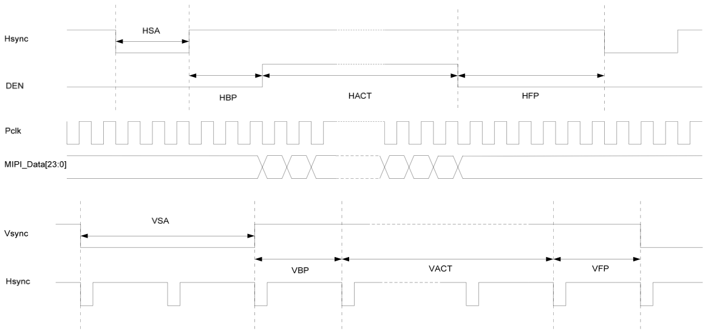

<!-- pdf:123 -->

**Table 9-10: PLL Setting for Non-burst Mode (PLL reference using pclk)**

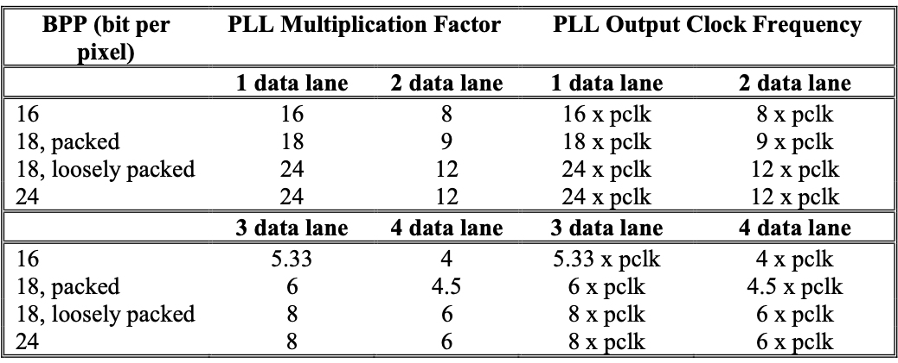

**Table 9-11: PLL Setting for Non-burst Mode (PLL reference using tx_clk)**

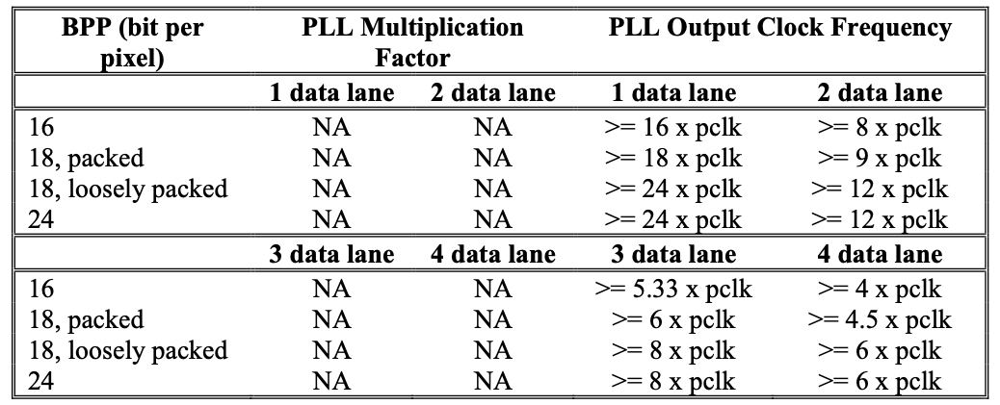

In Burst Mode, the CSS (register 0xB7 bit 5) needs to be set to 0 to select the tx_clk as PLL reference clock. The PLL multiplication factor should be set such that the serial link data rate is faster than the incoming data rate. Please refer to the table below for the PLL settings. Registers VICR2 to VICR6 (0xB1 to 0xB6) needs to be programmed. VICR1 is not used for this mode. The definition of all the fields is the same as non-burst mode with Sync Events.

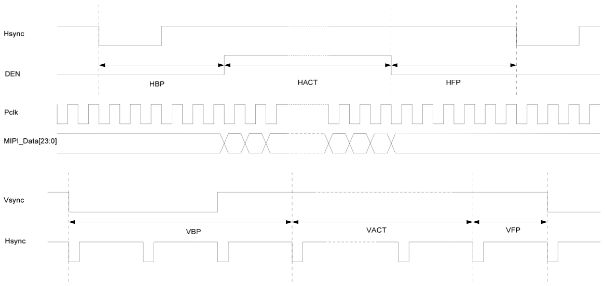

<!-- pdf:124 -->

**Table 9-12: PLL Setting for Burst Mode**

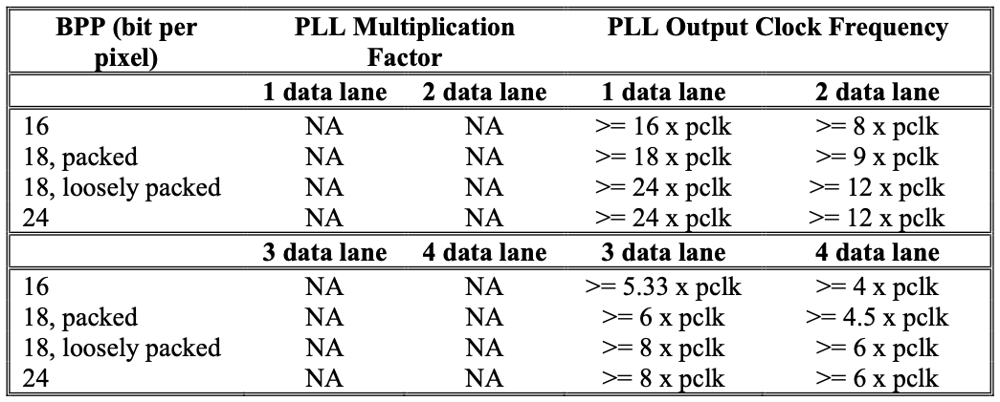

*: This value should be set such that the serial link data rate is faster than incoming data rate

The SSD2828 will also monitor the status of CM and SHUT signal. When there is a change of these signals, it will send out appropriate packets. On the rising edge of CM, the CM on packet will be sent. On the falling edge of CM, the CM off packet will be sent. On the rising edge of SHUT, the Shut Down Peripheral packet will be sent. On the falling edge of SHUT, the Turn On Peripheral packet will be sent. With these packets, the MIPI slave will be able to reconstruct the RGB interface signals.

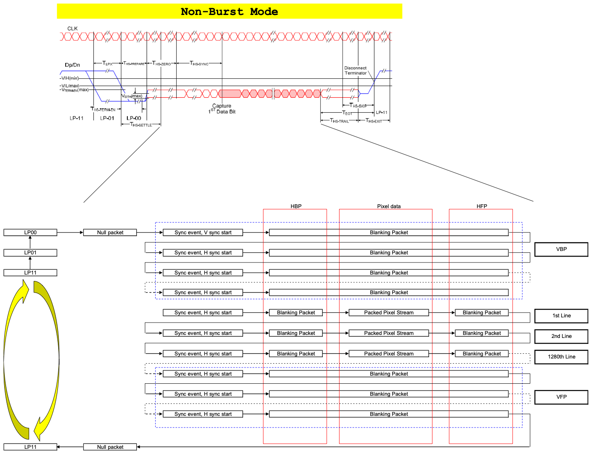

<!-- pdf:125 -->

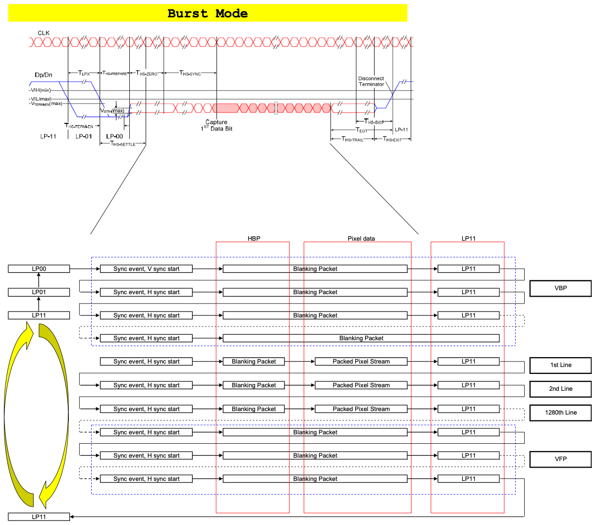

<!-- pdf:126 -->

9.3.1.1 Write Operation

To perform write operation, the user needs to set the REN bit to 0. The SSD2828 can issue four kinds of packets for write operation, which are Generic Short Write Packet, Generic Long Write Packet, DCS Short Write Packet and DCS Long Write Packet. The bit DCS controls whether Generic Write Packet or DCS Write Packet will be sent out. The VC1 or VC2 field determines the VC ID of the outgoing packets. (Please see the 8.1.9 for the difference between VC1 and VC2.)

The SSD2828 needs to know the payload size of the outgoing packets. Hence, the user needs to program the corresponding control registers. PSCR1 and PSCR2 form the TDC field that indicates the total number of payload bytes.

To send a DCS Write Packet, the user needs to write the DCS command/header and the payload to the register PDR and DCS bit set to 1. If the TDC field is no more than 2, the SSD2828 will send out DCS Short Write Packet with the correct type. Otherwise, DCS Long Write Packet will be sent out.

To send a Generic Write Packet, the user needs to write the payload to the register PDR and DCS bit set to 0. If the TDC field is no more than 2, the SSD2828 will send out Generic Short Write Packet with the correct type. Otherwise, Generic Long Write Packet will be sent out.

For DCS Write Packet, the partition is only enabled if the DCS command is 0x2C or 0x3C. Otherwise, SSD2828 will not perform automatic partition. (This is because the DCS command 0x2C and 0x3C are to write display data into the LCD panel display memory.) The payload will be partitioned into a few packets where the payload of each packet is PST bytes. The first byte is the DCS command and the following PST bytes are the payload. Only the last packet might contain less payload, as the total payload might not be integer multiple of PST. If the incoming DCS command is 0x2C, the DCS command for the first packet is 0x2C and the DCS command for all other packets is 0x3C. If the incoming DCS command is 0x3C, the DCS command of all the packets is 0x3C.

For example, in the raw data mode(IFC=0), if the TDC field is 200 and PST field is 80, 3 packets will be sent. The first two have 80 bytes of payload. The last packet has 40 bytes of payload.

After performing a write operation, the user can optionally make a BTA to let the MIPI slave report its status. This is done by setting FBW bit to 1. The SSD2828 will automatically make a BTA after each write operation. Please refer to 0 for how to handle the acknowledgement received.

<!-- pdf:127 -->

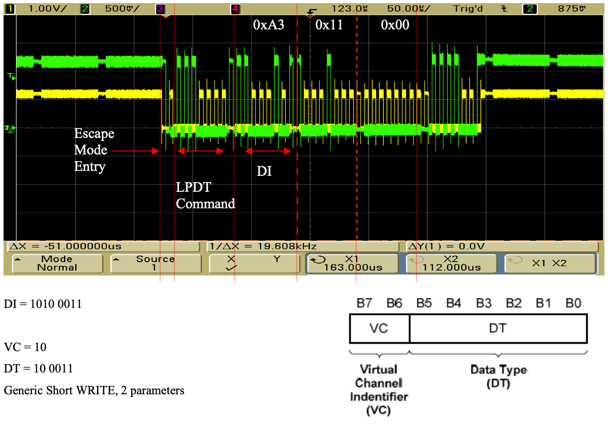

<!-- pdf:128 -->

9.3.1.2 Read Operation

To perform read operation, the user needs to set the REN bit to 1. The SSD2828 can issue two kinds of packets for read operation, which are Generic Read Packet, and DCS Read Packet. The bit DCS controls whether Generic Read Packet or DCS Read Packet will be sent out. The VC1 or VC2 field determines the VC ID of the outgoing packets. (Please see the 8.1.9 for the difference between VC1 and VC2.)

Before the read packet is sent out, the SSD2828 will always send out the Set Maximum Return Size Packet. This is to limit the Read Response Packet sent by the MIPI slave such that there is no over flow. Two factors determine the maximum size. One is the limit of the SSD2828 and the other is the limit of the application processor. The user should choose the smaller one among these two limits to use as the maximum return size.

The parameter in the Set Maximum Return Size Packet is taken from register MRSR. The user could program the MRSR before every read so that the correct value is sent through Set Maximum Return Size Packet. If the value in the MRSR is already the desired value, the user can choose not to program it. The SSD2828 will always automatically send out Set Maximum Return Size Packet using the value in MRSR.

To send a DCS Read Packet, the user just needs to write the DCS command (as there is no parameter for DCS read) to PDR register and DCS bit set to 1.

To send a Generic Read Packet, the user needs to write the payload to the register PDR and DCS bit set to 0.

Similar to the write operation, the TDC field is used to determine the payload size of the outgoing packet. For DCS Read Packet, the payload is just the DCS command. There is no parameter associated. For Generic Read Packet, the SSD2828 will send out the correct packet type according to the TDC value.

After sending out the read packet, the SSD2828 will automatically perform a BTA to wait for the Read Response Packet from the MIPI slave. The return data will be stored in register RR. No matter what read packet is sent out, there is only one packet returning data. Therefore, no matter whether the read is DCS read or Generic read, no matter what command is used in DCS read, the return data is always stored in register RR. The user can read the data out when the RDR bit is set to 1. After seeing RDR bit been set to 1, the user should first read register RDCR which contains the number of bytes returned by the MIPI slave. By using this information, the user will know how many data should be read out from register RR. After all the return data are read out, the RDR bit will be set to 0 by the SSD2828.

After the RDR bit been set to 1, the user can choose not to read the data out from register RR. The user can continue performing another operation. Once the user does so, the RDR bit will be set to 0 by the SSD2828.

There might be Acknowledge and Error Report Packet sent by the MIPI slave at the same time. The operation of acknowledgement handling is described in 0.

Under certain circumstance, the MIPI slave might only send back Acknowledge and Error Report Packet without any data. Thus, the RDR bit will not be set. Therefore, it is recommended that the user check the bit BTAR first. The BTAR is to indicate whether the MIPI slave has passed the bus authority back to the SSD2828 or not. Only when the BTAR is 1, there might be return data. If there is no return data, the user should follow 0 to handle the acknowledgement.

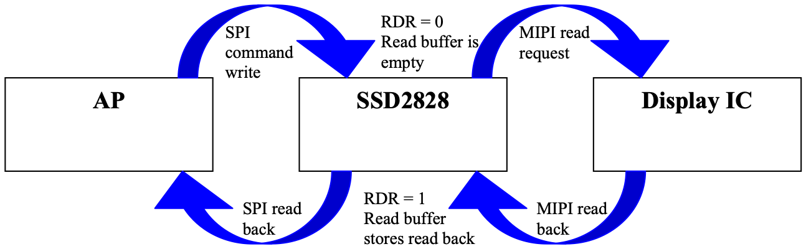

data

<!-- pdf:129 -->

MIPI read back

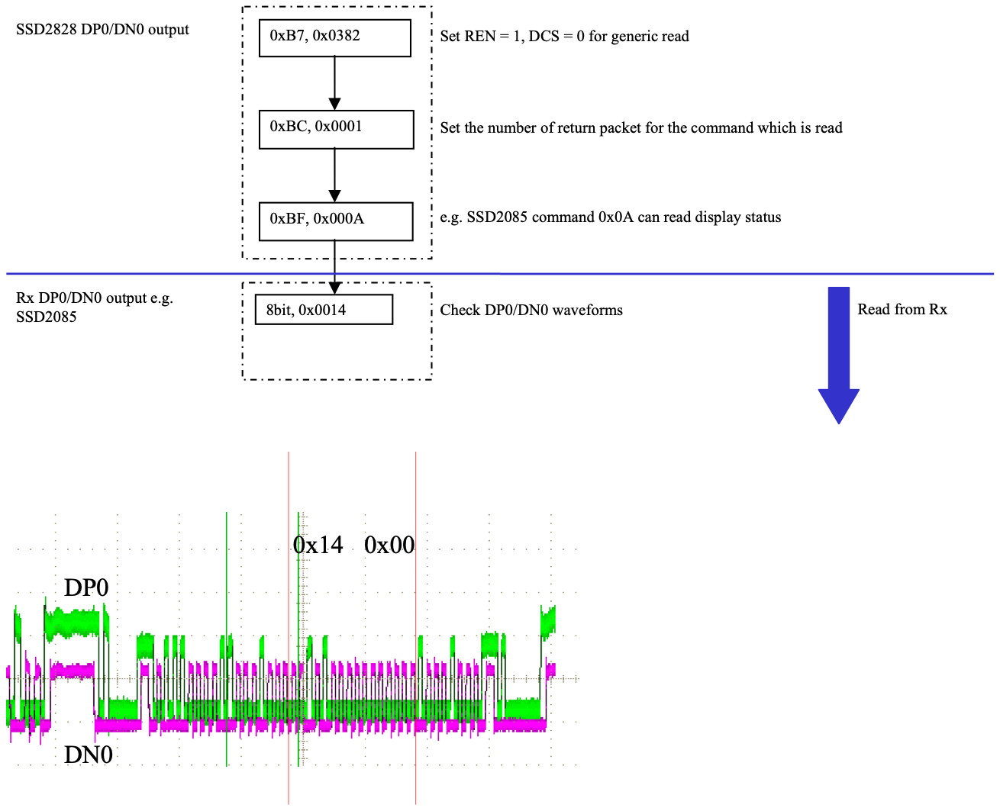

<!-- pdf:130 -->

9.3.1.3 Acknowledgement Operation

The SSD2828 can perform a BTA to give the bus authority to the MIPI slave and let it report its status. The BTA can be enabled by setting FBW bit to 1 and performing a write operation, or just performing a read operation. After the MIPI slave passes the bus authority back, the SDD2828 will set bit BTAR to 1.

If there is no error on the slave side, the MIPI slave will return ACK trigger message, if the packet before BTA is a write packet. The MIPI slave will return Read Response Packet, if the packet before BTA is a read packet. In this case, after receiving the response from the MIPI slave, SSD2828 will set bit ARR and ATR bits to 1. ARR indicates that response has been received from MIPI slave. ATR indicates that the MIPI slave has reported no error with ACK trigger message. Consequently, the register ARSR will be cleared to 0.

If there is error on the slave side, the MIPI slave will return Acknowledge and Error Report packet, if the packet before BTA is a write packet. The MIPI slave will return Read Response Packet (depending on the error type) and Acknowledge and Error Report Packet, if the packet before BTA is a read packet. In this case, after receiving the response from the MIPI slave, SSD2828 will set bit ARR bit to 1 and ATR bits to 0. ARR indicates that response has been received from MIPI slave. ATR indicates that the MIPI slave has sent Acknowledge and Error Report Packet instead of ACK trigger message. Therefore, the MIPI slave has reported error. The error reported by the MIPI slave will be stored in register ARSR. The user can read this register to see what error the MIPI slave has encountered.

For the detailed description of each error bit, please refer to MIPI DSI specification. Below are the flow charts of handling the MIPI slave acknowledgement. They are just for reference.

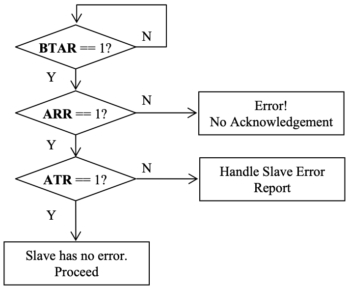

<!-- pdf:131 -->

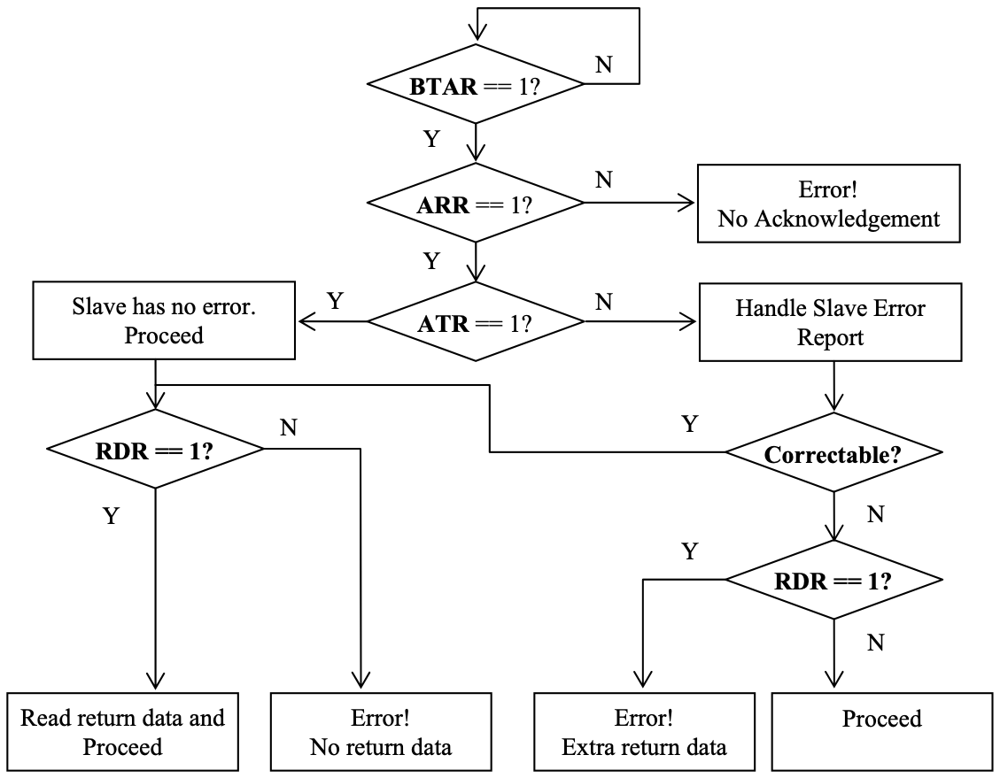

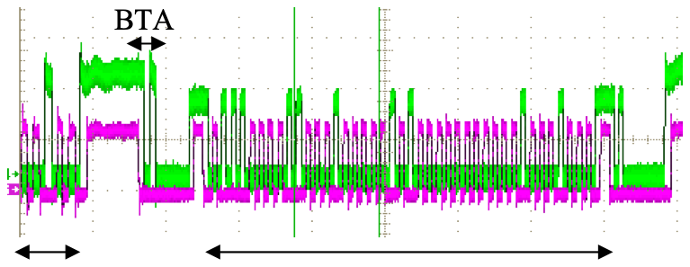

Tx Rx Read return data

Remark: LP clock of Rx must be within 10% of Tx LP clock

<!-- pdf:132 -->

| Bit | Description |
|---|---|
| 0 | SoT Error |
| 1 | SoT Sync Error |
| 2 | EoT Sync Error |
| 3 | Escape Mode Entry Command Error |
| 4 | Low-Power Transmit Sync Error |
| 5 | Peripheral Timeout Error |
| 6 | False Control Error |
| 7 | Contention Detected |
| 8 | ECC Error, single-bit (detected and corrected) |
| 9 | ECC Error, multi-bit (detected, not corrected) |
| 10 | Checksum Error (Long packet only) |
| 11 | DSI Data Type Not Recognized |
| 12 | DSI VC ID Invalid |
| 13 | Invalid Transmission Length |
| 14 | Reserved |
| 15 | DSI Protocol Violation |

**Table 9-13: MIPI error report**

<!-- pdf:133 -->

9.3.1.4 Tearing Effect (TE) Operation

The TE operation is to perform a BTA following the previous BTA without transmitting anything in between. The bus is handed to the MIPI slave for providing TE information. After getting the TE event from display driver, the MIPI slave will pass the bus authority back to the SSD2828 by using BTA trigger message.

The TE operation can be enabled by setting bit FBT and FBW to 1 before writing the last command to the MIPI slave. Afterwards, the application processor can instruct the SSD2828 to send out the last command in a write packet. Since FBW is 1, the SSD2828 will automatically perform a BTA after the write operation. The MIPI slave will response and pass the bus authority back. Since FBT is 1, the SSD2828 will perform another BTA without sending any data. This makes the MIPI slave enter TE mode.

The MIPI slave will send a TE trigger message back when it gets the TE event. After getting the trigger message, the SSD2828 will set the TE pin to 1 to indicate that TE event has been received. DATA[16] is used as the TE pin. At the same time, bit TER will be set to 1. The application processor can write 1 to this bit to clear it. As the TE trigger message only determines when the TE pin will be set to 1, a counter is used to determine when to set the TE pin to 0. The TE pin will be set to 0, once the counter reaches the value in TEC. The counter uses the reference clock to do counting.

If the MIPI slave does not send back the TE trigger message but just perform a BTA to pass the bus back, the SSD2828 will automatically perform another BTA to pass the bus to the MIPI slave again. It will continue do so until the MIPI slave respond with the TE trigger message, or the FBT bit is set to 0, or the LP RX timer expires.

If the MIPI slave does not send back the TE trigger message and still holds the bus, the user can set the bit FBC to 1 to force a bus contention. After bus contention is resolved, the slave will pass the bus back to SSD2828.

9.3.1.5 Contention Detection and Timer Operation

Two timers have been defined in SSD2828 to resolve the potential contention issue on the bus. The two timers are the HS TX timer and LP RX timer. Please see the register description for the detailed usage.

Whenever the SSD2828 sees a contention being detected, it will reset the state machine and enter the default mode, which is LP TX idle mode. The data line will be kept at LP11.

9.3.1.6 Interrupt Operation

An interrupt signal int_0/int_1 has been provided to interrupt the application processor so that it does not need to poll the status all the time. This will save the processing time of the application processor. int_0/int_1 is an active low signal, in other words, when the event has happened, it will go low.

There are many sources that can be mapped to the interrupt signal. The user can select different source to perform different task. If more than 1 source is selected, the int_0/int_1 signal will go low when the event for 1 of the sources has happened. In this case, the user needs to read the register ISR to determine what event has happened. The different sources can be enabled/disabled through register ICR. Below is the list of available interrupt sources and their usage.

RDR

To indicate that return data from MIPI slave is available for read.

BTAR

To indicate whether the SSD2828 has the bus authority or not. It can be used after SSD2828 makes a BTA. If the MIPI slave has returned the bus authority back to SSD2828, the interrupt will be set to indicate so. Please note that, on power up, the bus authority is already on the SSD2828. Hence, the SSD2828 will show that it has the bus authority.

ARR

To indicate whether the SSD2828 has received the acknowledge response from the MIPI slave. The acknowledge response can either report error or not error. This is to be determined by the ATR bit.

The above three interrupts are provided to the user to handle reading data from the MIPI slave or getting acknowledgement response from the MIPI slave.

<!-- pdf:134 -->

PLS

To indicate whether the PLL has been locked or not. If the PLL is not locked, the programming speed at the external interface must be slow. After changing the PLL setting or changing the reference clock source, the user also needs to use this interrupt to determine the PLL status.

On power up, only PLS interrupt is enabled. This is to let the user determine the programming speed before configuring the SSD2828.

LPTO

To indicate that there is LP RX time out.

HSTO

To indicate that there is HS TX time out.

The above two interrupts are provided to the user for error handling.

PO

To indicate whether the SSD2828 is ready to accept any data from the user. The SSD2828 has several internal buffers to hold the data written by the user. When the user writes after than the serial link speed, those buffers will be full. If the user still writes data to SSD2828, those data will be lost. The length of the payload of the next packet that the user is going to write is determined by TDC, PST, and DCS fields. The SSD2828 will use these fields to decide whether the user can write the next packet or not. Hence, after programming the above mentioned fields, the user needs to check the interrupt status before writing.

SE, SA, SLE, SLA, MLE, MLA

All these interrupts are provided to indicate the status of the internal data buffers. They are used if the user is familiar with the buffer management of the SSD2828. Otherwise, it is recommended to use the PO interrupt.

One important thing to note is the interrupt latency. The output interrupt signal does not change immediately after an operation. This is due to the internal processing of the SSD2828. For example, after changing the interrupt source from one to another, the output int_0/int_1 level will remain at the old level for a short period after the programming is done. Another example is that after programming the TDC field, the interrupt will take a short period to reflect the correct PO status on int_0/int_1. There is always a delay between the actual event and the interrupt.

In order to guarantee that the user can get the correct interrupt, it is recommended that the user performs a read of any SSD2828 local register before taking in the interrupt signal or polling the interrupt status bits. The read operation will cover the interrupt latency period. Alternatively, the user can wait for certain amount of time to make sure the interrupt reflects the true status. Below is a diagram for illustration.

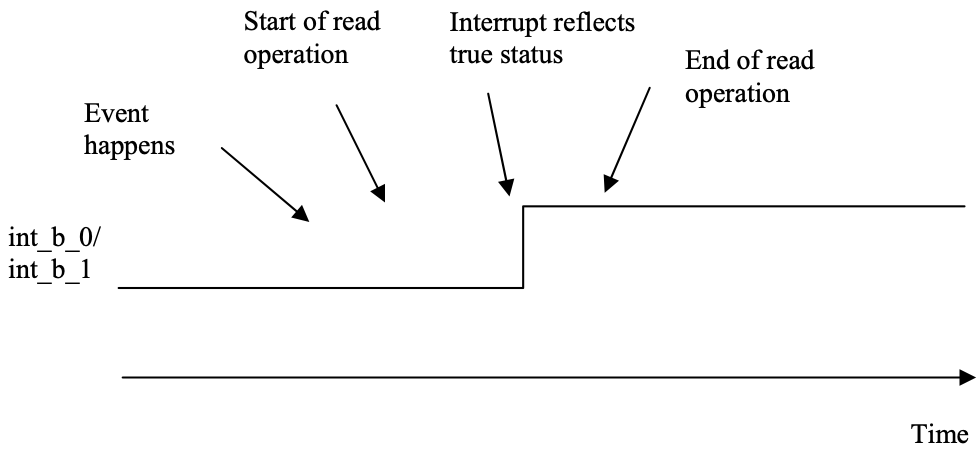

<!-- pdf:135 -->

9.3.1.7 Internal Buffer Status

There are totally 1 data buffer inside the SSD2828QN4, which is SPI command interface buffer (CB).

For CB buffers, all packets will be stored into them. They can store multiple packets and each packet size can be set to 1023 bytes. Below is a list of possible packets

- Generic Short Write Packet

- Generic Read Packet

- DCS Short Write Packet

- DCS Read Packet

- Generic Long Write Packet

- DCS Long Write Packet

In case of automatic partitioning, the packet length is determined by the PST field. It is not recommended to make the PST field so small.

The user can write the data through SPI interface. All packets will be written into the CB buffers. Hence, the user needs to check the corresponding interrupts. The usage of the interrupts is listed below.

CBE

To indicate that the Command buffer is empty.

CBA

To indicate that the Command buffer can hold at least 1 more packet. The user can write 1 such packet into CB buffer.

The interrupts mentioned here can be used as flow control between the application processor and the SSD2828. However, it requires the user to know the buffer operation well. The PO interrupt is a combination of the eight. It makes decision according to the parameters provided by the user for the next packet to be written. Hence, the user does not need to know which buffer is going to be used and how the buffer status is.

#### 9.3.2 State machine operation

The state machine controls the sending and receiving of the data packet over the serial link. It is triggered by an event from the application processor or the received data. Once a complete packet is written into the SSD2828 buffer, it will send it out through the serial link. The user can write 1 to bit COP at any time to cancel all the current operations. Please see 8.1.17 for the description.

When the SSD2828 is in high speed mode, the serial link is mainly used to send display data. If there is no data to send, it will send null packet to maintain the serial link timing. If the application processor does not have display data to send in a long period, it can turn the serial link into low power mode by setting the register bit HS to 0.

When the SSD2828 is in low power mode, the serial link is mainly used to send command and configuration data. If there is no data to sent, the SSD2828 will be idle in LP TX stop mode.

The user can also enter sleep mode by writing 1 to SLP bit. Once the SLP bit is set to 1, the SSD2828 will automatically enter LP mode. If the HS bit is 1, the SSD2828 will clear the HS bit to 0 and switch from HS to LP mode. Afterwards, the SSD2828 will issue ULPS trigger message to the MIPI slave to enter Ultra Low Power State. During this state, the clock to SSD2828 can be switched off such that the SSD2828 only consumes leakage current. This will save the overall system power consumption. When exiting from the ULPS, the user can write 0 to SLP bit. However, the user should be aware that the time to exit from ULPS is relatively long (pleaser refer to MIPI DPHY specification). Hence, the user cannot perform any data transmission before the system exits from ULPS.

<!-- pdf:136 -->

During reception, the state machine will disassemble the incoming data packet and put the received register content into the internal buffer for reading out. Once all the data are put into the buffers, it will set the register bit RDY to 1 to indicate that the SSD2828 is ready for read. The total number of received bytes will also be stored in RDCR.

After the reception is completed, the SSD2828 will perform a bus turn around to enter the transmission mode. It will always come back to the LP TX stop mode before it enters any other mode.

#### 9.3.3 D-PHY operation

D-PHY controls the operation of the analog transceiver. It controls whether the serial link is in high speed or low power mode and whether it’s in transmit or receive mode.

In transmit mode, the D-PHY will perform the handshaking procedure when switching between LP mode and HS mode according to the control from PCU. During HS mode, D-PHY will provide parallel data and clock to the analog transmitter for transmitting in differential signals serially. During LP mode, D-PHY will directly drive the Datap and Datan line output. It will provide serial data to the analog transmitter.

In receive mode, D-PHY will detect the handshaking sequence in LP mode and inform the PCU. Once entering escape mode, it will collect the serial data from analog receiver and put them in byte form for the PCU to process.

Various timing parameter has been defined in MIPI DPHY specification. The timing parameters are a mixture of absolute time and cycle counts. Hence, for different operation speed, there is different timing requirement. Registers DAR1 to DAR6 are provided for this purpose. The user can adjust the value in these registers to have different DPHY timing parameters. This gives maximum flexibility for different operation speed.

<!-- pdf:137 -->

#### 9.3.4 Analog Transceiver

#### 9.3.5 PLL

The PLL output frequency is calculated by the equations below,

f IN f PRE = MS f OUT = f PRE * NS

where the f IN is the input reference clock frequency and f OUT is the output clock frequency of the PLL.

The clock frequencies need to satisfy the constraint below.

5MHz > f IN ≥ 100MHz 5MHz > f REF ≥ 100MHz 62.5MHz > f OUT ≥ 1000MHz

The value of FR, MS, and NS are controlled in the register PLCR.

All the values of FR, MS and NS can only be modified when the PLL is turned off. Hence, the sequence for modification is to turn off PLL, modify register value, and turn on PLL.

<!-- pdf:138 -->

#### 9.3.6 Clock Source Example

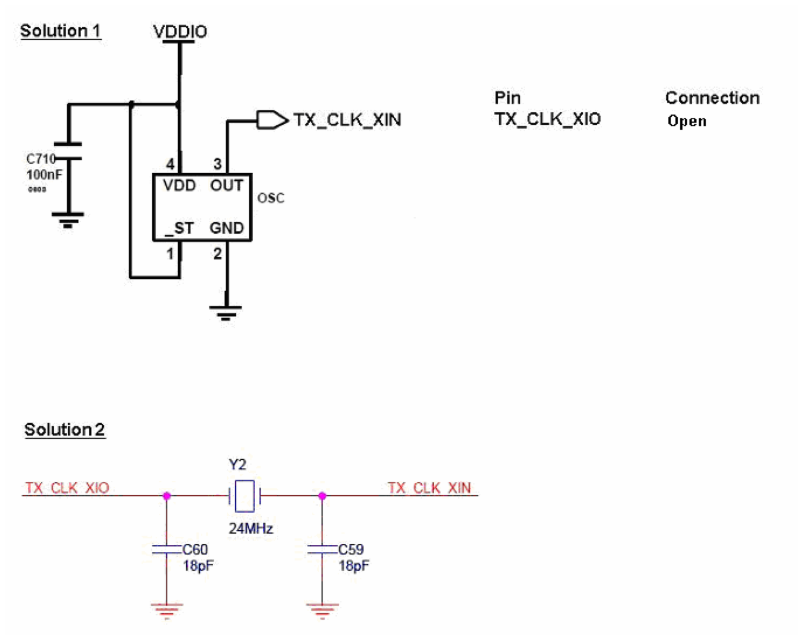
