# 10 External Interface

<!-- pdf:139 -->

The SSD2828 supports three types of SPI interface,

- 8-Bit 3 wire (type C option 1, DBI 2.0)

- 8-Bit 4 wire (type C option 3, DBI 2.0)

- 24-bit 3 wire

and RGB interfaces.

The selection is controlled by ps[1:0] pins.

RGB interface supports 4 bpp settings. Below are the data pins used for each interface. For all cases, R should be at the upper bits and B should be at the lower bits.

- data[15:0] for 16 bpp.

- data[17:0] for 18 bpp, packed.

- data[17:0] for 18 bpp, loosely packed.

- data[24:0] for 24 bpp.

SPI interface supports 8-Bit data bus. The least significant byte should be written first.

Below is the operation and timing diagram for each of the interfaces.

### 10.1 SPI Interface 8 bit 4 Wire

This interface consists of sdcx, sck, sdin, sdout and csx. It only supports 8-Bit data. Each cycle contains 8- Bit data. The first cycle should be a command write cycle to specify the register address for access. The subsequent cycles are read or write cycles for read or write operations.

The csx should be driven from 1 to 0 to start an operation and from 0 to 1 to end an operation. During 1 operation, the application processor can write or read multiple bytes.

sdcx indicates whether the operation is for data or command. When sdcx itsh 1, the operation is for data. When sdcx is 0, the operation is for command. sdcx is sampled at every 8 rising edge of sck during 1 operation.

During write operation, sdin will be sampled by SSD2828 at the rising edge of sck. The first rising edge of sck after the falling edge of csx samples the bit 7 of the 8-Bit tdh ata. The second rising edge of sck samples the bit 6 of the 8-Bit data, and so on. The value of sdcx is sampled at the 8 rising edge of sck, together with bit 0 of the 8-Bit data. Please see the diagram below for illustration. Optionally, the csx can be driven to 1 in between cycles.

<!-- pdf:140 -->

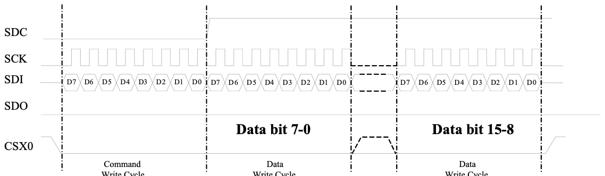

Remark: Send LSB 8bit of data before MSB 8bit

During read operation, since there is no rwx signal to indicate whether the operation is read or write. After csx is driven low, the first cycle is always a command write cycle, which specifies the register to access. The second cycle is still a command write cycle. If the command in this cycle matches the command in register LRR, the SPI interface will enter read mode. The subsequent cycles will be read cycles. If the command does not match, the SPI interface will remain in write mode.

After entering the read mode, the return data is provided on sdout, on the falling edge of sck. The application processor should use the rising edge of sck to sample the data. sdcx should be driven to 1 during the read cycles. Please see the diagram below for illustration. Optionally, the csx can be driven to 1 in between cycles.

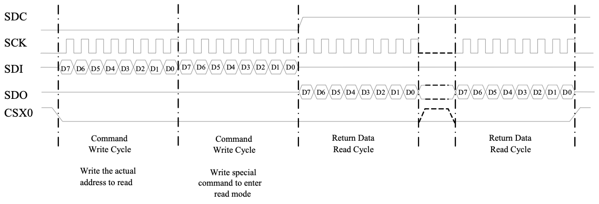

<!-- pdf:141 -->

### 10.2 SPI Interface 8 bit 3 Wire

This interface consists of sck, sdin, sdout and csx. It only supports 8-Bit data. Each cycle contains 8-Bit data. The first cycle should be a write cycle to specify the register address for access. The subsequent cycles are read or write cycles for read or write operations.

The csx should be driven from 1 to 0 to start an operation and from 0 to 1 to end an operation. During 1 operation, the application processor can write or read multiple bytes.

Instead of sdcx, an sdcx bit is used to indicate whether the operation is for data or command. Each byte is associated with an sdcx bit. When sdcx is 1, the operation is for display data. When sdcx is 0, the operation is for command. The sdcx bit is sent priori to each byte. In other words, the sdcx bit is the first bit of every 9 bits during 1 operation.

During write operation, sdin will be sampled by SSD2828 at the rising edge of sck. The first rising edge of sck after the falling edge of csx samples the sdcx bit. The second rising edge samples bit 7 of the 8-Bit data. The third rising edge of sck samples the bit 6 of the 8-Bit data, and so on. Please see the diagram below for illustration. Optionally, the csx can be driven to 1 in between cycles.

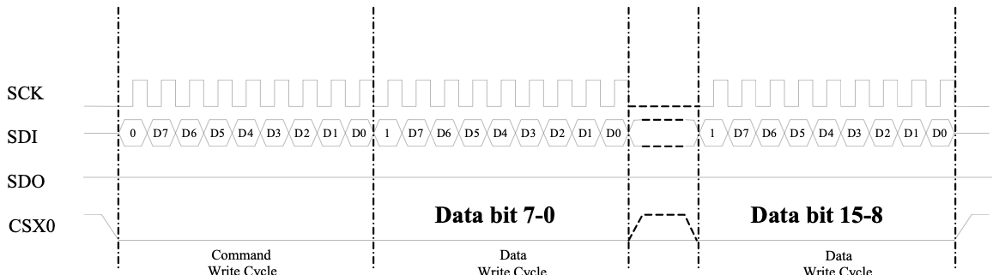

Remark: Send LSB 8bit of data before MSB 8bit

During read operation, since there is no rwx signal to indicate whether the operation is read or write. After csx is driven low, the first cycle is always a command write cycle, which specifies the register to access. The second cycle is still a command write cycle. If the command in this cycle matches the command in register LRR, the SPI interface will enter read mode. The subsequent cycles will be read cycles. If the command does not match, the SPI interface will remain in write mode.

After entering the read mode, the return data is provided on sdout, on the falling edge of sck. The application processor should use the rising edge of sck to sample the data. Please note that there is no sdcx bit to read out from SSD2828. Hence, each read cycle consists of 8-Bits instead of 9 bits. This is the difference between read and write cycles. Please see the diagram below for illustration. Optionally, the csx can be driven to 1 in between cycles.

<!-- pdf:142 -->

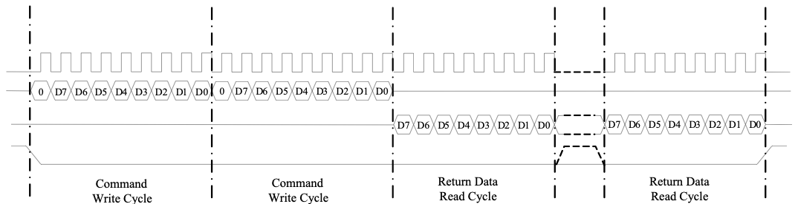

SCK

CSX0

reaudal commreaanddmtoodeenter

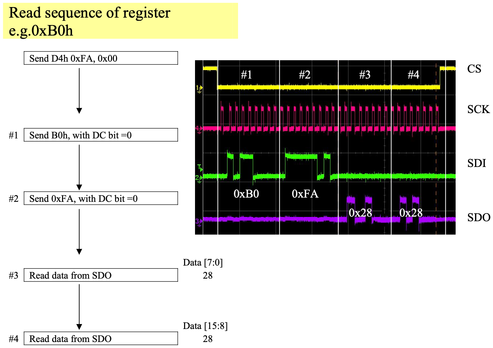

<!-- pdf:143 -->

10.2.1 3 or 4 wires 8bit SPI read back sequence for 0xFF register which is stored MIPI read back data

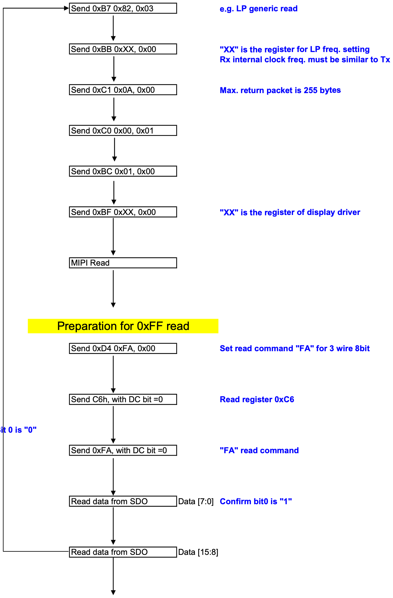

<!-- pdf:144 -->

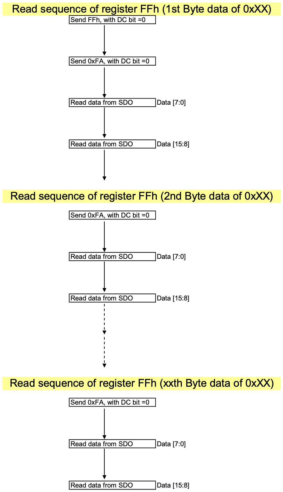

<!-- pdf:145 -->

### 10.3 SPI Interface 24 bit 3 Wire

This interface consists of sck, sdin, sdout and csx. It only supports 16-bit data. Each cycle contains 16-bit data. The first cycle should be a write cycle to specify the register address for access. The subsequent cycles are read or write cycles for read or write operations.

The csx should be driven from 1 to 0 to start cycle and from 0 to 1 to end a cycle. During 1 operation, the application processor can have multiple write or read cycles. However, the csx must go from 0 to 1 at the end of each cycle.

Each cycle contains 24-bit data. Among the 24-bit data, the first 8-Bit are for control purpose and the next 16-bit are the actual data. The first 6 bits are the ID bit for SSD2828, which must be 011100. If this field does not match, the cycle will not be taken in. The 7th bit is the sdcx bit which is the same as the 8-Bit 3 wire interface. The 8th bit is the RW bit which indicates whether the current cycle is a read or write cycle. When RW is 1, the cycle is a read cycle. When RW is 0, the cycle is a write cycle.

During write operation, sdin will be sampled by SSD2828 at the rising edge of sck. Please see the diagram below for illustration. It is an example for writing data 0x1264 to register address 0x28.

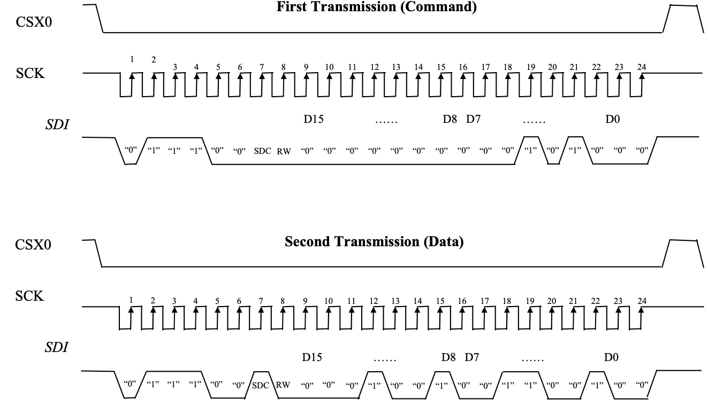

Remark: Send MSB 8bit of data before LSB 8bit

<!-- pdf:146 -->

During read operation, the first 8-Bit are still written by the application processor to specify whether the following 16-bit are for command or data. Afterwards, the SSD2828 will provide the return data on sdout, on the falling edge of sck. The application processor should use the rising edge of sck to sample. Please see the diagram below for illustration.

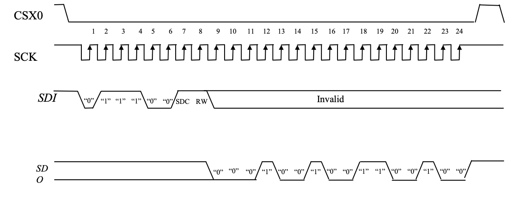

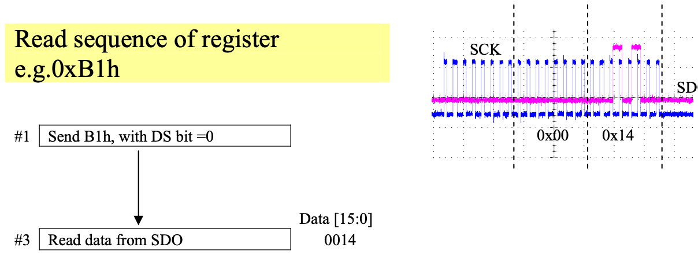

<!-- pdf:147 -->

10.3.1 3 wires 24bit SPI read back sequence for 0xFF register which is stored MIPI read back data

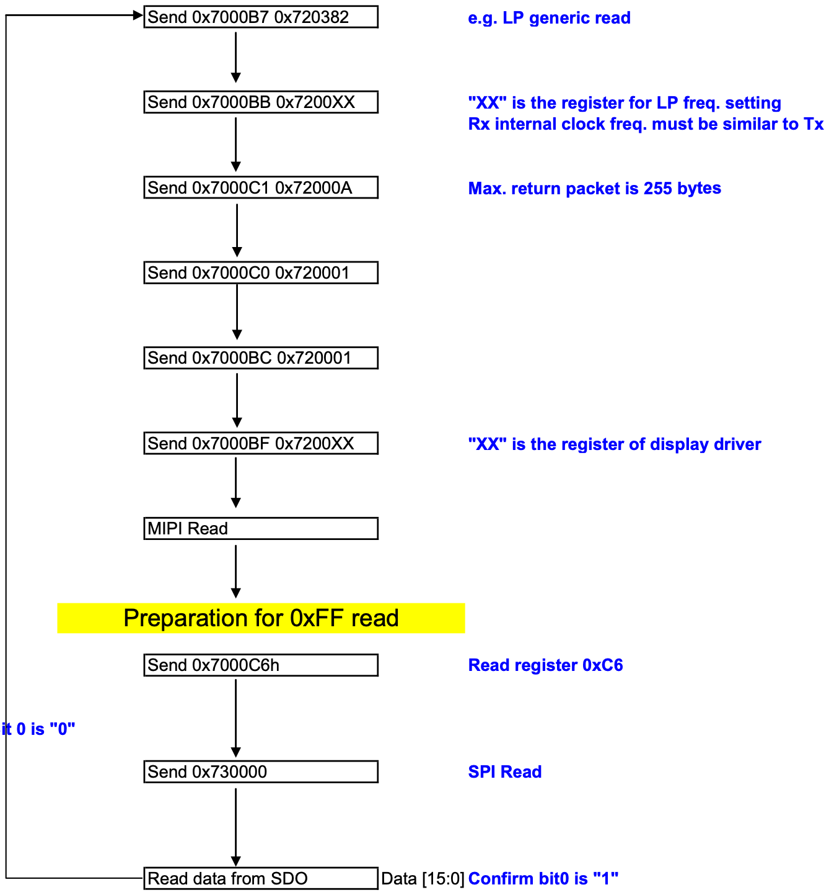

<!-- pdf:148 -->

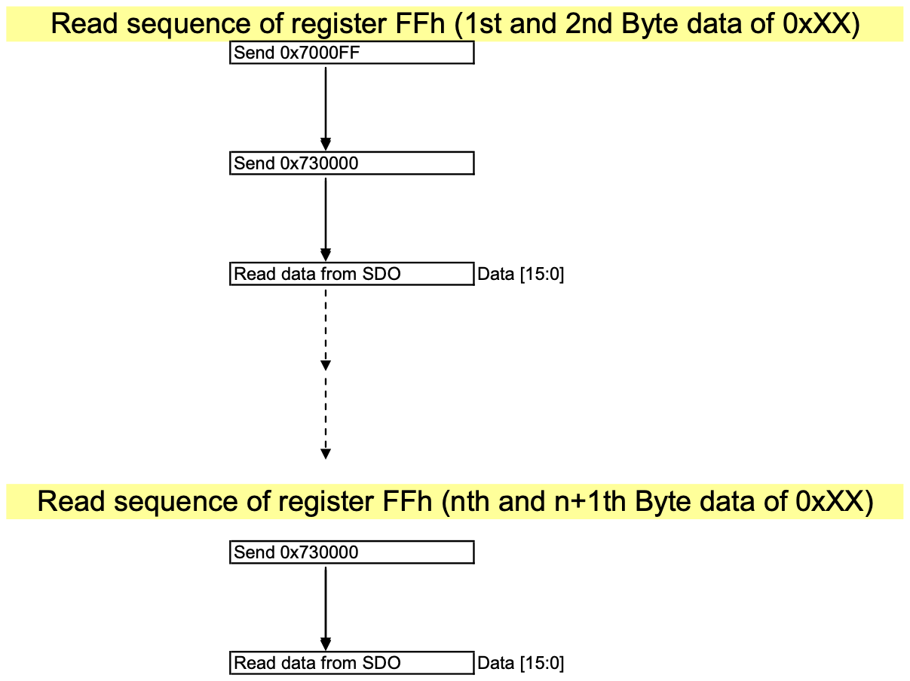
