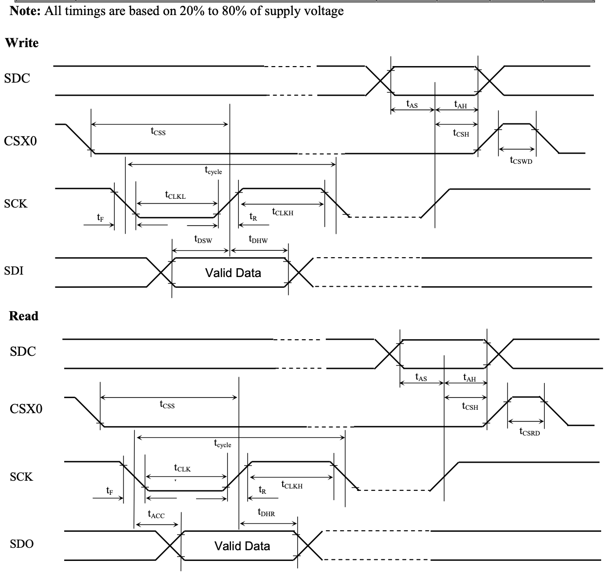
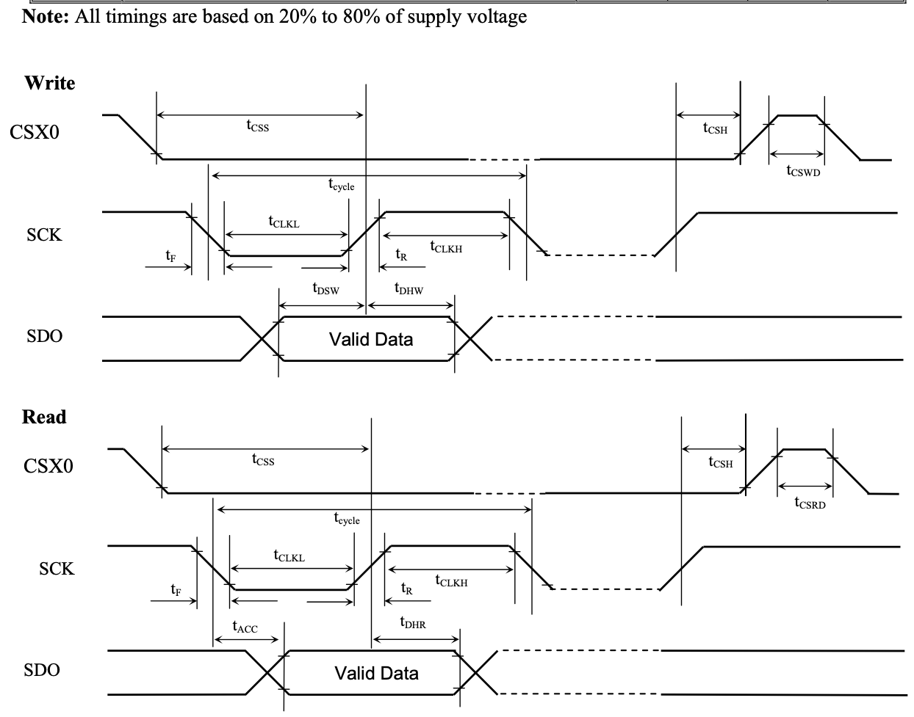
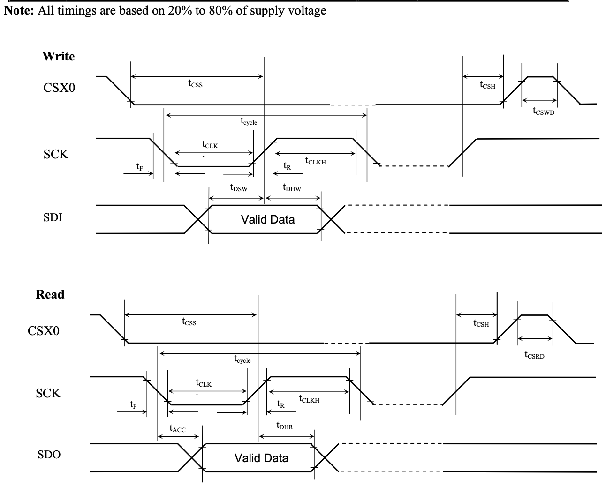
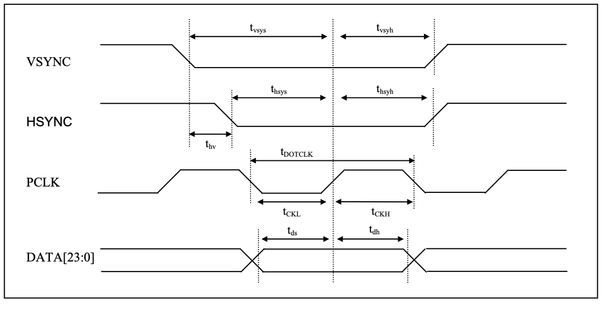
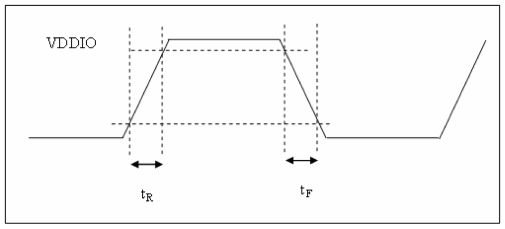

# 14 AC Characteristics

<!-- pdf:153 -->

NOTE:

1. After PLL gets locked, T is the period of the PLL output clock unless specified. Before PLL gets locked, T is the period of PLL input reference clock. The reference clock can be either the tx_clk or the pclk, depending on the CSS bit.

1 / T = PLL / 2,

e.g. When PLL is Off <0xB9 0x0000>,

TX_CLK = 10MHz,

PLL = TX_CLK x 2 = 20Mbps

1 / T = 10MHz

2. W is the width of the display, e.g. the number of pixels for the horizontal line.

3. The AC characteristics specifie the maximum speed of the incoming signals at the input interface. However, the data throughput on the serial link is another factor affecting the speed. If the user takes in the INT signal, there will be automatic flow control. If the user does not take the INT signal, the user needs to ensure that the output throughput is larger than the incoming data rate.

<!-- pdf:154 -->

14.1 8 Bit 4 Wire SPI Interface Timing

**Table 14-1: 8 Bit 4 Wire SPI Interface Timing Characteristics**

| Symbol | Parameter | Min | Typ | Max | Unit |
|---|---|---|---|---|---|
| t_cycle | Clock Cycle Time | 8T |  | - | ns |
| f_CLK | Serial Clock Cycle Time | - |  | 1/8T | MHz |
| t_AS | Register select Setup Time | 4 |  | - | ns |
| t_AH | Register select Hold Time | 0 |  | - | ns |
| t_CSS | Chip Select Setup Time | 4 |  | - | ns |
| t_CSH | Chip Select Hold Time | 0 |  | - | ns |
| t_DSW | Write Data Setup Time | 4 |  | - | ns |
| t_DHW | Write Data Hold Time | 0 |  | - | ns |
| t_ACC | Read Data Access Time | - |  | 4.4+6T | ns |
| t_DHR | Read Data Hold Time | 1.2+4T |  | 4.4+6T | ns |
| t_CLKL | Clock Low Time | 4T |  | - | ns |
| t_CLKH | Clock High Time | 4T |  | - | ns |
| t_CSWD | Chip Select Write Delay Time | 8T |  | - | ns |
| t_CSRD | Chip Select Read Delay Time | 16T |  | - | ns |
| t_R | Rise time | - |  | 2 | ns |
| t_F | Fall time | - |  | 2 | ns |

<!-- pdf:155 -->

14.2 8 Bit 3 Wire SPI Interface Timing

**Table 14-2: 8 Bit 3 Wire SPI Interface Timing Characteristics**

| Symbol | Parameter | Min | Typ | Max | Unit |
|---|---|---|---|---|---|
| t_cycle | Clock Cycle Time | 8T |  | - | ns |
| f_CLK | Serial Clock Cycle Time | - |  | 1/8T | MHz |
| t_CSS | Chip Select Setup Time | 4 |  | - | ns |
| t_CSH | Chip Select Hold Time | 0 |  | - | ns |
| t_DSW | Write Data Setup Time | 4 |  | - | ns |
| t_OHW | Write Data Hold Time | 0 |  | - | ns |
| t_ACC | Read Data Access Time | - |  | 4.4+6T | ns |
| t_DHR | Read Data Hold Time | 1.2+4T |  | 4.4+6T | ns |
| t_CLKL | Clock Low Time | 4T |  | - | ns |
| t_CLKH | Clock High Time | 4T |  | - | ns |
| t_CSWD | Chip Select Write Delay Time | 8T |  | - | ns |
| t_CSRD | Chip Select Read Delay Time | 16T |  | - | ns |
| t_R | Rise time | - |  | 2 | ns |
| t_F | Fall time | - |  | 2 | ns |

<!-- pdf:156 -->

14.3 24 Bit 3 Wire SPI Interface Timing

**Table 14-3: 24 Bit 3 Wire SPI Interface Timing Characteristics**

| Symbol | Parameters | Min | Typ | Max | Units |
|---|---|---|---|---|---|
| t_cycle | Clock Cycle Time | 8T |  | - | ns |
| f_CLK | Serial Clock Cycle Time | - |  | 1/8T | MHz |
| t_CSS | Chip Select Setup Time | 4 |  | - | ns |
| t_CSH | Chip Select Hold Time | 0 |  | - | ns |
| t_DSW | Write Data Setup Time | 4 |  | - | ns |
| t_OHW | Write Data Hold Time | 0 |  | - | ns |
| t_ACC | Read Data Access Time | - |  | 4.4+6T | ns |
| t_DHR | Read Data Hold Time | 1.2+4T |  | 4.4+6T | ns |
| t_CLKL | Clock Low Time | 4T |  | - | ns |
| t_CLKH | Clock High Time | 4T |  | - | ns |
| t_CSWD | Chip Select Write Delay Time | 8T |  | - | ns |
| t_CSRD | Chip Select Read Delay Time | 16T |  | - | ns |
| t_R | Rise time | - |  | 2 | ns |
| t_F | Fall time | - |  | 2 | ns |

<!-- pdf:157 -->

### 14.4 RGB Interface Timing

**Table 14-4: RGB Interface Timing Characteristics**

| Symbol | Parameters | Min | Typ | Max | Units |
|---|---|---|---|---|---|
| t_pclk | pclk Period | 16/18/24T | 16/18/24T |  | ns |
| t_vsys | Vertical Sync Setup Time | 5 |  |  | ns |
| t_vsyh | Vertical Sync Hold Time | 5 |  |  | ns |
| t_hsys | Horizontal Sync Setup Time | 5 |  |  | ns |
| t_hsyh | Horizontal Sync Hold Time | 5 |  |  | ns |
| t_hv | Phase difference of Sync Signal Falling Edge | 0 |  | W | t_pclk |
| t_CKL | pclk Low Period | 8/9/12T | 8/9/12T |  | ns |
| t_CKH | pclk High Period | 8/9/12T | 8/9/12T |  | ns |
| t_ds | Data Setup Time | 3.3 |  |  | ns |
| t_dh | Data hold Time | 3.3 |  |  | ns |

Note:

1. T represents the total bit rate Tmax = 1 / (PLL x number of lane) Tmax = 1 / 4G = 250ps

2. All timings are based on 20% to 80% of supply voltage

3. W is the number of pixel in a horizontal line

4. The pclk period depends on the bit per pixel (bpp) setting and whether the video mode is burst or non-burst mode. In burst mode, the values in the Min column should be followed. In non-burst mode, the values in the Typ column should be followed.

<!-- pdf:158 -->

### 14.5 RESET Timing

**Table 14-5: RESET Timing**

| Symbol | Parameters | Min | Typ | Max | Units |
|---|---|---|---|---|---|
| T_RESET | RESET “Low” Pulse Width | 10 | - | - | ms |

### 14.6 TX_CLK Timing

**Table 14-6: TX_CLK Timing Characteristics**

| Symbol | Parameters | Min | Typ | Max | Units |
|---|---|---|---|---|---|
| f_TXCLK | TX_CLK Frequency | 8 | - | 30 | MHz |
| t_R | Rise Time | - |  | 10 | ns |
| t_F | Fall Time | - |  | 10 | ns |

