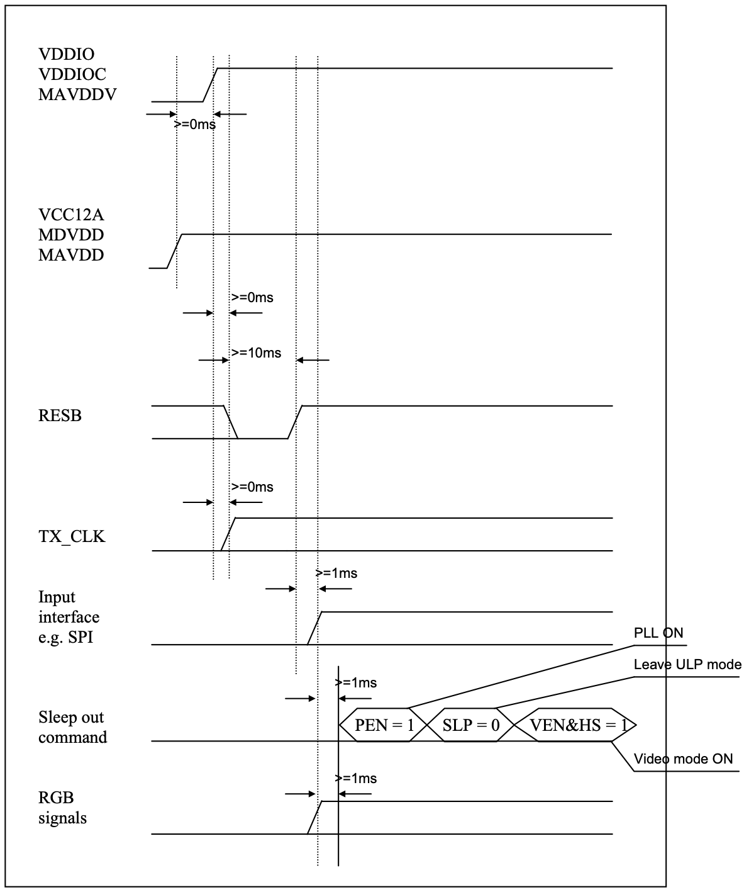

# 15 Power up sequence

<!-- pdf:159 -->

> **Note (derived from the diagram, not verbatim):** power-up order is VDDIO/VDDIOC/MAVDDV → VCC12A/MDVDD/MAVDD → release RESB → TX_CLK → SPI configuration (PEN=1, PLL on) → leave ULPS → SLP=0 and VEN&HS=1 (video mode) → RGB signals. The minimum gaps (>=0 ms / >=1 ms / >=10 ms) are marked on the figure only.
