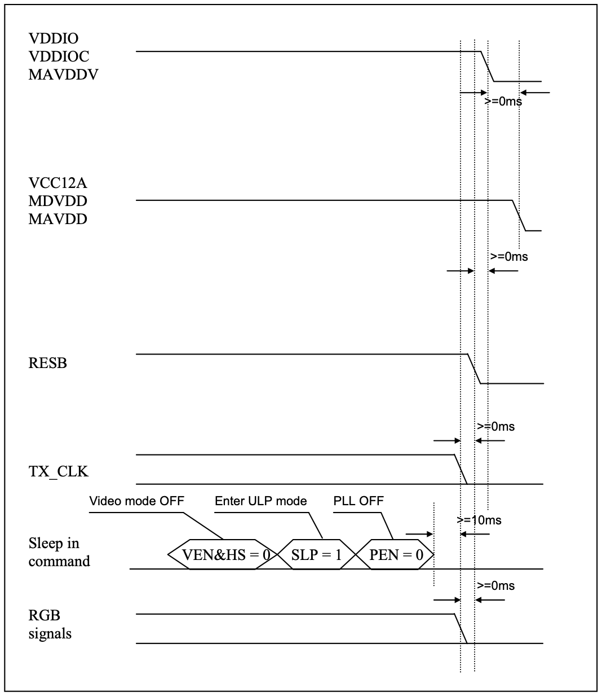

# 16 Power off sequence

<!-- pdf:160 -->

> **Note (derived from the diagram, not verbatim):** power-off order is the mirror image: sleep-in command VEN&HS=0 → SLP=1 → PEN=0, then RGB off, TX_CLK off, RESB low, then MVDD and finally VDDIO. Gaps are marked on the figure only.
