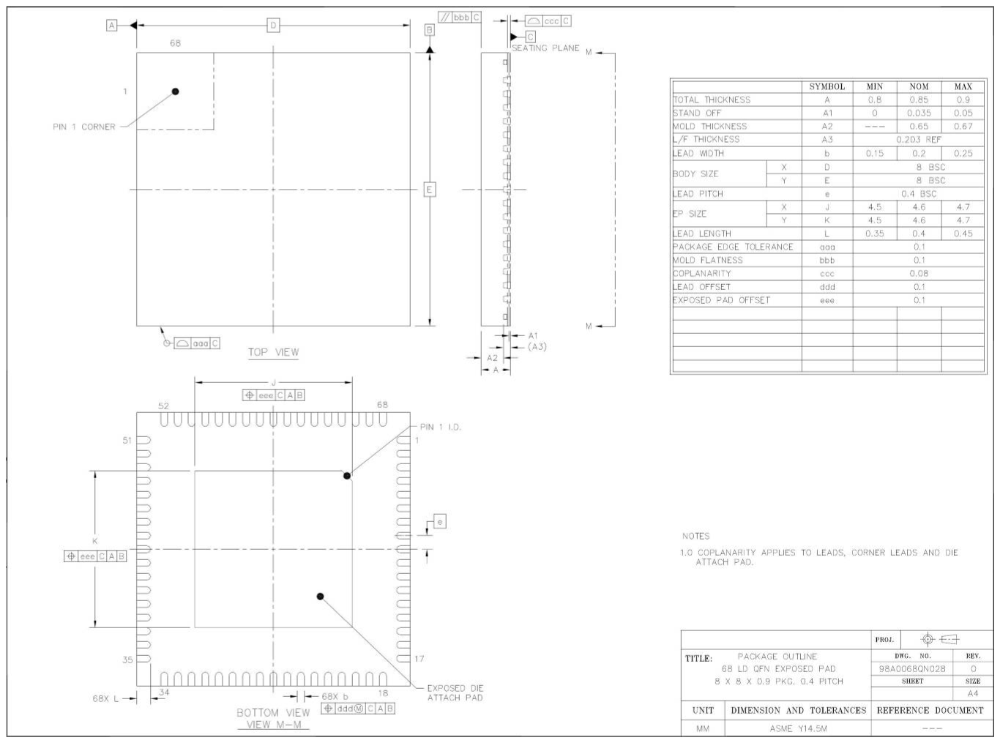
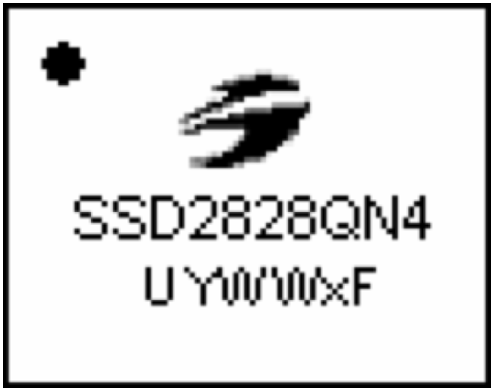
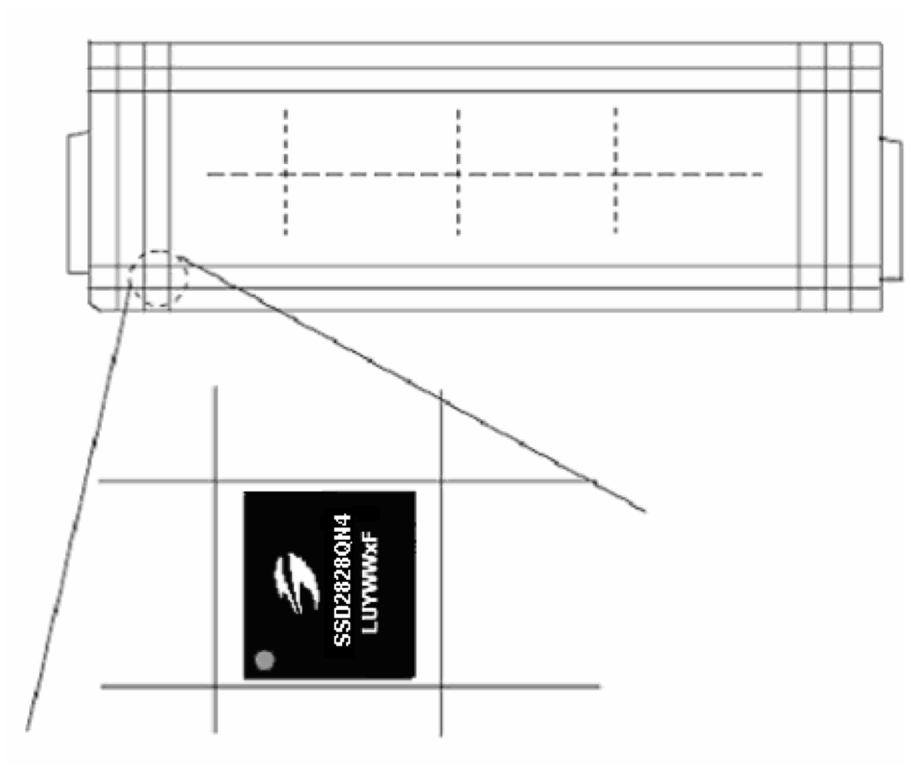
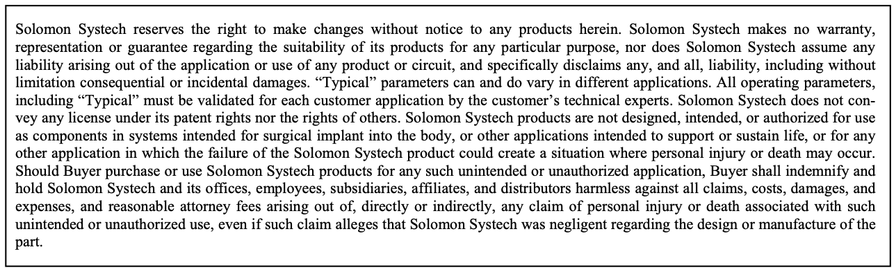

# 19 PACKAGE INFORMATION

<!-- pdf:165 -->

### 19.1 Dimension for SSD2828QN4

<!-- pdf:166 -->

<!-- pdf:167 -->

<!-- pdf:168 -->

The product(s) listed in this datasheet comply with Directive 2002/95/EC of the European Parliament and of the council of 27 January 2004 on the restriction of the use of certain hazardous substances in electrical and electronic equipment and People’s Republic of China Electronic Industry Standard SJ/T 11363-2006 “Requirements for concentration limits for certain hazardous substances in electronic information products (电子信息产品 中有毒有害物质的限量要求)”. Hazardous Substances test report is available upon request.

http://www.solomon-systech.com
