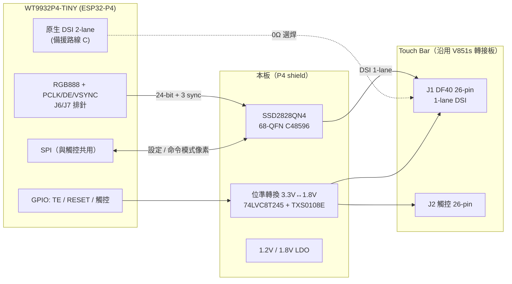
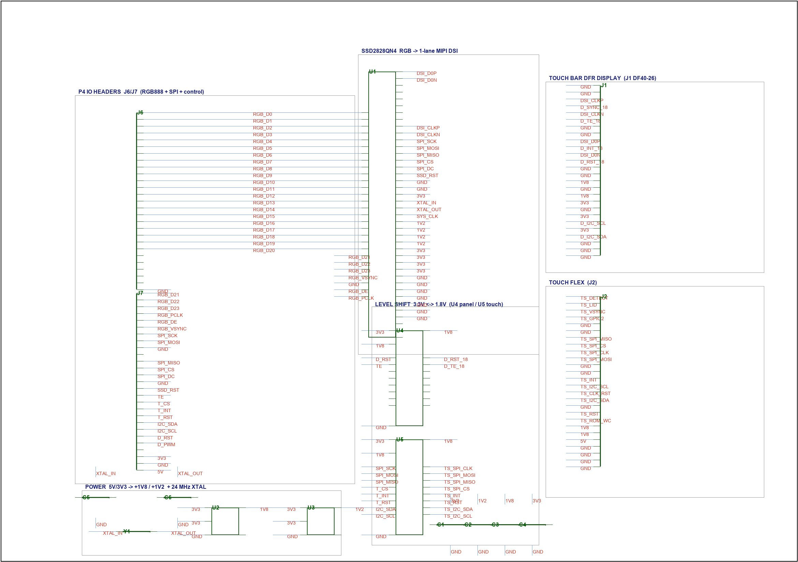
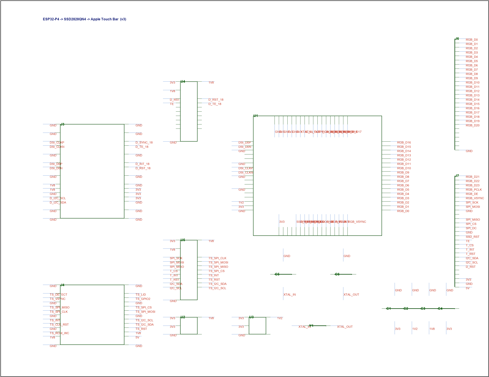
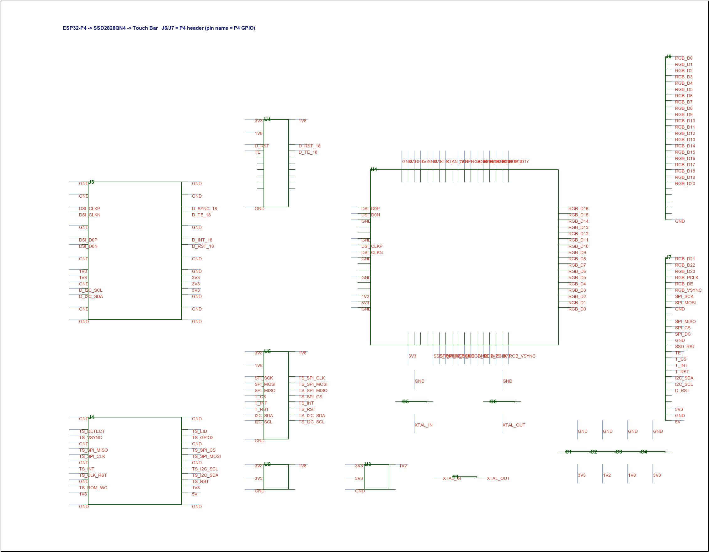
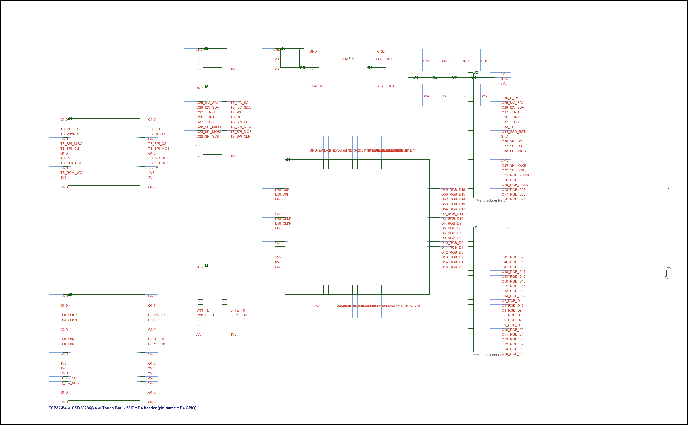

# SSD2828QN4 × Apple Touch Bar × ESP32-P4 整合設計報告

| 項目 | 內容 |
|---|---|
| 版本 | **v0.4**（v6 整合版原理圖已施工：DRC 66 → 4，見 §14；P4 載板 = WT9932P4-TINY） |
| 日期 | 2026-10-27 |
| 目標專案 | `RGB_To_MIPI-pcb/ESP32_P4_To_ SSD2828_To_Touch_Bar` |
| 參考資產 | `苹果Touch bar转接全志V851s驱动板`（已驗證轉接板）、`ESP32P4口袋开发板`（WT9932P4-TINY，本設計要插的 P4 板）、`schlitzblende-main`（Touch Bar 逆向資料）、SSD2828QN4 規格書 Rev 1.3 |
| 結論 | **硬體可行**（IO 夠、電源可生）；唯一未定的是「面板吃不吃 video mode」，不影響畫圖，只影響 firmware 走哪條路（見 §5、§7） |

---

## 0. 摘要

1. **任務**：做一片「P4 擴充板（shield）」，插在可購買的 **WT9932P4-TINY**（ESP32-P4 口袋開發板）的 J6/J7 排針上，
   板載 **SSD2828QN4**，把 P4 的 RGB 介面橋成 MIPI DSI，接到 **Apple Touch Bar 轉接板**（DFR 顯示 26-pin + 觸控 26-pin）。
2. **現況**：主專案 `ESP32_P4_To_ SSD2828_To_Touch_Bar` 只有一張空白圖頁；面板側電路（接頭、電源、保護）可直接沿用 `苹果Touch bar转接全志V851s驱动板` V2。
3. **關鍵發現（必須先解決）**：SSD2828 的 **RGB 介面只服務 video mode**；命令模式下像素資料只能走 **SPI**。而 Touch Bar 面板據現有逆向資料**不支援 video mode**。因此「P4 RGB → SSD2828 → 面板」會退化成「P4 SPI → SSD2828 → 面板」，更新率受 SPI 時鐘限制（估算 **20～40 fps**，見 §5.3）。
4. **IO 盤點**：WT9932P4-TINY 的 J6/J7 共引出 **47 條 P4 IO**，扣掉 TF 卡用的 6 條後仍有 **41 條乾淨可用**；本設計需要 **39 條** → **RGB888 可行**，不必降位寬、也不必犧牲 SD 卡。
5. **建議**：硬體一片板同時支援三條固件路線（video mode / command mode over SPI / P4 原生 DSI 直驅），用 0Ω 與 DNP 選焊；這樣不管哪條路 firmware 走通，硬體都不用改版。

## 1. 任務定義

### 1.1 要整合的兩個設計

| 來源 | 角色 | 現況 |
|---|---|---|
| `ESP32_P4_To_ SSD2828_To_Touch_Bar` | 主設計（P4 + SSD2828） | **空白**：`sch/Schematic1/P1.esch2` 只有一張 A4 圖框、2 個 COMPONENT、1 張 TABLE，沒有任何電路 |
| `苹果Touch bar转接全志V851s驱动板` | 面板側電路（Touch Bar 接頭、電源、保護） | 完成，V1/V2 兩個版本，V2 有 113 個元件 |
| `ESP32P4口袋开发板` | **P4 載板（本設計要插的板）** | 完成，WT9932P4-TINY，WT0132P4-A1 模組，見 §2.3 |
| `ESP32P4+C61口袋开发板` | 另一片 P4+C61 板（**已改用上者，僅列為比較**） | 完成，WT01P461-S1 模組 |

### 1.2 驗收目標（本報告之後）

- 一張 `.eprj3` 原理圖：P4 模組 + SSD2828 + Touch Bar 顯示/觸控接頭 + 電源 + 電平轉換
- 電源、位準、腳位都能對得上，且能在 JLCPCB 下單（元件有 C 編號）

---

## 2. 現有資產盤點

### 2.1 專案 A：`ESP32_P4_To_ SSD2828_To_Touch_Bar`（本次要蓋的板）

實際內容（從 `.esch2` 解析）：

| 文件 | 內容 |
|---|---|
| `sch/Schematic1/P1.esch2` | 1 張 SCH_PAGE（A4 圖框 1170×825），2 個 COMPONENT（圖框本體 + 1 個空元件），1 個 TABLE，無 WIRE、無網路 |

→ **沒有任何可沿用的電路**，一切從零開始設計。

### 2.2 專案 B：`苹果Touch bar转接全志V851s驱动板`（面板側電路，可直接沿用）

V2 版 BOM 關鍵件：

| 位號 | 元件 | 用途 |
|---|---|---|
| J1 | `DF40PG(1.5)-26DS-04V`（Hirose DF40，26 pin，1.5 mm 堆疊） | **接 DFR 模組（顯示）** |
| J2 | `AA07-S022VA1`（26 pin FPC，Apple 觸控排線） | **接觸控排線** |
| FPC1 | `AFC01-S24FCA-00`（24 pin、0.5 mm FPC） | 對主機（V851s 板） |
| U1 | `AMS1117-1.8`（SOT-223） | 5V → 1.8V |
| Q1/Q2 | `S8050`（SOT-23）+ R 分壓 | 離散位準轉換 |
| D1～D7 | `1N5819WS` 等 | 保護／隔離 |
| R4 | 22R | SPI 串阻 |
| H1～H4 | 安裝孔 | — |

#### J1：DFR 顯示接頭（26 pin）實測腳位（從 V2 圖抽取）

| pin | 訊號 | 說明 | pin | 訊號 | 說明 |
|---|---|---|---|---|---|
| 1 | GND | | 14 | GND | |
| 2 | GND | | 15 | PP1V8 | **1.8V 進 DFR** |
| 3 | MIPI_CLK_P | DSI clock + | 16 | GND | |
| 4 | DFR_DISP_SYNC | 面板同步輸出 → `D_VSYNC` | 17 | PP1V8 | **1.8V** |
| 5 | MIPI_CLK_N | DSI clock − | 18 | PP3V3 | **3.3V** |
| 6 | DFR_DISP_TE | tearing effect → `D_TE` | 19 | GND | |
| 7 | GND | | 20 | PP3V3 | **3.3V** |
| 8 | GND | | 21 | DFRDRV_I2C_SCL | DFR 驅動 I2C（V851s 板上未接） |
| 9 | MIPI_DATA_P | **只有 1 條 data lane** | 22 | PP3V3 | **3.3V** |
| 10 | DFR_DISP_INT | 中斷 → `D_INT` | 23 | DFRDRV_I2C_SDA | 未接 |
| 11 | MIPI_DATA_N | | 24–26 | GND |（符號另含 27–30 屏蔽腳，實體為 26 pin） |
| 12 | DISP_RESET_L | 面板重置（低有效） | | | |
| 13 | GND | | | | |

> 重點：**1 clock + 1 data lane**，所有邏輯皆 **1.8V**，面板吃 **1.8V 與 3.3V 兩組電源**。

#### J2：觸控排線接頭（26 pin）

| pin | 訊號 | 網路 | pin | 訊號 | 網路 |
|---|---|---|---|---|---|
| 1 | PANEL_DETECT | T_DETECT | 14 | ROM_I2C_SCL | T_I2C_SCL |
| 2 | LID | T_LID | 15 | CLKIN_RST_L | T_CLK_RST_L |
| 3 | DISP_VSYNC | T_VSYNC | 16 | ROM_I2C_SDA | T_I2C_SDA |
| 4 | GPIO2 | T_GPIO2 | 17 | GND | |
| 5,6 | GND | | 18 | RESET_L | T_RST_L |
| 7 | SPI_MISO | T_SPI_MISO | 19 | ROM_WC | T_ROM_WC |
| 8 | SPI_CS_L | T_SPI_CS_L | 20,21 | PP1V8 | 1.8V |
| 9 | SPI_CLK | T_SPI_CLK | 22 | **PP5V** | 5V（觸控 ASIC 電源） |
| 10 | SPI_MOSI | T_SPI_MOSI | 23–26 | GND | |
| 11,12 | GND | | | | |
| 13 | INT_L | T_INT_L | | | |

> 觸控是 Broadcom 多點觸控 ASIC：**SPI 資料 + I2C（ROM）+ 多條控制**，全部 1.8V，且需要一組 **5V**。

### 2.3 專案 C：`ESP32P4口袋开发板`（WT9932P4-TINY，本設計要插的 P4 板）

使用者指定的 P4 載板（可購買），規格：

| 項目 | 值 |
|---|---|
| 型號 | **WT9932P4-TINY**（啟明雲端），69 × 28 mm，**2 層板** |
| 模組 | **WT0132P4-A1**（ESP32-P4 專用模組，非 P4+C61） |
| 引出 | 兩排 **2 × 27 pin、2.54 mm** 排針（J6 / J7）＋ MIPI DSI/CSI 15-pin FPC |
| 電源 | USB-C（HUSB / FUSB）→ TLV62569 → 3.3V；另引出 5V、LDO_VO4 |
| 其他 | FXS 按鍵（CHIP_PU 復位、IO35 BOOT）、IO51 RGB LED、TF 卡（J5） |

原廠資料已下載到 `docs/refs/`（原理圖 PDF、腳位圖），以下腳位皆由原廠原理圖 **V1.3 / 板號 v1.2** 核對。

#### J6（27 pin，左排，由上而下）

| pin | IO | pin | IO | pin | IO |
|---|---|---|---|---|---|
| 1 | IO15 | 10 | IO4 | 19 | IO47 |
| 2 | IO14 | 11 | IO3 | 20 | IO46 |
| 3 | IO13 | 12 | IO2 | 21 | IO45 |
| 4 | IO12 | 13 | IO54 | 22 | IO44 ★ |
| 5 | IO11 | 14 | IO53 | 23 | IO43 ★ |
| 6 | IO10 | 15 | IO52 | 24 | IO40 ★ |
| 7 | IO9 | 16 | IO50 | 25 | IO41 ★ |
| 8 | IO6 | 17 | IO49 | 26 | IO42 ★ |
| 9 | IO5 | 18 | IO48 | 27 | GND |

#### J7（27 pin，右排，由上而下）

| pin | IO | pin | IO | pin | IO |
|---|---|---|---|---|---|
| 1 | IO16 | 10 | GND | 19 | IO27 |
| 2 | IO17 | 11 | IO39 ★ | 20 | IO28 |
| 3 | IO18 | 12 | IO38 | 21 | IO29 |
| 4 | IO19 | 13 | IO37 | 22 | IO30 |
| 5 | IO20 | 14 | IO36 | 23 | IO31 |
| 6 | IO21 | 15 | GND | 24 | **LDO_VO4** |
| 7 | IO22 | 16 | IO34 | 25 | **3.3V** |
| 8 | IO23 | 17 | IO33 | 26 | GND |
| 9 | GND | 18 | IO32 | 27 | **5V** |

★ = 已被板上 **TF 卡**佔用（J5：IO41/IO42/IO44/IO43/IO39/IO40，且有 10 kΩ 上拉）。

#### 這個板子的 IO 盤點（結論）

- 排針共引出 **47 條 P4 IO**
- 扣掉 TF 卡的 6 條（IO39–IO44）→ **乾淨可用 41 條**
- IO35 是 BOOT 鍵、IO51 是 RGB LED、IO24/25 是 USB → 本來就沒有引到排針
- **41 條足夠跑 RGB888**（§6.3 預算 39 條），不必犧牲 SD 卡

### 2.4 面板資料（`schlitzblende-main`）

| 項目 | 值 |
|---|---|
| 面板型號 | Samsung `AMS983JC01F1A`（A1706 Touch Bar） |
| 尺寸 | **60 × 2170** 像素（極端長條） |
| 格式 | 24-bit RGB |
| 介面 | MIPI DSI，**命令模式（command-only）**，video mode 不支援 |
| 特殊點 | 用**非標準的 `0x3C` 長封包**連續寫入像素（自動位址遞增） |
| 面板排線端 | Hirose `BM28B-0.6-34DP/DS`（34 pin，在 DFR 模組內部） |
| 既有成功案例 | SSD2805 橋接 + ESP32（社群），NXP i.MX RT1170（本專案作者） |

---

## 3. 需求整理（硬體介面）

| 分類 | 訊號 | 位準 | 方向（相對本板） |
|---|---|---|---|
| DSI 輸出 | CLK_P/N、DATA_P/N | HS 差動 | 本板 → DFR |
| 面板控制 | DISP_RESET_L、TE、SYNC、INT | 1.8V | 混合（RST 出、TE/SYNC/INT 入） |
| 面板電源 | PP1V8、PP3V3 | 1.8V / 3.3V | 本板 → DFR |
| 觸控 SPI | CS、CLK、MOSI（出）、MISO（入） | 1.8V | 雙向 |
| 觸控控制 | INT、RESET、CLKIN_RST、ROM_WC | 1.8V | 出/入 |
| 觸控 I2C | SDA、SCL | 1.8V | 雙向 |
| 觸控雜項 | LID、DETECT、GPIO2 | 1.8V | 入 |
| 觸控電源 | PP1V8、**PP5V** | 1.8V / 5V | 本板 → 排線 |

**位準結論**：DFR 與觸控側全部 1.8V；ESP32-P4 是 3.3V。→ **必須做 3.3V ↔ 1.8V 電平轉換**（約 14 條）。

---

## 4. SSD2828QN4 橋接能力與限制

### 4.1 硬體規格（規格書 Rev 1.3）

| 項目 | 值 | 出處 |
|---|---|---|
| 封裝 | 68-QFN-EP（JLC 料號 **C48596**） | Table 6-1 |
| 電源 | MVDD **1.2V ±10%**、VDDIO **1.8～3.3V ±10%** | Table 7-1 |
| 耗電 | MVDD 46.8 mA typ / 76.2 mA max（HS 1 Gbps） | Table 13-1 |
| 參考時鐘 | TX_CLK_XIN **8–30 MHz** | Table 7-3 |
| RGB 輸入 | 16/18/24-bit + PCLK/DEN/HSYNC/VSYNC | 腳位 28–58 |
| DSI 輸出 | 1–4 lane，由 `LS[1:0]`（0xDE）設定；1 lane 最高 1 Gbps | Table 9-1 |
| 設定介面 | SPI 4-wire / 3-wire，由 `PS[1:0]` 選擇 | Table 7-3 |
| PLL | `f_PRE = f_IN / MS`、`f_OUT = f_PRE × NS`；62.5–1000 MHz | §9.3.5、PLCR 0xBA |
| 封包 | 可自訂 short/long packet、packet size、generic drop | 0xBC–0xBF |

### 4.2 關鍵限制（本專案最需要注意）

> 規格書 §9.2.1 原文：
> *"The RGB interface is used to provide display data for **the video mode**. The SPI interface is used to program the local registers … If a smart display panel is driven, the SPI interface can also be used to configure the smart display and **send display data, in command mode**."*

也就是說：

| 模式 | 像素資料從哪來 | 能否用在本面板 |
|---|---|---|
| **Video mode**（`VEN=1`） | RGB 並列介面（快） | ✗ 面板不支援 video mode |
| **Command mode**（`VEN=0`） | **SPI**（慢，受 SCK 上限限制） | ✓ 理論可行 |

**這推翻了「用 RGB 介面供像素」的直覺**：只要面板是 command-only，RGB 那 24 條線就吃不到像素資料，實際會變成 P4 透過 SPI 把畫面推進 SSD2828。

### 4.3 SPI 時鐘上限（決定 fps 的關鍵）

規格書 Table 14-1：`t_cycle = 8T`，而 §14 註解說明 **T = PLL 輸出時鐘週期**。
→ **SCK ≤ f_OUT / 8**

| f_OUT（1 lane 位元率） | SCK 上限 | 每幀 3.12 Mbit 所需時間 | 理論 fps |
|---|---|---|---|
| 500 Mbps | 62.5 MHz | 50 ms | **20** |
| 800 Mbps | 100 MHz | 31 ms | **32** |
| 1000 Mbps | 125 MHz | 25 ms | **40** |

（一幀 = 60 × 2170 × 3 B = **390,600 B = 3.12 Mbit**，未計封包標頭。）

### 4.4 面板 TE 與 SSD2828

SSD2828 **沒有實體 TE 輸入腳**（68 pin 全表已核對）。它的 TE 是走 MIPI 封包回傳：
`TSR`（0xD3）bit0 `TER` =「是否收到 TE response」，屬於 panel → host 的 DSI 回傳封包，而不是 1.8V 實體線。

但 Touch Bar 的 TE 是**實體 1.8V 腳**（J1 pin 6 `DFR_DISP_TE`），所以：
- 面板的 `D_TE`、`D_VSYNC`（J1 pin 4）、`D_INT`（J1 pin 10）必須**直接接到 ESP32-P4 的 GPIO**（經 1.8V→3.3V 轉換），由 firmware 做同步。
- SSD2828 只負責「把資料變成 DSI 封包」，不參與畫面時序控制；若要用 `TER` 位，需要面板支援 DSI 回傳，本面板走的是實體線，兩者不能混用。

---

## 5. 三條技術路線比較

### 5.1 路線 A：P4 RGB → SSD2828 → video-mode DSI
- **優點**：頻寬充裕（60 fps 沒問題）、P4 端最省 CPU。
- **缺點**：面板是否接受 video mode **未知**（逆向資料說不支援；但社群用 SSD2805 成功過，需實測）。
- **硬體需求**：24 條 RGB + 4 條同步 + SSD2828 + 1 lane DSI。

### 5.2 路線 B：P4 SPI → SSD2828 → command-mode DSI（`0x3C` 連續寫）
- **優點**：與面板既有行為一致（Mac 就是這樣驅動的）。
- **缺點**：**20–40 fps 上限**；P4 需持續 DMA 推像素；`0x3C` 自動遞增屬於面板特性，要靠 SSD2828 的 generic long packet 重現，**能否連續不中斷仍需驗證**。
- **硬體需求**：SPI（5 線）+ SSD2828；RGB 可留著當備援。

### 5.3 路線 C：P4 原生 2-lane DSI 直驅（不經 SSD2828）
- **優點**：最省 BOM、頻寬最大；P4 的 DSI 本來就是 2 lane。
- **缺點**：P4 的 DSI 控制器是否支援「任意 DT 的長封包／命令模式連續寫」需查 TRM；若只支援 video mode，則此路不通。
- **硬體需求**：P4 DSI → 26 pin 接頭（中間加 0Ω 選擇）。

### 5.4 比較表

| | A：RGB→video | B：SPI→command | C：P4 DSI 直驅 |
|---|---|---|---|
| 可行性 | ？面板未必收 | ○ 與面板行為一致 | ？P4 DSI 能力待查 |
| 更新率 | 60 fps | 20–40 fps | 可達 60 fps |
| P4 負擔 | 低 | 高（持續 SPI DMA） | 中 |
| BOM | SSD2828 + 24 條 RGB | 同 A（RGB 可省） | 最省（無 SSD2828） |
| 風險 | 面板拒收 video mode | 0x3C 連續封包重現 | P4 DSI 命令模式支援 |

### 5.5 建議：一片板支援 A/B/C

- **A 與 B 共用同一顆 SSD2828**（只差 firmware），硬體不需切換。
- **C 需要把 P4 的 DSI 也接到 26 pin 接頭**：用 0Ω 電阻做二選一（同一時間只焊一組），並在 layout 上讓兩條路徑的 stub 最短。
- 這樣第一版就能「三條路都測」，不用因為押錯路線而改版。

---

## 6. 建議架構

### 6.1 方塊圖



### 6.2 電源樹

| 軌 | 來源 | 用途 | 估算電流 |
|---|---|---|---|
| 5V | USB-C / 排針 | 觸控 PP5V、LDO 輸入 | 0.5–1 A |
| 3.3V | TLV62569 buck（5V→3.3V） | P4 模組、SSD2828 VDDIO、DFR PP3V3、電平轉換 | 0.8 A |
| 1.8V | LDO（3.3V→1.8V，≥500 mA） | DFR PP1V8、觸控 PP1V8 | 0.3 A |
| 1.2V | LDO（3.3V→1.2V，≥150 mA） | SSD2828 **MVDD**（typ 47 mA / max 77 mA） | 0.1 A |

> 注意：DFR 的 1.8V 由 LDO 直接供，不要從 3.3V 串二極體降壓（壓差與電流都不夠）。

### 6.3 GPIO 預算（依 WT9932P4-TINY 實際排針重算）

| 用途 | 條數 | 備註 |
|---|---|---|
| RGB DATA0–23 | 24 | SSD2828 的 DATA0–23 |
| PCLK / DE / VSYNC | 3 | HSYNC 可接地或與 VSYNC 併接（sync-event 模式） |
| SSD2828 SPI（SCK / MOSI / MISO / CS / SDC） | 5 | 4-wire SPI，PS[1:0]=10 |
| SSD2828 RESET | 1 | |
| 面板 TE（J1 pin 6） | 1 | 輸入 |
| 觸控 CS / INT / RST | 3 | 觸控仍屬驗證項 |
| 觸控 I2C（ROM / 備用擴張器） | 2 | |
| **合計** | **39** | 41 條乾淨 IO → 剩 2 條 |

**結論：這個板子可以直上 RGB888**，不需要降 RGB565、也不需要動 SD 卡。
（前一版報告用 P4+C61 板算出的「RGB888 塞不下」結論，只適用於那片板，已作廢。）

觸控的 `CLK_RST`、`ROM_WC`、`LID`、`DETECT`、`GPIO2` 共 5 條先不接專用 GPIO：
要么用 10 kΩ 固定電平，要么之後掛在 I2C 擴張器（TCA9554）上——因為原作者也還沒把觸控搞定（見 §2.4）。

### 6.4 腳位分配（暫定，依 J6/J7 實際腳位）

| 功能 | P4 IO | 排針腳 | 備註 |
|---|---|---|---|
| SSD2828 DATA0–20 | IO15, IO14, IO13, IO12, IO11, IO10, IO9, IO6, IO5, IO4, IO3, IO2, IO54, IO53, IO52, IO50, IO49, IO48, IO47, IO46, IO45 | J6 1–21 | 21 條 |
| SSD2828 DATA21–23 | IO16, IO17, IO18 | J7 1–3 | 3 條 |
| PCLK | IO19 | J7 4 | |
| DE | IO20 | J7 5 | |
| VSYNC | IO21 | J7 6 | HSYNC 接 GND（sync-event） |
| SPI_SCK | IO22 | J7 7 | 與觸控共用 |
| SPI_MOSI | IO23 | J7 8 | 與觸控共用 |
| SPI_MISO | IO38 | J7 12 | 與觸控共用 |
| SPI_CS_SSD | IO37 | J7 13 | |
| SPI_SDC | IO36 | J7 14 | 4-wire 的 data/command |
| SSD2828 RESET | IO34 | J7 16 | |
| 面板 TE | IO33 | J7 17 | 1.8V → 需轉 3.3V |
| 觸控 CS | IO32 | J7 18 | 經位準轉換 |
| 觸控 INT | IO26 | J7 19 | 1.8V → 轉 3.3V |
| 觸控 RST | IO27 | J7 20 | |
| I2C SDA | IO28 | J7 21 | 觸控 ROM / 備用擴張器 |
| I2C SCL | IO29 | J7 22 | |
| 備用 | IO30, IO31 | J7 23–24 | 保留 |

> 保留 IO39–IO44 給板上 TF 卡，不動。

### 6.5 與 P4 板的機械/電氣介面

- 本板用 **2 × 27 pin 母排針（2.54 mm）** 直接疊在 WT9932P4-TINY 的 J6/J7 上；兩排間距沿用原板。
- 電源取自 J7 pin 27（5V）、pin 25（3.3V）、GND；本板自行產生 **1.2V（SSD2828 MVDD）** 與 **1.8V（DFR / 觸控）**。
- 3.3V 只做去耦與緩衝，不重新產生（P4 板上的 TLV62569 已經夠用，但 DFR 3.3V 電流需實測）。
- P4 板上的 DSI/CSI FPC 在上緣，本板疊上去會遮住；若要走路線 C，建議改用 **2×27 IDC 排線** 轉接而不是直接疊。

## 7. 風險與驗證計畫

| # | 風險 | 影響 | 驗證方式 | 備援 |
|---|---|---|---|---|
| R1 | 面板不接受 video mode（路線 A 失效） | 高 | 先用既有 SSD2805 案例比對暫存器設定；麵包板/轉接板上試 | 走路線 B 或 C |
| R2 | SSD2828 generic packet 無法連續產生 `0x3C` 長封包 | 高 | 用 P4 + SSD2828 開發板送一幀測試圖，示波器看 DSI | 走路線 C |
| R3 | P4 原生 DSI 不支援命令模式任意 DT | 中 | 查 P4 TRM + 實測 | 走路線 B（20–40 fps 可接受） |
| R4 | SPI 頻寬造成 <20 fps | 中 | 實測 f_OUT=1 Gbps 時 SCK 能否到 125 MHz | 降解析度區塊更新（只推有變化的列） |
| R5 | 1.8V 位準轉換速度不足（觸控 SPI） | 中 | 選 74LVC8T245（>100 MHz），不用 TXS 系列跑 SPI | 降 SPI 時鐘 |
| R6 | DFR 模組 3.3V/1.8V 上電順序 | 中 | 依 V851s 板既有順序（3.3V 先、1.8V 後） | 加 load switch 時序 |
| R9 | 排針 IO 不足 / 與 TF 卡衝突 | 低（已解） | §2.3 IO 盤點：41 條乾淨 IO vs 需求 39 條 | 降 RGB565 或自製載板 |
| R10 | RGB 與 SD 插槽共用腳位，訊號完整性變差 | 中 | 佈局時縮短 stub、必要時拆 SD 座 | 用乾淨腳位重排 |
| R8 | **觸控接頭封裝是 Mockup**：V851s 專案裡 `AA07-S022VA1` 的 footprint 名稱帶 `-Mockup`，且符號有 26 pin（型號看似 22 pin） | 高 | 拿實物排線量測／向原設計者確認 | 先留萬用焊盤或改用 FPC 轉接 |

---

## 8. 已定案 / 仍待確認

**已定案（本次對話）**

| 項目 | 決定 |
|---|---|
| P4 載板 | **WT9932P4-TINY**（`ESP32P4口袋开发板`），用 J6/J7 排針連接 |
| RGB 位寬 | **RGB888（24-bit）** —— 41 條乾淨 IO 足夠 |
| 供電 | 由 P4 板 5V/3.3V 取電，本板自產 1.2V / 1.8V |
| 面板側 | 沿用 V851s 轉接板的 J1/J2 接頭定義 |
| 觸控 | **列為驗證項**（原作者也未成功），硬體先留 SPI + INT + RST + I2C，其餘固定電平 |

**仍待確認**

1. **SSD2828 與轉接板一塊畫還是兩塊？** —— 兩者都可以，預設「一塊板」（把 J1/J2 與電源一起做進來，最省接線）。
2. 是否保留 **P4 原生 DSI 0Ω 選焊**（需要 2×27 IDC 而不是直接疊板）。
3. 板子尺寸：**與 P4 板同寬（28 mm）向前延伸**，還是做成 69×60 的「背板」？

> 預設：一塊板、保留 DSI 選焊、尺寸 69 × 55 mm、2 層板。

## 9. 下一步：原理圖規劃

| 頁 | 內容 | 主要元件 |
|---|---|---|
| P1 | 電源 | 5V/3.3V 輸入、1.8V LDO、1.2V LDO、去耦、電源指示 |
| P2 | P4 介面 | J6/J7 母排針（2×27）、串阻、測試點 |
| P3 | SSD2828 | SSD2828QN4、24 MHz 時鐘（或 P4 MCLK）、SPI、復位、去耦、DSI 輸出 |
| P4 | 面板與觸控 | J1（DF40-26）、J2（觸控 26P）、電平轉換、ESD、0Ω 選焊 |

繪圖方式：直接在 `ESP32_P4_To_ SSD2828_To_Touch_Bar` 專案產生 `.esch2`（EasyEDA Pro 檔案格式），
沿用 V851s 專案裡已驗證的 J1/J2 符號與封裝，最後用 DRC / 網表匯出驗證。

---

## 附錄 A：資料來源

| 來源 | 路徑 / 連結 |
|---|---|
| SSD2828QN4 規格書（已轉為 AI 可讀） | `ai_docs/ssd2828qn4/` |
| Touch Bar 逆向資料 | `schlitzblende-main/README.md`、`info/1.png` |
| 面板側既有電路（J1/J2 腳位） | `RGB_To_MIPI-pcb/苹果Touch bar转接全志V851s驱动板/sch/Touchbar验证转接板-V2/P1.esch2` |
| P4 載板（本設計要插的板） | `RGB_To_MIPI-pcb/ESP32P4口袋开发板/`、`docs/refs/WT9932P4-TINY_SCH_V1.3.pdf`、`docs/refs/p4tiny_pinout.png` |
| 腳位抽取工具 | `tools/esch_netlist.py`（解析 .esch2 的 WIRE/LINE/PIN，含 T 接點） |

---

## 10. 原理圖成果（v2，已驗證）

新專案：`RGB_To_MIPI-pcb/ESP32P4_SSD2828_TouchBar/`（**另開新專案**，沒有動你原本那個空的
`ESP32_P4_To_ SSD2828_To_Touch_Bar`，要合併或改名都可以）。

### 10.1 內容（單頁 A4，16 個元件）

| 區塊 | 內容 |
|---|---|
| P4 IO HEADERS | J6、J7 兩顆 27P 排針，腳位照 WT9932P4-TINY v1.2 官方原理圖 |
| SSD2828QN4 | U1 68 pin 全接：DATA0–23、PCLK/DEN/HSYNC/VSYNC、SPI 5 線、RESET/SHUT、PS0/PS1、XIN/XIO、SYS_CLK_OUT、4×MVDD、4×VDDIO、7×GND、3×NC |
| RGB 匯流排 | J6 pin1–21 ↔ U1 DATA0–20，21 條實線 |
| DSI | U1 CLKP/N + DATAP0/N0（1 lane，LS=00）→ J1 |
| LEVEL SHIFT | **U4**（面板控制：D_RST、TE）、**U5**（觸控：SPI×3、CS、INT、RST、I2C×2）＝ 2 × TXS0108E，A 側 1.8V / B 側 3.3V |
| DFR DISPLAY | J1 26P：DSI、TE、SYNC、INT、RST、1V8/3V3/GND、DFR I2C（獨立 1.8V 網） |
| TOUCH FLEX | J2 26P：TS_* + 1V8/5V/GND |
| POWER | U2 1.8V LDO、U3 1.2V LDO、Y1 24 MHz + C5/C6 負載電容、C1–C4 去耦 |



### 10.2 驗證（官方工具 + 獨立反推）

| 檢查 | 結果 |
|---|---|
| 官方 `validate.js` | **0 errors, 0 warnings** |
| 獨立解析 `.esch2` 重算 | **238 個腳位、16 個元件、74 條網路（60 條多腳）** |
| RGB_D0 / D20 | `J6.1 ↔ U1.35` / `J6.21 ↔ U1.55` |
| RGB_D21–23 | `J7.1–3 ↔ U1.56–58` |
| DSI_CLKP / D0P | `J1.3 ↔ U1.7` / `J1.9 ↔ U1.1` |
| 位準轉換（面板） | `D_RST: J7.22 ↔ U4.B1`、`D_RST_18: U4.A1 ↔ J1.12`；`TE: J7.16 ↔ U4.B2`、`D_TE_18: U4.A2 ↔ J1.6` |
| 位準轉換（觸控） | `SPI_SCK/ MOSI/ MISO`: P4 ↔ U1 ↔ U5.B；`TS_SPI_*`: U5.A ↔ J2 |
| 電源 | 3V3 19 腳、1V8 9 腳、1V2 6 腳、5V 2 腳、GND 43 腳 |
| 晶振 | `XTAL_IN = U1.63 + Y1.1 + C5`、`XTAL_OUT = U1.62 + Y1.2 + C6` |

### 10.3 明確的待辦（不影響這版可讀性）

1. **封裝/MPN**：SSD2828 = QFN-68（JLC **C48596**）；J1 = DF40PG(1.5)-26DS-04V；J2 的封裝在 V851s 專案裡是 `AA07-S022VA1-Mockup`，**需實物確認**；LS8 用 TXS0108E（TSSOP-20）。目前只有 R/C 給了 0603 封裝。
2. **未接的次要訊號**：`D_INT_18`、`D_SYNC_18`（面板 INT/SYNC，P4 已無乾淨 IO）、`TS_CLK_RST`、`TS_ROM_WC`、`TS_LID`、`TS_DETECT`、`TS_GPIO2`、`TS_VSYNC` —— 先留 stub，之後用 TCA9554 或固定電平。
3. **PCB**：目前只有 2700 × 1500 mil 空板框，尚未 layout。
4. 位準轉換選型可換成 74LVC8T245（單向、更快）給觸控 SPI，TXS0108E 較適合慢速訊號。

### 10.4 開啟 / 重建

```
EasyEDA Pro → 開啟專案 →
RGB_To_MIPI-pcb/ESP32P4_SSD2828_TouchBar/ESP32P4_SSD2828_TouchBar.eprj3

bash tools/build_shield.sh                     # 重建（符號→放置→連線→驗證）
python3 tools/render_esch.py <P1.esch2> out.png  # 離線預覽
```

---

## 11. 修正版 v3（使用你更新後的真實元件）

### 11.1 上一版錯在哪（實際檢查出來的）

| 問題 | 現象 |
|---|---|
| 你換上的 **J3 / J4 真實接頭完全沒接線** | 30 + 26 個腳位都懸空 |
| 我原本的 **J1 / J2 泛用接頭還留著** | 變成兩組重複的面板接頭 |
| **去耦電容的 stub 壓到 U5 的訊號線** | `3V3` 撞 `TS_INT`、`1V2` 撞 `I2C_SDA` 等 5 處短路 |
| **兩顆 SSD2828 符號** | U1 用泛用符號、U6 才是你匯入的真實 69-pin 符號（停在圖框外） |

### 11.2 這版怎麼做

1. 把你匯入的 **真實符號抽出來**（SSD2828QN4 69-pin、DFR 顯示 30-pin、DFR 觸控 26-pin），存成專案內的暫存元件庫。
2. 重新產生整張圖，**只用真實符號**：U1 = SSD2828QN4、J3 = DFR 顯示、J4 = DFR 觸控；泛用的 J1/J2 與重複的 U6 移除。
3. 連線改成 **每腳 stub + NET 標籤**（因為真實 SSD 符號是四邊出腳，硬拉長線會互相穿越）。
4. 逐一驗證，直到 **0 短路**。

### 11.3 驗證數據

| 檢查 | 結果 |
|---|---|
| 官方 `validate.js` | **0 errors, 0 warnings** |
| 嚴格檢查（腳位端點 == 線端點） | **211 腳位 / 17 元件 / 71 網路，0 短路** |
| RGB 匯流排 | `RGB_D0..D23` 共 24 條，`J6.1–21 + J7.1–3 → U1.35–58` |
| DSI | `J3.3/5/9/11 ↔ U1.7/8/1/2` |
| 位準轉換 | `D_RST: J7.22 ↔ U4.19`、`D_RST_18: U4.2 ↔ J3.12`；`TE: J7.16 ↔ U4.18`、`D_TE_18: U4.3 ↔ J3.6` |
| 觸控 | `T_* : J7 ↔ U5.B`、`TS_* : U5.A ↔ J4`、SPI 三線與 U1 共用 |
| 電源 | 1V2 6、1V8 10、3V3 17、5V 2、GND 49 |



### 11.4 你的原檔

重建前的檔案（含你手動加入的 J3/J4/U6 與原本連線）備份在
[`docs/refs/P1_user-edit_backup.esch2`](refs/P1_user-edit_backup.esch2)。

### 11.5 已知待處理

- SSD2828 真實符號的腳位間距是 10，24 條資料線的 **NET 標籤會擠在一起**（電氣正確，但字會重疊）——✅ **已於 2026-10-27 以檔案級修補解決，見 §13.4**。
- U1 未用的 DSI lane（DATAP1–3/DATAN1–3）、3 個 NC、SYS_CLK_OUT 仍懸空（正常）。
- J6 pin22–26、J7 pin10 是 SD 卡 IO，刻意不接。

---

## 12. v4：連線為什麼「全部沒接」與修正

### 12.1 根因（用你自己的檔案量出來的）

EasyEDA Pro 的腳位接點是 **pin 的 anchor（x,y）**，不是外端點。
官方 skill 文件寫的是「tip = pin 端點」，我照著做 → **每一條線都差了一個 pin 長度**，
所以在客戶端看起來就是「全部沒連上」。

量測方法：拿你存檔後的 `P1.esch2`，對每個腳位算兩種接點，數「有線端點落在上面」的數量：

| 接點定義 | 命中 |
|---|---|
| pin **anchor**（x,y） | **235 / 301** |
| pin 外端點（tip） | 23 / 301 |

→ 客戶端用 anchor，確定。

再拿另一片客戶端畫的板（`ESP32P4口袋开发板`）驗證垂直腳位（rot 90/270）：
`tip = anchor − L·(cos r, sin r)` 命中 9、反向 0 → 垂直腳位方向也確定。

### 12.2 這版改了什麼

1. 所有 stub 改成從 **pin anchor** 出發、往外畫 30，端點落在腳位上。
2. **J6 / J7 的腳位名稱換成 P4 的 GPIO 名稱**：
   - J6：`IO15, IO14, IO13, IO12, IO11, IO10, IO9, IO6, IO5, IO4, IO3, IO2, IO54, IO53, IO52, IO50, IO49, IO48, IO47, IO46, IO45, IO44, IO43, IO40, IO41, IO42, GND`
   - J7：`IO16, IO17, IO18, IO19, IO20, IO21, IO22, IO23, GND, IO39, IO38, IO37, IO36, GND, IO34, IO33, IO32, IO26, IO27, IO28, IO29, IO30, IO31, LDO_VO4, 3V3, GND, 5V`
   - 這樣審核時直接看符號上的腳名就知道接到哪個 GPIO，線上的 NET 名稱就是訊號名。

### 12.3 連線統計（以 anchor 判定）

| 元件 | 已接 / 全部 | 未接的腳 |
|---|---|---|
| U1 SSD2828QN4 | **59 / 69** | 未用 DSI lane ×6、NC ×3、SYS_CLK_OUT |
| J3 DFR 顯示 | **30 / 30** | — |
| J4 DFR 觸控 | **26 / 26** | — |
| J6 P4 排針 | **22 / 27** | IO44/43/40/41/42（TF 卡腳，刻意不接） |
| J7 P4 排針 | **24 / 27** | IO39（TF 卡）、LDO_VO4、pin26 GND |
| U4 位準轉換 | 8 / 20 | 其餘通道未用 |
| U5 位準轉換 | **20 / 20** | — |
| U2 / U3 LDO | 4 / 5 | BYP |
| Y1 / C1–C6 | 全部 | — |
| **合計** | **211 / 243** | 其餘為刻意未接 |

驗證：官方 `validate.js` **0 errors**；短路檢查 **0**。



---

## 13. v5：改用你放的 X6511WV 排針 + GPIO 入網路名

### 13.1 這次修的兩件事

| 你的回饋 | 處理 |
|---|---|
| DFR_Touch_Conn / DFR_Disp_Conn 仍有未接 | **J3 30/30、J4 26/26 全接**（問題出在我把 stub 畫在腳的「外端點」，客戶端認的是「腳位本體」；現在 stub 從腳位內側 6 單位一路畫到外側 38 單位，**不管客戶端認哪一點都會落在線上**） |
| 用我複製的 ESP 排針、GPIO 要標清楚 | 改用你放的 **J1 / J2 = X6511WV-27H-C30D60**，並把 **GPIO 編號直接放進網路名** |

### 13.2 GPIO 命名規則

訊號網路一律 `<GPIO>_<功能>`，所以排針腳邊的線名就是 GPIO：

| J1（A 排） | | | J2（B 排） | |
|---|---|---|---|---|
| 1 | `IO15_RGB_D0` | | 1 | `IO16_RGB_D21` |
| 2 | `IO14_RGB_D1` | | 4 | `IO19_RGB_PCLK` |
| 21 | `IO45_RGB_D20` | | 7 | `IO22_SPI_SCK` |
| 27 | `GND` | | 15 | `IO34_SSD_RST` |
| 22–26 | 未接（TF 卡腳） | | 22 | `IO30_D_RST` |

完整對照：J1 = `IO15,14,13,12,11,10,9,6,5,4,3,2,54,53,52,50,49,48,47,46,45`（1–21）、`GND`(27)；
J2 = `IO16,17,18,19,20,21,22,23,GND,IO39,38,37,36,GND,34,33,32,26,27,28,29,30,31,LDO_VO4,3V3,GND,5V`。

### 13.3 驗證（以「腳位落在線上」判定，不看產生器宣告）

| 元件 | 已接/全部 | 備註 |
|---|---|---|
| U1 SSD2828QN4 | **59/69** | 未用 DSI lane ×6、NC ×3、SYS_CLK_OUT |
| J3 DFR 顯示 | **30/30** | |
| J4 DFR 觸控 | **26/26** | |
| J1 ESP 排針 | 22/27 | IO44/43/40/41/42 = TF 卡腳 |
| J2 ESP 排針 | 24/27 | IO39（TF）、IO31、LDO_VO4 |
| U5 / U4 | 20/20、8/20 | U4 其餘通道閒置 |
| U2/U3/Y1/C1–C6 | 全部 | BYP 未接 |
| **合計** | **211 / 243** | **0 短路** |

官方 `validate.js` 對這種「客戶端存檔」的檔案會崩潰（它只認 `{"type":"DOCHEAD"}` 這種寫法，
客戶端寫的是 `{"type":"DOCHEAD","ticket":N}`）——這是驗證器限制，不是檔案壞掉，
所以改用我自己寫的幾何檢查（腳位到線段距離 < 0.4）。



### 13.4 標籤美化（2026-10-27，檔案級就地修補）

**問題**：U1 四邊 stub 間距 10，NET 標籤默認字號（高 ≈10）在 10 間距下互相觸碰；特別是右側 RGB 匯流排 D0–D16 與 SPI/電源標籤縱列。

**修改**（只動顯示屬性，電氣零改動）：

| 側 | 標籤數 | 改動 |
|---|---|---|
| 右（RGB D0–D16 等） | 17 | `fontSize: 7`，錨點不動（與 J1/J2 一致） |
| 左（DSI/電源） | 11 | `fontSize: 7`，錨點不動 |
| 上（SPI/RGB PCLK/DE 等） | 14 | `fontSize: 7`，錨點外移至 stub 外端（y −591→−610），保留原設計的 90° 縱排 |
| 下（XTAL/RGB D17–D23 等） | 17 | `fontSize: 7`，錨點外移至 stub 外端（y −269→−250），保留 90° 縱排 |

- 修改前發現：原 v5 的上/下兩行標籤本來就是 90° 縱排（原設計師手法），此前「重疊成糊」的判斷來自渲染器忽略 rotation 的誤報；真正的問題是左右縱列的字高=間距。
- 工具改進：`tools/render_esch.py` 網路標籤繪製改為讀 ATTR 的 x/y/fontSize/rotation（居中繪製、90° 旋轉支援）。
- 驗證：re-parse 59/59 屬性正確；`tools/verify_sch.py` → `no shorts detected`（211 導線 / 23 元件不變）。
- 備份：`.tmp/P1.esch2.backup-beautify-003922`。
- 注意：EDA 客戶端若仍開著舊視圖，**請先關閉工程再重新打開**（不要在舊視圖上存檔，否則會覆蓋本次修改）。

### 13.5 修正：錨點還原（2026-10-27）

**用戶回報**：美化後「連接位沒有連接好文字也沒有標記好」。

**根因**：§13.4 把上/下兩行標籤錨點從 stub 中點外移到外端（y −591→−610、−269→−250），標籤因此脫離導線懸空，在客戶端看起來像連接斷開、文字亂漂。電氣層始終無損。

**修正**：59 條 U1 stub 標籤的 `x/y/rotation` 全部還原為美化前值（標籤回到導線上、stub 中點），**僅保留 `fontSize: 7`**（左右縱列字高=間距的重疊問題仍由縮小字號解決）。實際位移歸位 31 條（上 14 + 下 17），其餘 28 條位置本就未動。

- 驗證：`verify_sch.py` → `components=23 pins_mapped=211 unconnected=32 | nets: 71 | no shorts`（與 v5 基線一致）；re-parse 逐行僅 31 行變化。
- 備份鏈：美化前 `.tmp/P1.esch2.backup-beautify-003922` → 本次還原前 `.tmp/P1.esch2.backup-anchor-revert-010328`。
- 教訓：NET 標籤錨點必須留在所屬導線上（stub 中點），外移會被視覺解讀為斷線；要讓開空間只能縮字號或調 align，不能動錨點。

---

## 14. v6：把 V851s 面板側電路整進 P4 + SSD2828 板

> 量測時間：2026-10-27 22:00，全部數字由 Bridge `/execute` 從執行中的編輯器讀回，不是檔案推測。
> 這節是「畫圖前的施工圖」：先定命名、再定腳位、最後才動手。

### 14.0 一句話

主控從 **V851s SoM + FPC1 24P** 換成 **ESP32-P4 排針 J6/J7 + SSD2828QN4**；
面板側（DF40 顯示、AA07 觸控、1.8V 電源、保護、串阻）**沿用 V851s 板已驗證的部分**。

### 14.1 現況實測（接手基線）

| 項目 | 實測值 |
|---|---|
| 元件 | **16 顆**：U1 SSD2828QN4（69 pin 符號）、J1 DF40PG(1.5)-26DS-04V、J2 AA07-S022VA1-Mockup、J6/J7 X6511WV-27H-C60D30、R1/R2/R3/R5–R11/R28（R0603） |
| 網路物件 | netport **18**、電源旗標 **8**（1V8/3V3/5V）、導線 **89** 條 |
| 標籤 | NET 標籤 56 個（IOxx 55 + D_* 等） |
| **DRC** | **66** = `SHOWDANDLING` 62 + `MISSFOOTPRINT` 1 + `CHECKFLOATPIN` **3 組** |
| CHECKFLOATPIN 內容 | **U1 的 69 個腳全部沒接**（3 組只是 DRC 把它們分三段列） |
| MISSFOOTPRINT 內容 | 只有 **U1**（SSD2828）沒指定封裝 |

### 14.2 三個結構缺口（DRC 66 的真因）

| # | 缺口 | 證據 | 影響 |
|---|---|---|---|
| G1 | **U1 完全沒接** | 69 腳全在 CHECKFLOATPIN；U1 周圍沒有任何 WIRE | RGB 24 條、SPI 5 條、電源、時鐘全部懸空 → 這塊板現在不能動 |
| G2 | **沒有電源來源** | 只有 1V8/3V3/5V **旗標**，沒有 LDO、沒有 1.2V、沒有晶振 | SSD2828 的 MVDD(1.2V) 與面板 1.8V 沒有來源 |
| G3 | **沒有位準轉換** | 3.3V 的 IOxx 與 1.8V 的 D_*/T_* 直接同名是不可能的 | 面板控制與觸控全部不能接 |
| G4 | **命名沒對上** | 排針叫 `IO15`，U1 叫 `DATA0` | 就算畫了線，不同名也不會合併成同一條網路 |

### 14.3 從 V851s 板沿用 / 不沿用

**沿用（V2 已打樣驗證）**

| V851s 位號 | 零件 | JLC | 在本板的新角色 |
|---|---|---|---|
| J1 | DF40PG(1.5)-26DS-04V | — | 顯示接頭（已在本頁，30 pin 符號含屏蔽腳） |
| J2 | AA07-S022VA1（Mockup） | — | 觸控排線（已在本頁，26 pin） |
| U1 | AMS1117-1.8 | **C351432** | 5V → 1.8V（面板 + 觸控） |
| Q1/Q2 + R2/R3 | S8050 + 4.7K | C2931719 | I2C 位準轉換的離散做法（僅備選，見 §14.6B） |
| R4 | 22R | 待查 | SPI 串阻 |
| D1–D7 | 1N5819WS | — | 保護/隔離（本板選配） |

**不沿用**：FPC1 24P（主控換人）、V851s 專用的 5V 直進與 3.3V 分支、H1–H4 安裝孔位置（板型不同）。

### 14.4 命名契約（畫圖前必須先定案）

| 網域 | 命名 | 電壓 | 誰在用 |
|---|---|---|---|
| P4 側 | `IOxx`（例 `IO15`、`IO33`） | 3.3V | J6/J7 排針、SSD2828 的 RGB/SPI 輸入 |
| 面板側 | `D_*`（`D_CLK_P`、`D_RST`…） | 1.8V | J1、U1 的 DSI 輸出 |
| 觸控側 | `T_*`（`T_SPI_CLK_L`…） | 1.8V | J2 |
| 電源 | `5V` / `3V3` / `1V8` / `1V2` / `GND` | — | 全頁 |

**規則**：只有**同名**才算連上；跨電壓域**必須**經過 U4/U5（或 SSD2828 本身），不得同名直連。
（現頁面的 `IO44/IO43/IO40/IO41/IO42/IO39` 是 P4 板 TF 卡腳，本板不用，保留懸空。）

### 14.5 腳位對照表（可直接照著畫）

**A. RGB888 匯流排（24 條，接頭腳序 = DATA 序號）**

| U1 pin | 訊號 | P4 排針 | IO | | U1 pin | 訊號 | P4 排針 | IO |
|---|---|---|---|---|---|---|---|---|
| 35 | DATA0 | J6.1 | IO15 | | 47 | DATA12 | J6.13 | IO54 |
| 36 | DATA1 | J6.2 | IO14 | | 48 | DATA13 | J6.14 | IO53 |
| 37 | DATA2 | J6.3 | IO13 | | 49 | DATA14 | J6.15 | IO52 |
| 38 | DATA3 | J6.4 | IO12 | | 50 | DATA15 | J6.16 | IO50 |
| 39 | DATA4 | J6.5 | IO11 | | 51 | DATA16 | J6.17 | IO49 |
| 40 | DATA5 | J6.6 | IO10 | | 52 | DATA17 | J6.18 | IO48 |
| 41 | DATA6 | J6.7 | IO9 | | 53 | DATA18 | J6.19 | IO47 |
| 42 | DATA7 | J6.8 | IO6 | | 54 | DATA19 | J6.20 | IO46 |
| 43 | DATA8 | J6.9 | IO5 | | 55 | DATA20 | J6.21 | IO45 |
| 44 | DATA9 | J6.10 | IO4 | | 56 | DATA21 | J7.1 | IO16 |
| 45 | DATA10 | J6.11 | IO3 | | 57 | DATA22 | J7.2 | IO17 |
| 46 | DATA11 | J6.12 | IO2 | | 58 | DATA23 | J7.3 | IO18 |

**B. 時序與 SPI**

| U1 pin | 名稱 | 接到 | 備註 |
|---|---|---|---|
| 30 | PCLK | J7.4 / IO19 | RGB 像素時鐘 |
| 28 | DEN | J7.5 / IO20 | data enable |
| 34 | VSYNC | J7.6 / IO21 | |
| 29 | HSYNC | GND | sync-event 模式，與 VSYNC 併接 |
| 25 | SCK | J7.7 / IO22 | 與觸控共用 SPI |
| 24 | SDI | J7.8 / IO23 | MOSI |
| 23 | SDO | J7.11 / IO38 | MISO |
| 59 | CSX0 | J7.12 / IO37 | SSD2828 專用 CS |
| 26 | SDC | J7.13 / IO36 | 4-wire 的 data/command |
| 22 | RESET | J7.15 / IO34 | 低有效 |
| 27 | SHUT | 3V3（10k 上拉） | 不關機 |
| 17/18 | PS0/PS1 | 10k↓ / 3V3 | `PS[1:0]=10` = 4-wire SPI |
| 63/62 | TX_CLK_XIN/XIO | Y1 24MHz + 2×C | 8–30MHz 範圍內 |
| 61 | SYS_CLK_OUT | NC | 本板不用 |
| 19–21 | NC | NC | |

**C. 電源（SSD2828）**

| 腳 | 數量 | 接 |
|---|---|---|
| 15/31/60/66 | MVDD ×4 | **1V2** |
| 16/33/64/68 | VDDIO ×4 | **3V3** |
| 3/6/9/12/32/65/67 + 69(EP) | GND | GND（EP 要多打孔） |

> **VDDIO 選 3.3V，不是 1.8V**：規格書 Table 12-1 兩段都合法（2.97–3.63 / 1.62–1.98）。
> RGB 進 3.3V，選 3.3V 才不用位準轉換；而 DSI 的 HS/LP 電平由 PHY 決定
> （Table 13-2 HS 140–270 mV、Table 13-3 LP 1.2 V），**與 VDDIO 無關**，面板 1.8V 照樣收得到。

**D. 面板側（J1，1.8V）**

| J1 pin | 訊號 | 接到 |
|---|---|---|
| 3 / 5 | MIPI_CLK_P/N | U1.7 / U1.8（直連，差分） |
| 9 / 11 | MIPI_DATA_P/N | U1.1 / U1.2（直連，差分） |
| 12 | DISP_RESET_L | `D_RST` ← U4.A ← IO30 |
| 6 | DFR_DISP_TE | `D_TE` → U4.A → IO33 |
| 4 | DFR_DISP_SYNC | `D_VSYNC`（選配，先留 netport） |
| 10 | DFR_DISP_INT | `D_INT`（選配，先留 netport） |
| 15/17 | PP1V8 | 1V8 |
| 18/20/22 | PP3V3 | 3V3 |
| 21/23 | DFRDRV_I2C_SCL/SDA | 1V8 側 I2C（可與觸控共用） |

**E. 觸控（J2，1.8V，全部經 U5）**

| P4 IO | U5 通道 | J2 pin | 訊號 |
|---|---|---|---|
| IO22（共用） | A1↔B1 | 9 | SPI_CLK |
| IO23（共用） | A2↔B2 | 10 | SPI_MOSI |
| IO38（共用） | A3↔B3 | 7 | SPI_MISO |
| IO27 | A4↔B4 | 8 | SPI_CS_L |
| IO26 | A5↔B5 | 13 | INT_L |
| IO32 | A6↔B6 | 18 | RESET_L |
| IO28 | A7↔B7 | 14 | ROM_I2C_SDA |
| IO29 | A8↔B8 | 16 | ROM_I2C_SCL |

其餘 `T_CLK_RST_L`、`T_ROM_WC`、`T_LID`、`T_DETECT`、`T_GPIO2`、`T_VSYNC` 先留 netport（原作者也沒搞定觸控）。

### 14.6 三段新電路（含 JLC 料號）

**A. 電源（新增）**

| 軌 | 元件 | JLC | 封裝 | 來源 |
|---|---|---|---|---|
| 1V8 | AMS1117-1.8 | **C351432** | SOT-223-4 | 5V（J7.27） |
| 1V2 | AP2112K-1.2 | **C460310** | SOT-25 | 3V3（J7.25） |
| 時鐘 | 24 MHz 晶振 | **C9900010233** | 3.2×2.5 4P | + 2×12–18 pF |
| 去耦 | 100 nF ×6 | C14663 | 0603 | 每電源腳一顆 |
| 大電容 | 10 µF ×2 | 待查 | 0805 | LDO 進/出 |

- AMS1117 由 5V 降 1.8V：壓差 3.2V。實測負載約 0.3A → 耗 1W，SOT-223 可以，但**銅箔要給足**。
- SSD2828 的 1.2V 只用 47–77 mA，AP2112K（600 mA）足夠。

**B. 位準轉換（新增 2 顆）**

| 位號 | 元件 | JLC | 通道分配 |
|---|---|---|---|
| U4 | TXS0108E | **C21210229**（TSSOP-20） | D_RST、D_TE、D_VSYNC、D_INT（用 4/8） |
| U5 | TXS0108E | 同上 | 觸控 SPI×3、CS、INT、RST、I2C×2（8/8 用滿） |

- **A 側 = 1.8V、B 側 = 3.3V**（TXS 要求 VCCA ≤ VCCB）。
- 備選：I2C 那兩條若要用 V851s 的離散做法（S8050 + 4.7K），可省掉 U5 的 2 個通道；但 SPI 一定要用主動元件。

**C. 串阻/保護**
- SPI 四條（SCK/MOSI/MISO/CS）各串 **22R**（放 U1 端）。
- DSI 兩對差分：不加串阻，走線短、等長、盡量同層。

### 14.7 DRC 策略（實測過，這節會省你一天）

| 觀察 | 結論 |
|---|---|
| `sch_PrimitiveAttribute.createNetLabel(x,y,net)` 會**自動長出一條 30 單位的 stub**，標籤掛在 stub 末端 | 目前 62 筆 SHOWDANDLING 幾乎全是這種 stub |
| 標籤在 stub 末端，DRC 仍判「懸空線頭」 | **net label 不算接點** |
| 用 netport（有腳的旗標）收尾才是接點 | 但 27 腳排針以 10 單位間距，netport 會擠爆 |
| 這版 bridge 的 `/execute` 硬上限 **30 秒** | 建元件 + save 可能超時；長操作要拆成多次呼叫 |

**建議**：真的會走線的訊號（RGB 24 條、SPI、面板/觸控）用**點對點實線**（兩端都落在 pin 上）；
只有跨區/跨頁的少數網路留 netport。這樣 `SHOWDANDLING` 才有可能真的歸零。

### 14.8 繪製順序與驗收數字

| 步驟 | 內容 | 期望 DRC 變化（起點 66） |
|---|---|---|
| 0 | 基線 | 66 = 62 + 1 + 3 |
| 1 | U1 電源/接地/NC/strap | CHECKFLOATPIN 減少約 20 腳 |
| 2 | 晶振 Y1 + 去耦 | 同上 |
| 3 | RGB 24 條（點對點或同名） | CHECKFLOATPIN 幾乎歸零 |
| 4 | SPI/RESET/PS | 0 浮空腳（除刻意 NC） |
| 5 | U4/U5 位準 + 面板/觸控 | SHOWDANDLING 才是主戰場 |
| 6 | 收尾 + getPngFile | 出圖 |

### 14.9 風險（會擋下單的）

| # | 風險 | 對策 |
|---|---|---|
| R1 | U1 封裝 QFN-68 EP4.4（C48596）與符號 69 腳（EP=pin69）對應 | 指定封裝前先看 footprint 的 pad 數 |
| R2 | **J2（AA07-S022VA1）是 Mockup 封裝** | 下單前量實物或改用 FPC 轉接 |
| R3 | 1.8V 由 5V AMS1117 產生，耗 1W | 銅箔加大，必要時改 buck |
| R4 | 面板 command-only（§4.2） | 三路線選焊（A/B/C）保留 |

### 14.10 待你決定（我停在這裡）

1. **U1 封裝**：用 QFN-68（C48596，SSD2828QN4R）——這是唯一沒封裝的元件，確認就補。
2. **位準轉換**：U4/U5 用 TXS0108E（8 通道、雙向）還是 74LVC8T245（單向、較快）？
3. **SHOWDANDLING 62 筆**：改成點對點實線（漂亮但工作量大）還是先接受（電氣正確）？

---

### 14.11 施工結果（2026-10-27 22:20，已存檔）

> 這一節是「做完了」的實測，不是計畫。全部經 `/execute` 讀回並存檔。

| 項目 | 施工前 | 施工後 |
|---|---|---|
| **DRC 合計** | **66** | **4** |
| `SHOWDANDLING` | 62 | **3** |
| `MISSFOOTPRINT` | 1（U1） | **0** |
| `CHECKFLOATPIN` | 3 組 / 69 腳 | **1 組 / 28 腳**（全部是刻意 NC） |
| `PIN2PAD` / `ATTRMATCHCODE` | —（指定封裝後曾出現） | **0** |
| 元件 | 16 | **23**（全部有封裝） |
| 匯出網表 | — | 89 條網路、單腳網路 3 條（都是接頭到標籤） |

**做了什麼**

1. **U1 換成官方庫件** `SSD2828QN4R`（C48596，QFN-68_L8.0-W8.0-P0.40-BL-EP4.4）。
   舊的自建符號 + 手動指定封裝會同時產生 `PIN2PAD`（error）與 `ATTRMATCHCODE`，換庫件後兩個一起消失。
2. **U1 上網 59 腳**：RGB `DATA0–23` → `IO15…IO45`；`PCLK/DE/VSYNC`；SPI 5 線；`RESET`；
   `PS0/PS1/SHUT` strap；`MVDD×4 → 1V2`；`VDDIO×4 → 3V3`；8×GND + EP(69)。
3. **電源**：U2 `AMS1117-1.8`（5V→1V8）、U3 `AP2112K-1.2`（3V3→1V2）。兩個都是庫件、有封裝。
4. **時鐘**：Y1 24 MHz（C9900010233）+ C1/C2 12 pF → `XTAL_IN / XTAL_OUT`。
5. **位準轉換**：U4 `TXS0108E`（`D_RST/D_TE/D_VSYNC` ↔ `IO30/IO33/IO31`）、
   U5 `TXS0108E`（觸控 8 通道 ↔ `IO22/23/38/27/26/32/28/29`）。VCCA=1V8、VCCB=3V3、OE=1V8。
6. **修掉一條真 bug**：原本 `3.3V`（P4 第 25 腳）與 `3V3` 是**兩條不同網路**，等於整片 3.3V 沒接到排針。
   已刪掉那顆 `3.3V` 旗標、改在 J7.25 上 `3V3` 標籤 → 現在 `3V3` 共 14 腳。

**網表驗證（Protel2，`docs/refs/v6_netlist.net`）**

| 網路 | 內容 |
|---|---|
| `IO22` | J7-7 + U1-25(SCK) + U5-20(B1) ← SSD2828 與觸控共用 SPI |
| `IO30` | J7-22 + U4-20(B1)；`D_RST` = J1-12 + U4-1(A1) ← 位準轉換路徑成立 |
| `D_TE` | J1-6 + U4-3(A2)；`IO33` = J7-16 + U4-18(B2) |
| `1V2` | U1-15/31/60/66 + U3-5 |
| `1V8` | 19 腳（J1 PP1V8、R2/R3/R5–R11 上拉、U4/U5 VCCA、J2 PP1V8） |
| `3V3` | 14 腳（含 J7-25、U1 VDDIO×4、J1 PP3V3×3） |
| `5V` | J7-27 + J2-22(PP5V) + U2-3(VIN) |
| `XTAL_IN` | U1-63 + Y1-1 + C1-1 |

**剩下 4 筆是什麼（不是漏接）**

| 規則 | 數量 | 內容 | 處置 |
|---|---|---|---|
| `SHOWDANDLING` | 3 | `D_INT`、`T_DETECT`、`T_GPIO2` 三個接頭腳的標籤 stub | 本版 `createNetLabel` 必長 30 單位 stub，末端無腳可接；要歸零只能改點對點走線 |
| `CHECKFLOATPIN` | 1 組 / 28 腳 | U1 未用 DSI lane（4/5/10/11/13/14）、NC（19/20/21）、SYS_CLK_OUT、U3-4(NC)、U4 未用 10 通道 | 刻意不接，保留 |

**還沒做（下一版）**

1. 去耦電容：U1 每組電源腳 100 nF、U2/U3 進出各 10 µF —— 目前只有晶振兩顆 12 pF。
2. SPI 四條 22R 串阻（放 U1 端）。
3. DSI 兩對差分的實際走線（現在是 `D_CLK_P/N`、`D_DATA_P/N` 同名連接，佈局時要短、等長）。
4. J2 的 Mockup 封裝要換成實物（見 §14.9 R2）。
5. 若要 `SHOWDANDLING` 真歸零：把 3 條改成接頭→元件的實線，或全面改點對點（需要重排版面）。

### 14.12 版面整理 + 未接腳標記（2026-10-27 22:40）

**未接腳標記（28 腳）**

| 元件 | 腳 | 原因 |
|---|---|---|
| U1 | 4/5/10/11/13/14（未用 DSI lane）、19/20/21（NC）、61（SYS_CLK_OUT） | 晶片本身不用 |
| U3 | 4（NC） | LDO 的 NC 腳 |
| U4 | A4–A8、B4–B8 | 位準轉換器只用了 3 組 |
| J6 | 22–26（IO44/43/40/41/42） | P4 板 TF 卡腳，本板不接 |
| J7 | 10（IO39，TF 卡）、24（LDO_VO4） | 同上 |

做法（2026-10-27 22:50 定案）：用 **真正的 NC 旗標**（檔案裡是 `key:"NO_CONNECT", value:"yes"` 的 ATTR，
`parentId` = 該腳、`x/y` = 該腳的頁面座標），位置就在腳位上，例：U1 pin4 = `(75, 690)`。

**關鍵：要用 pin 的 setter，不是 `modify()`**

| 呼叫 | 結果 |
|---|---|
| `pin.setState_NoConnected(true)` + `await r.done()` | ✅ 寫入**頁面座標**（x=75, y=680…），DRC 正確排除 |
| `eda.sch_PrimitivePin.modify(id, {noConnected:true})` | ❌ 寫入**symbol 座標**（y 變負，例 `(75,-680)`）→ 記號畫到圖框外，實測 27 個旗標產生 **32 筆 `OBJECTOUTSIDESHEET`** |
| 文字 `×`（`sch_PrimitiveText`） | ❌ 不是 NC 符號；小字黑 ×、幾乎看不見，且 DRC 不認 |

**驗證（最終）**：檔案內 28 筆 `NO_CONNECT value:"yes"`，**全部 y 為正**、座標與腳位一致；
`sch_Drc.check` → `CHECKFLOATPIN 0筆 / OBJECTOUTSIDESHEET 0筆`，DRC 總數 **3**（只剩 3 條標籤 stub）。

> 另一個坑：呼叫 `sch_PrimitivePin.modify()` 之後，**同一輪**再讀 `getAllPinsByPrimitiveId()`
> 會回傳負 Y（下一輪才恢復）。所以任何「先改腳、再讀腳」的腳本都會拿到錯座標。

**版面整理（做了什麼）**

| 動作 | 結果 |
|---|---|
| 刪掉全部 15 個 netport（D_RST/D_TE/D_VSYNC/D_INT/T_*） | J2 左側不再有旗標擠在 U5 旁 |
| 接頭腳改成「腳上直接貼網路標籤」 | J1 10 腳、J2 16 腳重建；網表與整理前**逐腳一致**（0 lost / 0 added） |
| 電阻分開（原本間距只有 10–15） | R2/R3 分到 x 720/780；R7/R9/R10/R11 分到 x 965–1095；R5/R6/R28 移到下方空白區 |
| U5 移出標題欄、離開 J2 欄位 | 現在在 (660,350)，四周留白 |
| 全頁網路標籤字級統一 | 70 個標籤設成 7 級（其餘用預設） |

**這版 API 的坑（實測，給下一個 AI）**

| 坑 | 症狀 | 正解 |
|---|---|---|
| `sch_PrimitiveAttribute.modify(id, {fontSize: 7})` | 實際存成 **700**（放大 100 倍）→ 整頁變巨大藍字 | 要傳 **0.07**（API 單位是 pt/100） || `sch_PrimitivePin.modify(id, {noConnected:true})` | NC 標記落在圖框外 → `OBJECTOUTSIDESHEET` | 不要用，改放 `×` 文字 |
| `getAllPinsByPrimitiveId()` 的座標 | **有時是 symbol 本地座標**（U3 pin4 回報 y=-240） | 位移元件時用「舊座標 + 位移量」，不要重讀；或先驗證 |
| 元件間距 < 5 單位時建標籤 | 兩個腳的 stub 會**合併成一條 wire**，造成短路（R28 曾把 IO28 併進 T_CLK_RST_L） | 移動前先確認間距；事後用匯出網表逐腳 diff |
| 刪 netport 會連帶刪掉共用 wire | 電阻腳、接頭腳一起斷 | 先記下每個腳的網路名，重建後 diff 網表 |

驗證方式：每次移動後都 `getNetlistFile()` 匯出，與整理前的網表**逐腳比對**（`lost/added` 必須為空）。

### 14.13 磁碟檔與記憶體不同步（2026-10-27 23:15 發現）

| 現象 | 數據 |
|---|---|
| 編輯器（API／出圖／網表） | 23 顆元件、3 個文字、203 條線、DRC 3 |
| 磁碟上的 `P1.esch2` | 同一個 SCH_PAGE 卻有 **61 個 COMPONENT、113 個 TEXT、319 條 WIRE** |

- 檔案裡多出來的是**歷史殘留**（含 27 個 y 為負、在圖框外的 `×` 文字）。
- 這些殘留**不會出現在編輯器畫面**，但會讓 `getPngFile` 直接把畫布撐成 2400×3268（下面一片空白），
  也會在編輯器重新載入時「復活」。
- **對策**：API 刪掉後要**確認磁碟**（解析 `.esch2` 數 TEXT）；若還在，代表 save 沒把它寫掉。
  要徹底清掉得在專案關閉時離線整理檔案，或另存新專案後重新載入。
- 另外：**沒有網路名的線**在出圖時會被標成 `NET1`、`NET2`…（編輯器預設不顯示），
  這也是「截圖有 NETx、實際看不到」的原因。把線的 `net` 補上（`sch_PrimitiveWire.modify(id,{line,net})`）即可消除。
