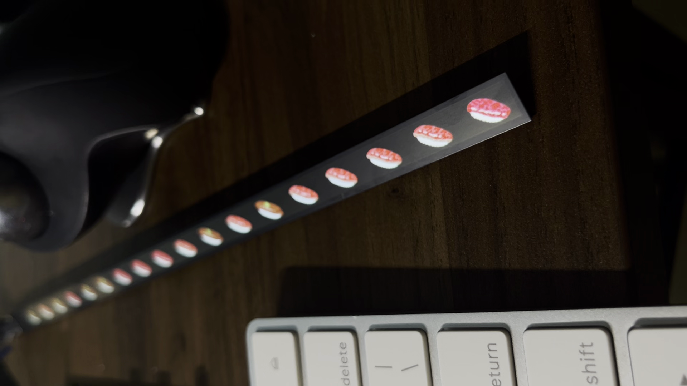
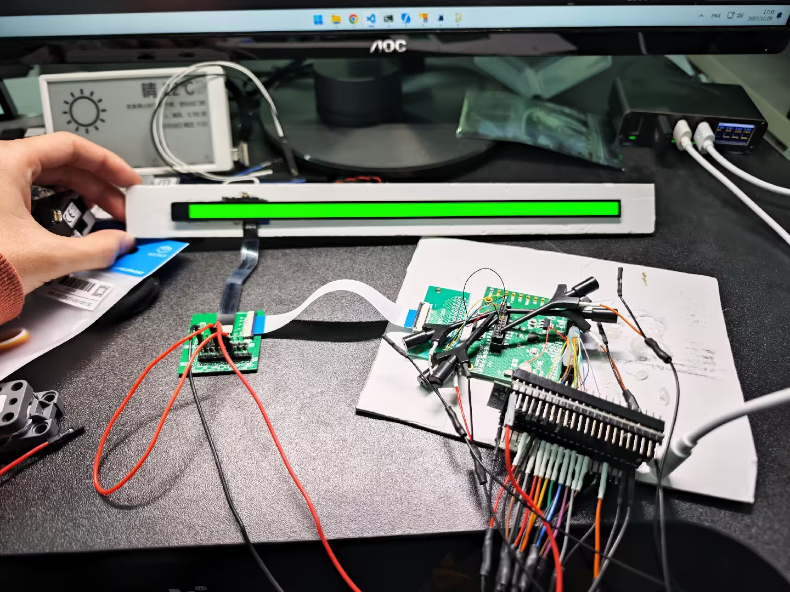

# Project Schlitzblende

**Sushi-ya Demo**

## RE Touchbar for fun

Touchbar is the Applespeak for their "DFR" (Dynamic Function Row ?) module on the old MacBook Pro computers. It's a touch screen that replaces the function keys with an extreme aspect ratio that can't be found anywhere else.

I personally love exotic stuff, and I believe this can be used in a lot of places such as custom keyboards. So here comes the project. We were able to reverse engineer the interface and make it work on a NXP devboard. The English video is not up yet. You can checkout the Chinese version first if you're interested.

[https://www.bilibili.com/video/BV1494y1w7jn/](https://www.bilibili.com/video/BV1494y1w7jn/)

Long story short, it's a MIPI-DSI display that has a non-standard long command 0x3C to send the video data with automated address increment. The initialization sequence does contain some secret, non-standard commands, but the display seems to work just fine without them. The screen does not support video mode at all, it's a command-only display.

Don't be intimidated by MIPI-DSI. People have already replicated our work in a couple of days, made the display work in HS using a SSD2805 bridge and ESP32! (Image Credit: [借来的猫w](https://space.bilibili.com/1637994))

The touchscreen RE is yet to be done. It's using the same Broadcom multi-touch ASIC found on other Apple products.

## Hardware Info

### A1706

- **Internal Model Number:** AMS983JC01F1A
- **Manufacturer:** Samsung
- **Type:** OLED
- **Width:** 60 pixels
- **Height:** 2170 pixels
- **Pixel format:** 24-bit RGB

